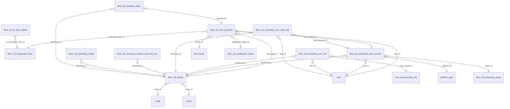

# DB 3D Streaming and Moderation

tifoxr_3d_* tables: live streaming config, sessions, entry logs, questions inbox and AI moderation.

Part of [[DB Current State]]. Generated from: script file dev-06-10-2026-Schema-Only.sql, as of 2026-10-14T16:39:38. Tables: 12. Purposes are inferred from names and are **not verified**. Do not hand-edit: the next refresh overwrites this note.

## Relationships

## Tables

### tifoxr_3d_ai_class_labels

PK: `id`. Columns: 6.

| Column | Type | Null | Notes |
|---|---|---|---|
| id | int | no | PK, identity |
| ai_moderated_class_id | int | no | FK to tifoxr_3d_moderated_class |
| ai_label | varchar(64) | no |  |
| is_deleted | bit | no |  |
| modified_time | datetime2(7) | no |  |
| modified_by | varchar(36) | no |  |

References: ai_moderated_class_id to [[DB 3D Streaming and Moderation#tifoxr_3d_moderated_class|tifoxr_3d_moderated_class]].id

### tifoxr_3d_moderated_class

PK: `id`. Columns: 5.

| Column | Type | Null | Notes |
|---|---|---|---|
| id | int | no | PK, identity |
| name | varchar(64) | no |  |
| is_deleted | bit | no |  |
| modified_time | datetime2(7) | no |  |
| modified_by | varchar(36) | no |  |

Referenced by: [[DB 3D Streaming and Moderation#tifoxr_3d_ai_class_labels|tifoxr_3d_ai_class_labels]] (ai_moderated_class_id), [[DB 3D Streaming and Moderation#tifoxr_3d_user_question|tifoxr_3d_user_question]] (moderated_class_id)

### tifoxr_3d_moderation_status

PK: `id`. Columns: 5.

| Column | Type | Null | Notes |
|---|---|---|---|
| id | int | no | PK, identity |
| status | varchar(64) | no |  |
| is_deleted | bit | no |  |
| modified_time | datetime2(7) | no |  |
| modified_by | varchar(36) | no |  |

Referenced by: [[DB 3D Streaming and Moderation#tifoxr_3d_user_question|tifoxr_3d_user_question]] (moderation_status_id)

### tifoxr_3d_question_inbox

PK: `id`. Columns: 6.

| Column | Type | Null | Notes |
|---|---|---|---|
| id | int | no | PK, identity |
| streaming_id | uniqueidentifier | no | FK to tifoxr_3d_stream |
| question_id | int | no | FK to tifoxr_3d_user_question |
| is_deleted | bit | no |  |
| modified_time | datetime2(7) | no |  |
| modified_by | varchar(36) | no |  |

References: question_id to [[DB 3D Streaming and Moderation#tifoxr_3d_user_question|tifoxr_3d_user_question]].id; streaming_id to [[DB 3D Streaming and Moderation#tifoxr_3d_stream|tifoxr_3d_stream]].id

### tifoxr_3d_stream

PK: `id`. Columns: 7.

| Column | Type | Null | Notes |
|---|---|---|---|
| id | uniqueidentifier | no | PK |
| event_id | int | no | FK to event |
| entity_id | int | no | FK to entity |
| streaming_url | varchar(255) | yes |  |
| is_deleted | bit | no |  |
| modified_time | datetime2(7) | no |  |
| modified_by | varchar(36) | no |  |

References: entity_id to [[DB Spaces and Access#entity|entity]].id; event_id to [[DB Events#event|event]].id

Referenced by: [[DB 3D Streaming and Moderation#tifoxr_3d_question_inbox|tifoxr_3d_question_inbox]] (streaming_id), [[DB 3D Streaming and Moderation#tifoxr_3d_streaming_config|tifoxr_3d_streaming_config]] (streaming_id), [[DB 3D Streaming and Moderation#tifoxr_3d_streaming_session_summary_mtx|tifoxr_3d_streaming_session_summary_mtx]] (streaming_id), [[DB 3D Streaming and Moderation#tifoxr_3d_streaming_user_entry_log|tifoxr_3d_streaming_user_entry_log]] (streaming_id), [[DB 3D Streaming and Moderation#tifoxr_3d_streaming_user_mtx|tifoxr_3d_streaming_user_mtx]] (streaming_id), [[DB 3D Streaming and Moderation#tifoxr_3d_streaming_user_session|tifoxr_3d_streaming_user_session]] (streaming_id), [[DB 3D Streaming and Moderation#tifoxr_3d_user_question|tifoxr_3d_user_question]] (streaming_id)

### tifoxr_3d_streaming_config

PK: `id`. Columns: 7.

| Column | Type | Null | Notes |
|---|---|---|---|
| id | int | no | PK, identity |
| streaming_id | uniqueidentifier | no | FK to tifoxr_3d_stream |
| max_question_length | int | no |  |
| max_questions_per_user | smallint | no |  |
| is_deleted | bit | no |  |
| modified_time | datetime2(7) | no |  |
| modified_by | varchar(36) | no |  |

References: streaming_id to [[DB 3D Streaming and Moderation#tifoxr_3d_stream|tifoxr_3d_stream]].id

### tifoxr_3d_streaming_session_summary_mtx

PK: `id`. Columns: 9.

| Column | Type | Null | Notes |
|---|---|---|---|
| id | int | no | PK, identity |
| streaming_id | uniqueidentifier | no | FK to tifoxr_3d_stream |
| snapshot_time | datetime2(7) | no |  |
| total_viewers | int | no |  |
| average_bitrate | int | no |  |
| average_fps | decimal(5,2) | no |  |
| is_deleted | bit | no |  |
| modified_time | datetime2(7) | no |  |
| modified_by | varchar(36) | no |  |

References: streaming_id to [[DB 3D Streaming and Moderation#tifoxr_3d_stream|tifoxr_3d_stream]].id

### tifoxr_3d_streaming_status

PK: `id`. Columns: 5.

| Column | Type | Null | Notes |
|---|---|---|---|
| id | int | no | PK, identity |
| status | varchar(64) | no |  |
| is_deleted | bit | no |  |
| modified_time | datetime2(7) | no |  |
| modified_by | varchar(36) | no |  |

Referenced by: [[DB 3D Streaming and Moderation#tifoxr_3d_streaming_user_session|tifoxr_3d_streaming_user_session]] (status_id)

### tifoxr_3d_streaming_user_entry_log

PK: `id`. Columns: 9.

| Column | Type | Null | Notes |
|---|---|---|---|
| id | uniqueidentifier | no | PK |
| streaming_id | uniqueidentifier | no | FK to tifoxr_3d_stream |
| user_id | uniqueidentifier | no | FK to user |
| user_session_id | uniqueidentifier | no | FK to tifoxr_3d_streaming_user_session |
| join_time | datetime2(7) | no |  |
| leave_time | datetime2(7) | yes |  |
| is_deleted | bit | no |  |
| modified_time | datetime2(7) | no |  |
| modified_by | varchar(36) | no |  |

References: streaming_id to [[DB 3D Streaming and Moderation#tifoxr_3d_stream|tifoxr_3d_stream]].id; user_id to [[DB Users and Auth#user|user]].id; user_session_id to [[DB 3D Streaming and Moderation#tifoxr_3d_streaming_user_session|tifoxr_3d_streaming_user_session]].id

### tifoxr_3d_streaming_user_mtx

PK: `id`. Columns: 11.

| Column | Type | Null | Notes |
|---|---|---|---|
| id | uniqueidentifier | no | PK |
| user_id | uniqueidentifier | no | FK to user |
| user_activity_id | uniqueidentifier | no | FK to user_event_activity_mtx |
| streaming_id | uniqueidentifier | no | FK to tifoxr_3d_stream |
| os | varchar(64) | no |  |
| device_type | varchar(64) | no |  |
| avg_bitrate | int | no |  |
| avg_fps | decimal(5,2) | no |  |
| is_deleted | bit | no |  |
| modified_time | datetime2(7) | no |  |
| modified_by | varchar(36) | no |  |

References: streaming_id to [[DB 3D Streaming and Moderation#tifoxr_3d_stream|tifoxr_3d_stream]].id; user_id to [[DB Users and Auth#user|user]].id; user_activity_id to [[DB Metrics and Activity#user_event_activity_mtx|user_event_activity_mtx]].id

### tifoxr_3d_streaming_user_session

PK: `id`. Columns: 14.

| Column | Type | Null | Notes |
|---|---|---|---|
| id | uniqueidentifier | no | PK |
| user_id | uniqueidentifier | no | FK to user |
| streaming_id | uniqueidentifier | no | FK to tifoxr_3d_stream |
| platform_id | int | no | FK to platform_type |
| ip_address | varchar(45) | yes |  |
| oauth_token | varchar(500) | yes |  |
| status_id | int | no | FK to tifoxr_3d_streaming_status |
| start_time | datetime2(7) | no |  |
| last_active_time | datetime2(7) | yes |  |
| end_time | datetime2(7) | yes |  |
| expiration_time | datetime2(7) | yes |  |
| is_deleted | bit | no |  |
| modified_time | datetime2(7) | no |  |
| modified_by | varchar(36) | no |  |

References: platform_id to [[DB Spaces and Access#platform_type|platform_type]].id; status_id to [[DB 3D Streaming and Moderation#tifoxr_3d_streaming_status|tifoxr_3d_streaming_status]].id; streaming_id to [[DB 3D Streaming and Moderation#tifoxr_3d_stream|tifoxr_3d_stream]].id; user_id to [[DB Users and Auth#user|user]].id

Referenced by: [[DB 3D Streaming and Moderation#tifoxr_3d_streaming_user_entry_log|tifoxr_3d_streaming_user_entry_log]] (user_session_id), [[DB 3D Streaming and Moderation#tifoxr_3d_user_question|tifoxr_3d_user_question]] (user_session_id)

### tifoxr_3d_user_question

PK: `id`. Columns: 14.

| Column | Type | Null | Notes |
|---|---|---|---|
| id | int | no | PK, identity |
| streaming_id | uniqueidentifier | no | FK to tifoxr_3d_stream |
| user_session_id | uniqueidentifier | no | FK to tifoxr_3d_streaming_user_session |
| user_id | uniqueidentifier | no | FK to user |
| question_text | nvarchar(max) | no |  |
| locale_id | varchar(10) | yes | FK to i18n_locale |
| moderation_status_id | int | no | FK to tifoxr_3d_moderation_status |
| toxicity_score | decimal(5,2) | no |  |
| moderated_class_id | int | yes | FK to tifoxr_3d_moderated_class |
| banned_terms_found | smallint | yes |  |
| request_time | datetime2(7) | no |  |
| is_deleted | bit | no |  |
| modified_time | datetime2(7) | no |  |
| modified_by | varchar(36) | no |  |

References: locale_id to [[DB Content Media and Approval#i18n_locale|i18n_locale]].id; moderation_status_id to [[DB 3D Streaming and Moderation#tifoxr_3d_moderation_status|tifoxr_3d_moderation_status]].id; moderated_class_id to [[DB 3D Streaming and Moderation#tifoxr_3d_moderated_class|tifoxr_3d_moderated_class]].id; streaming_id to [[DB 3D Streaming and Moderation#tifoxr_3d_stream|tifoxr_3d_stream]].id; user_session_id to [[DB 3D Streaming and Moderation#tifoxr_3d_streaming_user_session|tifoxr_3d_streaming_user_session]].id; user_id to [[DB Users and Auth#user|user]].id

Referenced by: [[DB 3D Streaming and Moderation#tifoxr_3d_question_inbox|tifoxr_3d_question_inbox]] (question_id)

## Stored procedures (0)

Grouped by the first table each procedure writes (or reads if it writes none). Table lists come from the SQL text and miss dynamic SQL. SQL text: `05-Database/Procedures/<name>.sql`. Logic column: ok (summary matches current SQL), STALE (SQL changed since the summary), missing (no summary yet).

