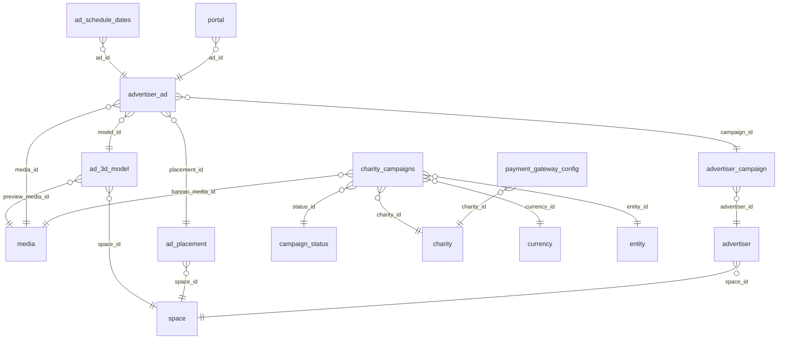

# DB Ads Campaigns and Charity

Advertisers, campaigns, ads, 3D ad models, ad placements and schedules, charities.

Part of [[DB Current State]]. Generated from: script file dev-06-10-2026-Schema-Only.sql, as of 2026-10-14T16:39:38. Tables: 10. Purposes are inferred from names and are **not verified**. Do not hand-edit: the next refresh overwrites this note.

## Relationships

## Tables

### ad_3d_model

PK: `id`. Columns: 12.

| Column | Type | Null | Notes |
|---|---|---|---|
| id | int | no | PK, identity |
| space_id | int | no | FK to space |
| model_key | varchar(64) | no |  |
| display_name | nvarchar(100) | no |  |
| description | nvarchar(500) | yes |  |
| preview_media_id | bigint | yes | FK to media |
| is_active | bit | no |  |
| is_deleted | bit | no |  |
| created_by | varchar(36) | no |  |
| created_time | datetime2(7) | no |  |
| modified_by | varchar(36) | yes |  |
| modified_time | datetime2(7) | yes |  |

References: preview_media_id to [[DB Content Media and Approval#media|media]].id; space_id to [[DB Spaces and Access#space|space]].id

Referenced by: [[DB Ads Campaigns and Charity#advertiser_ad|advertiser_ad]] (model_id)

### ad_placement

PK: `id`. Columns: 8.

| Column | Type | Null | Notes |
|---|---|---|---|
| id | int | no | PK, identity |
| space_id | int | no | FK to space |
| placement_key | varchar(50) | no |  |
| label | varchar(100) | no |  |
| is_3d | bit | no |  |
| is_deleted | bit | no |  |
| modified_time | datetime2(7) | yes |  |
| modified_by | varchar(36) | yes |  |

References: space_id to [[DB Spaces and Access#space|space]].id

Referenced by: [[DB Ads Campaigns and Charity#advertiser_ad|advertiser_ad]] (placement_id)

### ad_placement_migration_log

PK: `log_id`. Columns: 14.

| Column | Type | Null | Notes |
|---|---|---|---|
| log_id | int | no | PK, identity |
| migration_id | uniqueidentifier | no |  |
| migrated_at | datetime2(7) | no |  |
| migrated_by | nvarchar(128) | no |  |
| space_id | int | no |  |
| source_key | varchar(50) | no |  |
| destination_key | varchar(50) | no |  |
| ad_id | int | no |  |
| old_placement_id | int | no |  |
| new_placement_id | int | no |  |
| old_modified_time | datetime2(7) | yes |  |
| old_modified_by | varchar(36) | yes |  |
| rolled_back_at | datetime2(7) | yes |  |
| rolled_back_by | nvarchar(128) | yes |  |

### ad_schedule_dates

PK: `id`. Columns: 8.

| Column | Type | Null | Notes |
|---|---|---|---|
| id | int | no | PK, identity |
| ad_id | int | no | FK to advertiser_ad |
| run_date | date | no |  |
| is_deleted | bit | no |  |
| created_time | datetime2(7) | no |  |
| created_by | nvarchar(255) | no |  |
| modified_time | datetime2(7) | no |  |
| modified_by | nvarchar(255) | no |  |

References: ad_id to [[DB Ads Campaigns and Charity#advertiser_ad|advertiser_ad]].id; ad_id to [[DB Ads Campaigns and Charity#advertiser_ad|advertiser_ad]].id

### advertiser

PK: `id`. Columns: 11.

| Column | Type | Null | Notes |
|---|---|---|---|
| id | int | no | PK, identity |
| space_id | int | no | FK to space |
| name_key | uniqueidentifier | no |  |
| industry | varchar(100) | yes |  |
| is_active | bit | no |  |
| is_deleted | bit | no |  |
| modified_time | datetime2(7) | yes |  |
| modified_by | varchar(36) | yes |  |
| created_by | varchar(36) | no |  |
| created_time | datetime2(7) | no |  |
| status | varchar(20) | no |  |

References: space_id to [[DB Spaces and Access#space|space]].id

Referenced by: [[DB Ads Campaigns and Charity#advertiser_campaign|advertiser_campaign]] (advertiser_id)

### advertiser_ad

PK: `id`. Columns: 13.

| Column | Type | Null | Notes |
|---|---|---|---|
| id | int | no | PK, identity |
| campaign_id | int | no | FK to advertiser_campaign |
| name_key | uniqueidentifier | no |  |
| placement_id | int | no | FK to ad_placement |
| media_id | bigint | no | FK to media |
| duration_seconds | int | no |  |
| is_deleted | bit | no |  |
| modified_time | datetime2(7) | yes |  |
| modified_by | varchar(36) | yes |  |
| created_by | varchar(36) | no |  |
| created_time | datetime2(7) | no |  |
| status | varchar(20) | no |  |
| model_id | int | yes | FK to ad_3d_model |

References: campaign_id to [[DB Ads Campaigns and Charity#advertiser_campaign|advertiser_campaign]].id; media_id to [[DB Content Media and Approval#media|media]].id; model_id to [[DB Ads Campaigns and Charity#ad_3d_model|ad_3d_model]].id; placement_id to [[DB Ads Campaigns and Charity#ad_placement|ad_placement]].id

Referenced by: [[DB Ads Campaigns and Charity#ad_schedule_dates|ad_schedule_dates]] (ad_id), [[DB Ads Campaigns and Charity#ad_schedule_dates|ad_schedule_dates]] (ad_id), [[DB Booths Portals and Teleport#portal|portal]] (ad_id)

### advertiser_campaign

PK: `id`. Columns: 16.

| Column | Type | Null | Notes |
|---|---|---|---|
| id | int | no | PK, identity |
| advertiser_id | int | no | FK to advertiser |
| name_key | uniqueidentifier | no |  |
| start_date | date | no |  |
| end_date | date | no |  |
| daily_rate | decimal(18,2) | no |  |
| duration_modifier | decimal(5,2) | no |  |
| cost_per_day | decimal(18,2) | no |  |
| total_cost | decimal(18,2) | no |  |
| is_deleted | bit | no |  |
| modified_time | datetime2(7) | yes |  |
| modified_by | varchar(36) | yes |  |
| created_by | varchar(36) | no |  |
| created_time | datetime2(7) | no |  |
| status | varchar(20) | no |  |
| currency_id | int | yes |  |

References: advertiser_id to [[DB Ads Campaigns and Charity#advertiser|advertiser]].id

Referenced by: [[DB Ads Campaigns and Charity#advertiser_ad|advertiser_ad]] (campaign_id)

### campaign_status

PK: `id`. Columns: 5.

| Column | Type | Null | Notes |
|---|---|---|---|
| id | int | no | PK, identity |
| status | varchar(50) | no |  |
| is_deleted | bit | no |  |
| modified_time | datetime2(7) | no |  |
| modified_by | varchar(36) | no |  |

Referenced by: [[DB Ads Campaigns and Charity#charity_campaigns|charity_campaigns]] (status_id)

### charity

PK: `id`. Columns: 14.

| Column | Type | Null | Notes |
|---|---|---|---|
| id | int | no | PK, identity |
| name_key | uniqueidentifier | yes |  |
| description_key | uniqueidentifier | yes |  |
| logo_media_id | bigint | yes |  |
| website_url | varchar(255) | yes |  |
| donation_url | varchar(255) | no |  |
| is_active | bit | no |  |
| is_deleted | bit | no |  |
| modified_time | datetime2(7) | no |  |
| modified_by | varchar(36) | no |  |
| space_id | int | no |  |
| created_by | varchar(36) | no |  |
| created_time | datetime2(7) | no |  |
| status | varchar(20) | no |  |

Referenced by: [[DB Ads Campaigns and Charity#charity_campaigns|charity_campaigns]] (charity_id), [[DB Payments#payment_gateway_config|payment_gateway_config]] (charity_id)

### charity_campaigns

PK: `id`. Columns: 14.

| Column | Type | Null | Notes |
|---|---|---|---|
| id | int | no | PK, identity |
| entity_id | int | yes | FK to entity |
| charity_id | int | no | FK to charity |
| name_key | uniqueidentifier | no |  |
| description_key | uniqueidentifier | yes |  |
| currency_id | int | no | FK to currency |
| status_id | int | no | FK to campaign_status |
| goal_amount | decimal(18,2) | yes |  |
| start_time | datetime2(7) | no |  |
| end_time | datetime2(7) | yes |  |
| banner_media_id | bigint | yes | FK to media |
| is_deleted | bit | no |  |
| modified_time | datetime2(7) | no |  |
| modified_by | varchar(36) | no |  |

References: banner_media_id to [[DB Content Media and Approval#media|media]].id; charity_id to [[DB Ads Campaigns and Charity#charity|charity]].id; currency_id to [[DB Shop Items and Orders#currency|currency]].id; entity_id to [[DB Spaces and Access#entity|entity]].id; status_id to [[DB Ads Campaigns and Charity#campaign_status|campaign_status]].id

## Stored procedures (37)

Grouped by the first table each procedure writes (or reads if it writes none). Table lists come from the SQL text and miss dynamic SQL. SQL text: `05-Database/Procedures/<name>.sql`. Logic column: ok (summary matches current SQL), STALE (SQL changed since the summary), missing (no summary yet).

| Procedure | Writes | Reads | Logic |
|---|---|---|---|
| sp_ActiveAds_GetByDate |  | ad_placement, ad_schedule_dates, advertiser, advertiser_ad, advertiser_campaign, media, media_localization | missing |
| sp_ActiveAds_GetScheduleForDate |  | ad_3d_model, ad_placement, ad_schedule_dates, advertiser, advertiser_ad, advertiser_campaign, i18n, media, media_localization, media_type, portal, portal_link, supported_languages | missing |
| sp_Ad3dModel_Delete | ad_3d_model | advertiser_ad, space | missing |
| sp_Ad3dModel_GetAll |  | ad_3d_model, media, media_localization, media_type, space | missing |
| sp_Ad3dModel_GetById |  | ad_3d_model, media, media_localization, media_type, space | missing |
| sp_AdPlacement_Create | ad_placement | space | missing |
| sp_AdPlacement_Delete | ad_placement | ad_schedule_dates, advertiser, advertiser_ad, advertiser_campaign | missing |
| sp_AdPlacement_GetAvailability |  | ad_placement, advertiser, advertiser_ad, advertiser_campaign | missing |
| sp_AdPlacement_GetAvailabilityPerDay |  | ad_placement, ad_schedule_dates, advertiser_ad | missing |
| sp_AdPlacement_GetById |  | ad_placement | missing |
| sp_AdPlacement_GetBySpace |  | ad_placement | missing |
| sp_AdPlacement_GetOccupied |  | ad_placement, advertiser, advertiser_ad, advertiser_campaign | missing |
| sp_AdPlacement_Update | ad_placement | ad_schedule_dates, advertiser, advertiser_ad, advertiser_campaign | missing |
| sp_Ad_Delete | ad_schedule_dates, advertiser_ad, i18n, media, media_localization | advertiser, advertiser_campaign, portal | missing |
| sp_Ad_GetByCampaign |  | ad_3d_model, ad_placement, ad_schedule_dates, advertiser, advertiser_ad, advertiser_campaign, content_approval, i18n, media, media_localization, media_type, portal, portal_link, supported_languages | missing |
| sp_Ad_GetByCampaign_Unity |  | ad_3d_model, ad_placement, advertiser, advertiser_ad, advertiser_campaign, i18n, media, media_localization, media_type, portal, portal_link, supported_languages | missing |
| sp_Ad_GetById |  | ad_3d_model, ad_placement, ad_schedule_dates, advertiser, advertiser_ad, advertiser_campaign, content_approval, i18n, media, media_localization, media_type, portal, portal_link, supported_languages | missing |
| sp_Ad_GetById_Unity |  | ad_3d_model, ad_placement, advertiser, advertiser_ad, advertiser_campaign, i18n, media, media_localization, media_type, portal, portal_link, supported_languages | missing |
| sp_Ad_PruneUnairedDates |  | ad_schedule_dates, advertiser, advertiser_ad, advertiser_campaign | missing |
| sp_Advertiser_Create | advertiser, i18n |  | missing |
| sp_Advertiser_GetById |  | advertiser, content_approval, i18n | missing |
| sp_Advertiser_GetById_Unity |  | advertiser, i18n | missing |
| sp_Advertiser_GetBySpace |  | advertiser, content_approval, i18n | missing |
| sp_Advertiser_GetBySpace_Unity |  | advertiser, i18n | missing |
| sp_Campaign_Create | advertiser_campaign, i18n | advertiser | missing |
| sp_Campaign_GetByAdvertiser |  | advertiser, advertiser_campaign, content_approval, i18n | missing |
| sp_Campaign_GetByAdvertiser_Unity |  | advertiser, advertiser_campaign, i18n | missing |
| sp_Campaign_GetById |  | advertiser, advertiser_campaign, content_approval, i18n | missing |
| sp_Campaign_GetById_Unity |  | advertiser, advertiser_campaign, i18n | missing |
| sp_Charity_Delete | charity, i18n, media, media_localization |  | missing |
| sp_Charity_GetById |  | charity, content_approval, i18n, media, media_localization | missing |
| sp_Charity_GetById_Unity |  | charity, i18n, media, media_localization | missing |
| sp_Charity_GetBySpace |  | charity, content_approval, i18n, media, media_localization | missing |
| sp_Charity_GetBySpace_Unity |  | charity, i18n, media, media_localization | missing |
| sp_GetSpacesWithAdPlacements |  | ad_placement | missing |
| usp_Campaign_BulkUpdateCurrencyBySpace |  | advertiser, advertiser_campaign | missing |
| usp_Campaign_GetCurrencyImpact |  | advertiser, advertiser_campaign | missing |
