# DB Booths Portals and Teleport

Booths and booth content, custom booth items, portals and links, teleport tables, hosting, map spots, selfie jumbotron.

Part of [[DB Current State]]. Generated from: script file dev-06-10-2026-Schema-Only.sql, as of 2026-10-14T16:39:38. Tables: 17. Purposes are inferred from names and are **not verified**. Do not hand-edit: the next refresh overwrites this note.

## Relationships

```mermaid
erDiagram
  "booth" }o--|| "map_spot" : "map_spot_id"
  "booth" }o--|| "space" : "space_id"
  "booth_comment" }o--|| "booth" : "booth_id"
  "booth_comment" }o--|| "predefined_comments" : "predefined_comments_id"
  "booth_comment" }o--|| "space" : "space_id"
  "booth_comment" }o--|| "user" : "user_id"
  "booth_media" }o--|| "booth" : "booth_id"
  "booth_media" }o--|| "media" : "media_id"
  "custom_booth_item" }o--|| "booth" : "booth_id"
  "custom_booth_item" }o--|| "custom_booth_item_type" : "custom_booth_item_type_id"
  "custom_booth_item" }o--|| "media" : "corresponding_media_id"
  "custom_booth_item_link" }o--|| "custom_booth_item" : "custom_booth_item_id"
  "custom_booth_item_link" }o--|| "media" : "thumbnail_media_id"
  "hosting" }o--|| "event" : "event_id"
  "hosting" }o--|| "space" : "space_id"
  "portal" }o--|| "advertiser_ad" : "ad_id"
  "portal" }o--|| "booth" : "booth_id"
  "portal" }o--|| "event" : "event_id"
  "portal" }o--|| "media" : "corresponding_media_id"
  "portal" }o--|| "portal_type" : "portal_type_id"
  "portal" }o--|| "space" : "space_id"
  "portal_access_mtx" }o--|| "portal" : "portal_id"
  "portal_access_mtx" }o--|| "portal_type" : "portal_type_id"
  "portal_link" }o--|| "media" : "thumbnail_media_id"
  "portal_link" }o--|| "portal" : "portal_id"
  "portal_link" }o--|| "portal_position" : "position_id"
  "selfie_jumbotron" }o--|| "space" : "space_id"
  "selfie_jumbotron" }o--|| "user" : "user_id"
  "teleport_table" }o--|| "space" : "space_id"
  "teleport_table_activity_mtx" }o--|| "teleport_table" : "table_id"
  "teleport_table_activity_mtx" }o--|| "teleport_table_button" : "button_id"
  "teleport_table_button" }o--|| "map_spot" : "map_spot_id"
  "teleport_table_button" }o--|| "teleport_table" : "teleport_table_id"
  "user_booth_activity_mtx" }o--|| "booth" : "booth_id"
```

## Tables

### booth

PK: `id`. Columns: 11.

| Column | Type | Null | Notes |
|---|---|---|---|
| id | int | no | PK, identity |
| space_id | int | no | FK to space |
| map_spot_id | int | yes | FK to map_spot |
| name_key | uniqueidentifier | no |  |
| is_deleted | bit | no |  |
| modified_time | datetime2(7) | no |  |
| modified_by | varchar(36) | no |  |
| created_time | datetime2(7) | no |  |
| created_by | varchar(36) | no |  |
| status | varchar(20) | no |  |
| icon_key | varchar(50) | yes |  |

References: map_spot_id to [[DB Booths Portals and Teleport#map_spot|map_spot]].id; space_id to [[DB Spaces and Access#space|space]].id

Referenced by: [[DB Booths Portals and Teleport#booth_comment|booth_comment]] (booth_id), [[DB Booths Portals and Teleport#booth_media|booth_media]] (booth_id), [[DB Booths Portals and Teleport#custom_booth_item|custom_booth_item]] (booth_id), [[DB Booths Portals and Teleport#portal|portal]] (booth_id), [[DB Metrics and Activity#user_booth_activity_mtx|user_booth_activity_mtx]] (booth_id)

### booth_comment

PK: `id`. Columns: 11.

| Column | Type | Null | Notes |
|---|---|---|---|
| id | int | no | PK, identity |
| space_id | int | yes | FK to space |
| booth_id | int | yes | FK to booth |
| user_id | uniqueidentifier | no | FK to user |
| predefined_comments_id | int | no | FK to predefined_comments |
| is_active | bit | no |  |
| is_deleted | bit | no |  |
| modified_time | datetime2(7) | no |  |
| modified_by | varchar(36) | no |  |
| created_by | varchar(36) | no |  |
| created_time | datetime2(7) | no |  |

References: booth_id to [[DB Booths Portals and Teleport#booth|booth]].id; predefined_comments_id to [[DB Booths Portals and Teleport#predefined_comments|predefined_comments]].id; space_id to [[DB Spaces and Access#space|space]].id; user_id to [[DB Users and Auth#user|user]].id

### booth_media

PK: `id`. Columns: 9.

| Column | Type | Null | Notes |
|---|---|---|---|
| id | int | no | PK, identity |
| booth_id | int | no | FK to booth |
| media_id | bigint | no | FK to media |
| is_deleted | bit | no |  |
| modified_time | datetime2(7) | no |  |
| modified_by | varchar(36) | no |  |
| created_time | datetime2(7) | no |  |
| created_by | varchar(36) | no |  |
| status | varchar(20) | no |  |

References: booth_id to [[DB Booths Portals and Teleport#booth|booth]].id; media_id to [[DB Content Media and Approval#media|media]].id

### custom_booth_item

PK: `id`. Columns: 14.

| Column | Type | Null | Notes |
|---|---|---|---|
| id | int | no | PK, identity |
| booth_id | int | no | FK to booth |
| custom_booth_item_type_id | int | no | FK to custom_booth_item_type |
| corresponding_media_id | bigint | no | FK to media |
| name_key | uniqueidentifier | no |  |
| description_key | uniqueidentifier | yes |  |
| start_datetime | datetime2(7) | yes |  |
| end_datetime | datetime2(7) | yes |  |
| is_deleted | bit | no |  |
| status | varchar(20) | no |  |
| modified_time | datetime2(7) | no |  |
| modified_by | varchar(36) | no |  |
| created_time | datetime2(7) | no |  |
| created_by | varchar(36) | no |  |

References: booth_id to [[DB Booths Portals and Teleport#booth|booth]].id; corresponding_media_id to [[DB Content Media and Approval#media|media]].id; custom_booth_item_type_id to [[DB Booths Portals and Teleport#custom_booth_item_type|custom_booth_item_type]].id

Referenced by: [[DB Booths Portals and Teleport#custom_booth_item_link|custom_booth_item_link]] (custom_booth_item_id)

### custom_booth_item_link

PK: `id`. Columns: 11.

| Column | Type | Null | Notes |
|---|---|---|---|
| id | int | no | PK, identity |
| custom_booth_item_id | int | no | FK to custom_booth_item |
| position_id | int | yes |  |
| external_link | varchar(255) | yes |  |
| thumbnail_media_id | bigint | yes | FK to media |
| is_deleted | bit | no |  |
| status | varchar(20) | no |  |
| modified_time | datetime2(7) | no |  |
| modified_by | varchar(36) | no |  |
| created_time | datetime2(7) | no |  |
| created_by | varchar(36) | no |  |

References: custom_booth_item_id to [[DB Booths Portals and Teleport#custom_booth_item|custom_booth_item]].id; thumbnail_media_id to [[DB Content Media and Approval#media|media]].id

### custom_booth_item_type

PK: `id`. Columns: 9.

| Column | Type | Null | Notes |
|---|---|---|---|
| id | int | no | PK, identity |
| type_key | varchar(50) | no |  |
| name | varchar(64) | no |  |
| description | varchar(255) | yes |  |
| is_deleted | bit | no |  |
| created_by | varchar(36) | no |  |
| created_time | datetime2(7) | no |  |
| modified_by | varchar(36) | no |  |
| modified_time | datetime2(7) | no |  |

Referenced by: [[DB Booths Portals and Teleport#custom_booth_item|custom_booth_item]] (custom_booth_item_type_id)

### hosting

PK: `id`. Columns: 12.

| Column | Type | Null | Notes |
|---|---|---|---|
| id | int | no | PK, identity |
| space_id | int | no | FK to space |
| name_key | uniqueidentifier | no |  |
| stream_url | nvarchar(2048) | no |  |
| is_active | bit | no |  |
| is_deleted | bit | no |  |
| modified_time | datetime2(7) | no |  |
| modified_by | varchar(36) | no |  |
| created_by | varchar(36) | no |  |
| created_time | datetime2(7) | no |  |
| status | varchar(20) | no |  |
| event_id | int | yes | FK to event |

References: event_id to [[DB Events#event|event]].id; space_id to [[DB Spaces and Access#space|space]].id

### map_spot

PK: `id`. Columns: 7.

| Column | Type | Null | Notes |
|---|---|---|---|
| id | int | no | PK, identity |
| x | decimal(18,2) | no |  |
| y | decimal(18,2) | no |  |
| z | decimal(18,2) | no |  |
| is_deleted | bit | no |  |
| modified_time | datetime2(7) | no |  |
| modified_by | varchar(36) | no |  |

Referenced by: [[DB Booths Portals and Teleport#booth|booth]] (map_spot_id), [[DB Booths Portals and Teleport#teleport_table_button|teleport_table_button]] (map_spot_id)

### portal

PK: `id`. Columns: 14.

| Column | Type | Null | Notes |
|---|---|---|---|
| id | int | no | PK, identity |
| space_id | int | no | FK to space |
| booth_id | int | yes | FK to booth |
| portal_type_id | int | no | FK to portal_type |
| event_id | int | yes | FK to event |
| corresponding_media_id | bigint | no | FK to media |
| text_field_key | uniqueidentifier | no |  |
| is_deleted | bit | no |  |
| modified_time | datetime2(7) | no |  |
| modified_by | varchar(36) | no |  |
| created_time | datetime2(7) | no |  |
| created_by | varchar(36) | no |  |
| status | varchar(20) | no |  |
| ad_id | int | yes | FK to advertiser_ad |

References: booth_id to [[DB Booths Portals and Teleport#booth|booth]].id; corresponding_media_id to [[DB Content Media and Approval#media|media]].id; event_id to [[DB Events#event|event]].id; portal_type_id to [[DB Booths Portals and Teleport#portal_type|portal_type]].id; space_id to [[DB Spaces and Access#space|space]].id; ad_id to [[DB Ads Campaigns and Charity#advertiser_ad|advertiser_ad]].id

Referenced by: [[DB Metrics and Activity#portal_access_mtx|portal_access_mtx]] (portal_id), [[DB Booths Portals and Teleport#portal_link|portal_link]] (portal_id)

### portal_link

PK: `id`. Columns: 11.

| Column | Type | Null | Notes |
|---|---|---|---|
| id | int | no | PK, identity |
| portal_id | int | no | FK to portal |
| position_id | int | yes | FK to portal_position |
| external_link | varchar(255) | yes |  |
| thumbnail_media_id | bigint | yes | FK to media |
| is_deleted | bit | no |  |
| modified_time | datetime2(7) | no |  |
| modified_by | varchar(36) | no |  |
| created_time | datetime2(7) | no |  |
| created_by | varchar(36) | no |  |
| status | varchar(20) | no |  |

References: thumbnail_media_id to [[DB Content Media and Approval#media|media]].id; portal_id to [[DB Booths Portals and Teleport#portal|portal]].id; position_id to [[DB Booths Portals and Teleport#portal_position|portal_position]].id

### portal_position

PK: `id`. Columns: 5.

| Column | Type | Null | Notes |
|---|---|---|---|
| id | int | no | PK |
| name | varchar(50) | no |  |
| is_deleted | bit | no |  |
| modified_time | datetime2(7) | no |  |
| modified_by | varchar(36) | no |  |

Referenced by: [[DB Booths Portals and Teleport#portal_link|portal_link]] (position_id)

### portal_type

PK: `id`. Columns: 6.

| Column | Type | Null | Notes |
|---|---|---|---|
| id | int | no | PK, identity |
| type | varchar(64) | no |  |
| code | int | no |  |
| is_deleted | bit | no |  |
| modified_time | datetime2(7) | no |  |
| modified_by | varchar(36) | no |  |

Referenced by: [[DB Booths Portals and Teleport#portal|portal]] (portal_type_id), [[DB Metrics and Activity#portal_access_mtx|portal_access_mtx]] (portal_type_id)

### predefined_comments

PK: `id`. Columns: 7.

| Column | Type | Null | Notes |
|---|---|---|---|
| id | int | no | PK, identity |
| comment_key | char(36) | no |  |
| is_active | bit | no |  |
| is_deleted | bit | no |  |
| modified_time | datetime2(7) | no |  |
| modified_by | varchar(36) | no |  |
| status | varchar(20) | no |  |

Referenced by: [[DB Booths Portals and Teleport#booth_comment|booth_comment]] (predefined_comments_id)

### selfie_jumbotron

PK: `id`. Columns: 8.

| Column | Type | Null | Notes |
|---|---|---|---|
| id | int | no | PK, identity |
| user_id | uniqueidentifier | no | FK to user |
| space_id | int | no | FK to space |
| selfie_url | varchar(255) | no |  |
| scheduled_time | datetime2(7) | no |  |
| is_deleted | bit | no |  |
| modified_time | datetime2(7) | no |  |
| modified_by | varchar(36) | no |  |

References: space_id to [[DB Spaces and Access#space|space]].id; user_id to [[DB Users and Auth#user|user]].id

### teleport_button_position

PK: `id`. Columns: 5.

| Column | Type | Null | Notes |
|---|---|---|---|
| id | int | no | PK, identity |
| created_at | datetime2(7) | no |  |
| created_by | nvarchar(256) | yes |  |
| modified_at | datetime2(7) | no |  |
| modified_by | nvarchar(256) | yes |  |

### teleport_table

PK: `id`. Columns: 10.

| Column | Type | Null | Notes |
|---|---|---|---|
| id | int | no | PK, identity |
| space_id | int | no | FK to space |
| name_key | uniqueidentifier | yes |  |
| is_active | bit | no |  |
| is_deleted | bit | no |  |
| modified_time | datetime2(7) | no |  |
| modified_by | varchar(36) | no |  |
| created_by | varchar(36) | no |  |
| created_time | datetime2(7) | no |  |
| status | varchar(20) | no |  |

References: space_id to [[DB Spaces and Access#space|space]].id

Referenced by: [[DB Metrics and Activity#teleport_table_activity_mtx|teleport_table_activity_mtx]] (table_id), [[DB Booths Portals and Teleport#teleport_table_button|teleport_table_button]] (teleport_table_id)

### teleport_table_button

PK: `id`. Columns: 13.

| Column | Type | Null | Notes |
|---|---|---|---|
| id | int | no | PK, identity |
| teleport_table_id | int | no | FK to teleport_table |
| map_spot_id | int | yes | FK to map_spot |
| name_key | uniqueidentifier | no |  |
| is_active | bit | no |  |
| is_deleted | bit | no |  |
| modified_time | datetime2(7) | no |  |
| modified_by | varchar(36) | no |  |
| created_by | varchar(36) | no |  |
| created_time | datetime2(7) | no |  |
| status | varchar(20) | no |  |
| position_id | int | yes |  |
| icon_key | varchar(50) | yes |  |

References: map_spot_id to [[DB Booths Portals and Teleport#map_spot|map_spot]].id; teleport_table_id to [[DB Booths Portals and Teleport#teleport_table|teleport_table]].id

Referenced by: [[DB Metrics and Activity#teleport_table_activity_mtx|teleport_table_activity_mtx]] (button_id)

## Stored procedures (51)

Grouped by the first table each procedure writes (or reads if it writes none). Table lists come from the SQL text and miss dynamic SQL. SQL text: `05-Database/Procedures/<name>.sql`. Logic column: ok (summary matches current SQL), STALE (SQL changed since the summary), missing (no summary yet).

| Procedure | Writes | Reads | Logic |
|---|---|---|---|
| sp_ActivityLog_GetEntityName |  | booth, charity, custom_booth_item, entity, i18n, portal, predefined_comments, teleport_table | missing |
| sp_AdPortal_RemoveForAds |  | i18n, media, media_localization, portal, portal_link | missing |
| sp_Booth_Create | booth, booth_media, i18n, media, media_localization | map_spot, supported_languages | missing |
| sp_Booth_GetById |  | booth, content_approval, i18n, map_spot | missing |
| sp_Booth_GetById_Unity |  | booth, booth_media, i18n, map_spot, media, media_localization | missing |
| sp_Booth_GetBySpace |  | booth, booth_media, content_approval, i18n, map_spot, media, media_localization | missing |
| sp_Booth_GetBySpace_Unity |  | booth, booth_media, i18n, map_spot, media, media_localization | missing |
| sp_Booth_GetMedia |  | booth_media, content_approval, i18n, media, media_localization | missing |
| sp_Booth_GetMediaById |  | booth, booth_media, i18n, media, media_localization | missing |
| sp_Booth_Update | booth, i18n, media, media_localization, teleport_table_button | map_spot, teleport_table | missing |
| sp_CustomBoothItemLinks_Get |  | custom_booth_item_link, media, media_localization | missing |
| sp_CustomBoothItemLinks_GetApproved_Unity |  | custom_booth_item_link, media, media_localization | missing |
| sp_CustomBoothItem_Create | custom_booth_item | booth | missing |
| sp_CustomBoothItem_Delete | custom_booth_item, custom_booth_item_link, i18n, media, media_localization | booth | missing |
| sp_CustomBoothItem_GetByBoothIds |  | content_approval, custom_booth_item, custom_booth_item_type, i18n, media, media_localization | missing |
| sp_CustomBoothItem_GetByBoothIds_Unity |  | custom_booth_item, custom_booth_item_type, i18n, media, media_localization | missing |
| sp_CustomBoothItem_GetById |  | booth, custom_booth_item, custom_booth_item_type, i18n, media, media_localization | missing |
| sp_CustomBoothItem_GetTypes |  | custom_booth_item_type | missing |
| sp_CustomBoothItem_Update | custom_booth_item |  | missing |
| sp_Hosting_Create | hosting, i18n |  | missing |
| sp_Hosting_Delete | hosting, i18n |  | missing |
| sp_Hosting_GetById |  | content_approval, hosting, i18n | missing |
| sp_Hosting_GetById_Unity |  | hosting, i18n | missing |
| sp_Hosting_GetBySpace |  | content_approval, hosting, i18n | missing |
| sp_Hosting_GetBySpace_Unity |  | hosting, i18n | missing |
| sp_MapSpot_Create | map_spot |  | missing |
| sp_MapSpot_GetAll |  | map_spot | missing |
| sp_PortalLinks_Get |  | media, media_localization, portal_link, supported_languages | missing |
| sp_PortalLinks_GetApproved_Unity |  | media, media_localization, portal_link, supported_languages | missing |
| sp_Portal_Create | portal |  | missing |
| sp_Portal_GetByBooth |  | content_approval, i18n, media, media_localization, portal, supported_languages | missing |
| sp_Portal_GetByBoothIds |  | content_approval, i18n, media, media_localization, portal, supported_languages | missing |
| sp_Portal_GetByBoothIds_Unity |  | i18n, media, media_localization, portal, supported_languages | missing |
| sp_Portal_GetByBooth_Unity |  | i18n, media, media_localization, portal, supported_languages | missing |
| sp_Portal_GetById |  | content_approval, i18n, media, media_localization, portal | missing |
| sp_Portal_GetById_Unity |  | i18n, media, media_localization, portal | missing |
| sp_Portal_GetBySpace |  | content_approval, i18n, media, media_localization, portal, supported_languages | missing |
| sp_Portal_GetBySpace_Unity |  | i18n, media, media_localization, portal, supported_languages | missing |
| sp_Portal_Update | i18n, media, media_localization, portal, portal_link | supported_languages | missing |
| sp_PredefinedComment_GetByKey |  | content_approval, i18n, predefined_comments | missing |
| sp_PredefinedComment_GetBySpace |  | content_approval, i18n, predefined_comments | missing |
| sp_PredefinedComment_GetBySpace_Unity |  | i18n, predefined_comments | missing |
| sp_TeleportButtonPosition_GetAll |  | teleport_button_position | missing |
| sp_TeleportButton_GetById |  | i18n, map_spot, teleport_button_position, teleport_table, teleport_table_button | missing |
| sp_TeleportButton_UpdateMapSpot |  | teleport_table, teleport_table_button | missing |
| sp_TeleportButton_UpdatePosition |  | teleport_table, teleport_table_button | missing |
| sp_TeleportTable_AutoCreate | teleport_table |  | missing |
| sp_TeleportTable_ButtonDuplicateCheck |  | teleport_table_button | missing |
| sp_TeleportTable_GetById |  | content_approval, i18n, map_spot, teleport_button_position, teleport_table, teleport_table_button | missing |
| sp_TeleportTable_GetBySpace |  | content_approval, i18n, map_spot, teleport_button_position, teleport_table, teleport_table_button | missing |
| sp_TeleportTable_GetBySpace_Unity |  | i18n, map_spot, teleport_button_position, teleport_table, teleport_table_button | missing |
