# DB Content Media and Approval

Content approval workflow and versions, media, localization, blob uploads, audit and activity logs.

Part of [[DB Current State]]. Generated from: script file dev-06-10-2026-Schema-Only.sql, as of 2026-10-14T16:39:38. Tables: 13. Purposes are inferred from names and are **not verified**. Do not hand-edit: the next refresh overwrites this note.

## Relationships

```mermaid
erDiagram
  "ad_3d_model" }o--|| "media" : "preview_media_id"
  "advertiser_ad" }o--|| "media" : "media_id"
  "avatar" }o--|| "media" : "thumbnail_media_id"
  "badge" }o--|| "media" : "media_id"
  "booth_media" }o--|| "media" : "media_id"
  "charity_campaigns" }o--|| "media" : "banner_media_id"
  "content_approval" }o--|| "space" : "space_id"
  "content_approval" }o--|| "user" : "decided_by"
  "content_approval" }o--|| "user" : "last_edited_by"
  "content_approval" }o--|| "user" : "submitted_by"
  "custom_booth_item" }o--|| "media" : "corresponding_media_id"
  "custom_booth_item_link" }o--|| "media" : "thumbnail_media_id"
  "entity" }o--|| "i18n_locale" : "locale_id"
  "guess_player_game" }o--|| "media" : "media_id"
  "i18n" }o--|| "i18n_locale" : "locale_id"
  "i18n" }o--|| "space" : "space_id"
  "light_config" }o--|| "media" : "thumbnail_media_id"
  "media" }o--|| "media_type" : "media_type_id"
  "media" }o--|| "space" : "space_id"
  "media_localization" }o--|| "i18n_locale" : "locale_id"
  "media_localization" }o--|| "media" : "media_id"
  "merchandise" }o--|| "media" : "thumbnail_media_id"
  "package" }o--|| "media" : "thumbnail_media_id"
  "personality" }o--|| "media" : "media_id"
  "portal" }o--|| "media" : "corresponding_media_id"
  "portal_access_mtx" }o--|| "media" : "media_id"
  "portal_link" }o--|| "media" : "thumbnail_media_id"
  "rules" }o--|| "workflow" : "workflow_id"
  "supported_languages" }o--|| "event" : "event_id"
  "supported_languages" }o--|| "space" : "space_id"
  "tifoxr_3d_user_question" }o--|| "i18n_locale" : "locale_id"
  "workflow" }o--|| "space" : "space_id"
  "workflow" }o--|| "state_type" : "state_type_id"
```

## Tables

### activity_log

PK: `id`. Columns: 9.

| Column | Type | Null | Notes |
|---|---|---|---|
| id | bigint | no | PK, identity |
| space_id | int | no |  |
| entity_type | nvarchar(50) | no |  |
| entity_id | nvarchar(50) | no |  |
| entity_name | nvarchar(200) | yes |  |
| action | nvarchar(20) | no |  |
| performed_by | nvarchar(256) | no |  |
| performed_at | datetime2(0) | no |  |
| correlation_id | nvarchar(100) | yes |  |

### audit_log

PK: `id`. Columns: 9.

| Column | Type | Null | Notes |
|---|---|---|---|
| id | uniqueidentifier | no | PK |
| table_name | varchar(64) | no |  |
| row_id | char(36) | no |  |
| column_name | varchar(255) | no |  |
| old_value | varchar(255) | no |  |
| new_value | varchar(255) | no |  |
| modified_time | datetime2(7) | no |  |
| modified_by | varchar(36) | no |  |
| change_reason | varchar(255) | no |  |

### blob_upload

PK: `id`. Columns: 8.

| Column | Type | Null | Notes |
|---|---|---|---|
| id | int | no | PK, identity |
| blob_path | nvarchar(500) | no |  |
| file_name | nvarchar(260) | no |  |
| content_type | nvarchar(200) | no |  |
| size_bytes | bigint | no |  |
| uploaded_by | varchar(64) | no |  |
| uploaded_at | datetime2(7) | no |  |
| is_deleted | bit | no |  |

### content_approval

PK: `id`. Columns: 20.

| Column | Type | Null | Notes |
|---|---|---|---|
| id | int | no | PK, identity |
| space_id | int | no | FK to space |
| content_type | varchar(50) | no |  |
| content_id | bigint | no |  |
| content_name | nvarchar(255) | yes |  |
| submitted_by | uniqueidentifier | no | FK to user |
| last_edited_by | uniqueidentifier | yes | FK to user |
| status | varchar(20) | no |  |
| submitted_at | datetime2(7) | no |  |
| decided_at | datetime2(7) | yes |  |
| decided_by | uniqueidentifier | yes | FK to user |
| rejection_reason | varchar(500) | yes |  |
| created_by | varchar(36) | no |  |
| created_time | datetime2(7) | no |  |
| modified_by | varchar(36) | no |  |
| modified_time | datetime2(7) | no |  |
| action_type | varchar(10) | no |  |
| proposed_data | nvarchar(max) | yes |  |
| current_snapshot | nvarchar(max) | yes |  |
| proposed_snapshot | nvarchar(max) | yes |  |

References: decided_by to [[DB Users and Auth#user|user]].id; last_edited_by to [[DB Users and Auth#user|user]].id; space_id to [[DB Spaces and Access#space|space]].id; submitted_by to [[DB Users and Auth#user|user]].id

### content_version

PK: `space_id`, `content_type`. Columns: 4.

| Column | Type | Null | Notes |
|---|---|---|---|
| space_id | int | no | PK |
| content_type | nvarchar(50) | no | PK |
| version | int | no |  |
| updated_at | datetime2(7) | no |  |

### i18n

PK: `id`. Columns: 10.

| Column | Type | Null | Notes |
|---|---|---|---|
| id | uniqueidentifier | no | PK |
| space_id | int | yes | FK to space |
| locale_id | varchar(10) | no | FK to i18n_locale |
| key | uniqueidentifier | no |  |
| value | varchar(max) | no |  |
| is_deleted | bit | no |  |
| modified_time | datetime2(7) | no |  |
| modified_by | varchar(36) | no |  |
| created_time | datetime2(7) | no |  |
| created_by | varchar(36) | no |  |

References: locale_id to [[DB Content Media and Approval#i18n_locale|i18n_locale]].id; space_id to [[DB Spaces and Access#space|space]].id

### i18n_locale

PK: `id`. Columns: 5.

| Column | Type | Null | Notes |
|---|---|---|---|
| id | varchar(10) | no | PK |
| language_name | nvarchar(max) | no |  |
| is_deleted | bit | no |  |
| modified_time | datetime2(7) | no |  |
| modified_by | varchar(36) | no |  |

Referenced by: [[DB Spaces and Access#entity|entity]] (locale_id), [[DB Content Media and Approval#i18n|i18n]] (locale_id), [[DB Content Media and Approval#media_localization|media_localization]] (locale_id), [[DB 3D Streaming and Moderation#tifoxr_3d_user_question|tifoxr_3d_user_question]] (locale_id)

### image_data

PK: **none**. Columns: 2.

| Column | Type | Null | Notes |
|---|---|---|---|
| tbl_name | varchar(255) | yes |  |
| row_count | int | yes |  |

### media

PK: `id`. Columns: 10.

| Column | Type | Null | Notes |
|---|---|---|---|
| id | bigint | no | PK, identity |
| space_id | int | no | FK to space |
| media_type_id | int | no | FK to media_type |
| text_key | uniqueidentifier | yes |  |
| description_key | uniqueidentifier | yes |  |
| is_deleted | bit | no |  |
| modified_time | datetime2(7) | no |  |
| modified_by | varchar(36) | no |  |
| created_time | datetime2(7) | no |  |
| created_by | varchar(36) | no |  |

References: media_type_id to [[DB Content Media and Approval#media_type|media_type]].id; space_id to [[DB Spaces and Access#space|space]].id

Referenced by: [[DB Ads Campaigns and Charity#ad_3d_model|ad_3d_model]] (preview_media_id), [[DB Ads Campaigns and Charity#advertiser_ad|advertiser_ad]] (media_id), [[DB Users and Auth#avatar|avatar]] (thumbnail_media_id), [[DB Users and Auth#badge|badge]] (media_id), [[DB Booths Portals and Teleport#booth_media|booth_media]] (media_id), [[DB Ads Campaigns and Charity#charity_campaigns|charity_campaigns]] (banner_media_id), [[DB Booths Portals and Teleport#custom_booth_item|custom_booth_item]] (corresponding_media_id), [[DB Booths Portals and Teleport#custom_booth_item_link|custom_booth_item_link]] (thumbnail_media_id), [[DB Games and Leaderboards#guess_player_game|guess_player_game]] (media_id), [[DB Spaces and Access#light_config|light_config]] (thumbnail_media_id), [[DB Content Media and Approval#media_localization|media_localization]] (media_id), [[DB Shop Items and Orders#merchandise|merchandise]] (thumbnail_media_id), [[DB Shop Items and Orders#package|package]] (thumbnail_media_id), [[DB Users and Auth#personality|personality]] (media_id), [[DB Booths Portals and Teleport#portal|portal]] (corresponding_media_id), [[DB Metrics and Activity#portal_access_mtx|portal_access_mtx]] (media_id), [[DB Booths Portals and Teleport#portal_link|portal_link]] (thumbnail_media_id)

### media_localization

PK: `id`. Columns: 9.

| Column | Type | Null | Notes |
|---|---|---|---|
| id | uniqueidentifier | no | PK |
| media_id | bigint | no | FK to media |
| locale_id | varchar(10) | no | FK to i18n_locale |
| media_link | varchar(255) | no |  |
| is_deleted | bit | no |  |
| modified_time | datetime2(7) | no |  |
| modified_by | varchar(36) | no |  |
| created_time | datetime2(7) | no |  |
| created_by | varchar(36) | no |  |

References: locale_id to [[DB Content Media and Approval#i18n_locale|i18n_locale]].id; media_id to [[DB Content Media and Approval#media|media]].id

### media_type

PK: `id`. Columns: 5.

| Column | Type | Null | Notes |
|---|---|---|---|
| id | int | no | PK, identity |
| type | varchar(64) | no |  |
| is_deleted | bit | no |  |
| modified_time | datetime2(7) | no |  |
| modified_by | varchar(36) | no |  |

Referenced by: [[DB Content Media and Approval#media|media]] (media_type_id)

### supported_languages

PK: `id`. Columns: 10.

| Column | Type | Null | Notes |
|---|---|---|---|
| id | int | no | PK, identity |
| space_id | int | yes | FK to space |
| event_id | int | yes | FK to event |
| locale_id | varchar(10) | no |  |
| is_default | bit | no |  |
| is_deleted | bit | no |  |
| modified_time | datetime2(7) | no |  |
| modified_by | varchar(36) | no |  |
| created_by | varchar(36) | no |  |
| created_time | datetime2(7) | no |  |

References: event_id to [[DB Events#event|event]].id; space_id to [[DB Spaces and Access#space|space]].id

### workflow

PK: `id`. Columns: 7.

| Column | Type | Null | Notes |
|---|---|---|---|
| id | int | no | PK, identity |
| space_id | int | no | FK to space |
| name | varchar(50) | no |  |
| state_type_id | int | no | FK to state_type |
| is_deleted | bit | no |  |
| modified_time | datetime2(7) | no |  |
| modified_by | varchar(36) | no |  |

References: space_id to [[DB Spaces and Access#space|space]].id; state_type_id to [[DB Spaces and Access#state_type|state_type]].id

Referenced by: [[DB Rules Engine#rules|rules]] (workflow_id)

## Stored procedures (45)

Grouped by the first table each procedure writes (or reads if it writes none). Table lists come from the SQL text and miss dynamic SQL. SQL text: `05-Database/Procedures/<name>.sql`. Logic column: ok (summary matches current SQL), STALE (SQL changed since the summary), missing (no summary yet).

| Procedure | Writes | Reads | Logic |
|---|---|---|---|
| sp_ActivityLog_GetBySpace |  | activity_log | missing |
| sp_ActivityLog_Insert | activity_log |  | missing |
| sp_Ad3dModel_Create | ad_3d_model, media | space | missing |
| sp_Ad3dModel_Update | ad_3d_model, media | ad_placement, ad_schedule_dates, advertiser, advertiser_ad, advertiser_campaign, space | missing |
| sp_AdPortal_Apply | media, portal, portal_link | media_localization | missing |
| sp_AdPortal_SetI18n | i18n |  | missing |
| sp_AdPortal_SetMediaLinks | media_localization |  | missing |
| sp_AdPortal_SoftDeleteMedia | media, media_localization |  | missing |
| sp_Ad_Create | ad_schedule_dates, advertiser_ad, i18n, media, media_localization | ad_3d_model, ad_placement, advertiser, advertiser_campaign | missing |
| sp_Ad_Update | ad_schedule_dates, advertiser_ad, i18n, media, media_localization, portal | ad_3d_model, ad_placement, advertiser, advertiser_campaign, portal_link | missing |
| sp_Advertiser_Delete | advertiser, advertiser_campaign, i18n | ad_schedule_dates, advertiser_ad, media, media_localization | missing |
| sp_Advertiser_Update | advertiser, i18n |  | missing |
| sp_Booth_DeleteMediaById | booth_media, i18n, media, media_localization | booth | missing |
| sp_Booth_InsertMedia | booth_media, i18n, media, media_localization | booth, supported_languages | missing |
| sp_Booth_UpdateMediaSingle | booth_media, i18n, media, media_localization | booth | missing |
| sp_BumpContentVersion | content_version |  | missing |
| sp_Campaign_Delete | advertiser_ad, advertiser_campaign, i18n | ad_schedule_dates, advertiser, media, media_localization | missing |
| sp_Campaign_GetDateChangeImpact |  | ad_placement, ad_schedule_dates, advertiser, advertiser_ad, advertiser_campaign, content_approval, i18n | missing |
| sp_Campaign_Update | advertiser_campaign, i18n | ad_schedule_dates, advertiser, advertiser_ad, content_approval, media, media_localization | missing |
| sp_Charity_Create | charity, i18n, media, media_localization |  | missing |
| sp_Charity_Update | charity, i18n, media, media_localization |  | missing |
| sp_Event_Update | event, hosting, i18n |  | missing |
| sp_Game_Update | game, i18n |  | missing |
| sp_Hosting_Update | hosting, i18n |  | missing |
| sp_Media_Create | i18n, media, media_localization |  | missing |
| sp_SupportedLanguages_Get |  | i18n_locale, supported_languages | missing |
| sp_UpsertContentVersion | content_version |  | missing |
| usp_BlobUpload_GetStatus |  | blob_upload | missing |
| usp_BlobUpload_Insert | blob_upload |  | missing |
| usp_BlobUpload_ListAll |  | blob_upload | missing |
| usp_BlobUpload_SoftDelete | blob_upload |  | missing |
| usp_ContentApproval_Decide | content_approval, custom_booth_item_link, portal, portal_link |  | missing |
| usp_ContentApproval_GetByContent |  | content_approval | missing |
| usp_ContentApproval_GetById |  | content_approval | missing |
| usp_ContentApproval_GetInbox |  | content_approval, user | missing |
| usp_ContentApproval_GetMySubmissions |  | content_approval, user | missing |
| usp_ContentApproval_IsTeleportSpotLocked |  | content_approval | missing |
| usp_ContentApproval_ResetToPending | content_approval |  | missing |
| usp_ContentApproval_Submit | content_approval |  | missing |
| usp_ContentApproval_Withdraw | content_approval |  | missing |
| usp_I18n_SoftDeleteByKey | i18n |  | missing |
| usp_I18n_Upsert | i18n |  | missing |
| usp_admin_get_space_supported_languages |  | i18n_locale, supported_languages | missing |
| usp_admin_upsert_space_supported_languages | supported_languages | i18n_locale | missing |
| usp_get_global_languages |  | i18n_locale | missing |
