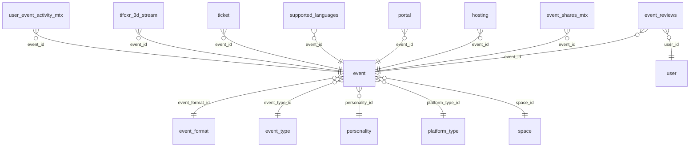

# DB Events

Event definitions, types, formats and reviews. Events is phase 0 on develop (not user-usable).

Part of [[DB Current State]]. Generated from: script file dev-06-10-2026-Schema-Only.sql, as of 2026-10-14T16:39:38. Tables: 4. Purposes are inferred from names and are **not verified**. Do not hand-edit: the next refresh overwrites this note.

## Relationships

## Tables

### event

PK: `id`. Columns: 24.

| Column | Type | Null | Notes |
|---|---|---|---|
| id | int | no | PK, identity |
| platform_type_id | int | no | FK to platform_type |
| event_type_id | int | no | FK to event_type |
| personality_id | int | yes | FK to personality |
| localized_name_id | char(36) | no |  |
| description_id | char(36) | yes |  |
| event_url | nvarchar(max) | yes |  |
| is_live | char(1) | no |  |
| subtitle_enabled | bit | yes |  |
| scheduled_length | int | no |  |
| scheduled_start_datetime | datetime2(7) | no |  |
| scheduled_end_datetime | datetime2(7) | no |  |
| actual_start_datetime | datetime2(7) | yes |  |
| actual_end_datetime | datetime2(7) | yes |  |
| rating | decimal(2,1) | yes |  |
| is_deleted | bit | no |  |
| modified_time | datetime2(7) | no |  |
| modified_by | varchar(36) | no |  |
| created_by | varchar(36) | no |  |
| created_time | datetime2(7) | no |  |
| status | varchar(20) | no |  |
| space_id | int | yes | FK to space |
| capacity | int | yes |  |
| event_format_id | int | yes | FK to event_format |

References: event_type_id to [[DB Events#event_type|event_type]].id; personality_id to [[DB Users and Auth#personality|personality]].id; platform_type_id to [[DB Spaces and Access#platform_type|platform_type]].id; event_format_id to [[DB Events#event_format|event_format]].id; space_id to [[DB Spaces and Access#space|space]].id

Referenced by: [[DB Events#event_reviews|event_reviews]] (event_id), [[DB Metrics and Activity#event_shares_mtx|event_shares_mtx]] (event_id), [[DB Booths Portals and Teleport#hosting|hosting]] (event_id), [[DB Booths Portals and Teleport#portal|portal]] (event_id), [[DB Content Media and Approval#supported_languages|supported_languages]] (event_id), [[DB Shop Items and Orders#ticket|ticket]] (event_id), [[DB 3D Streaming and Moderation#tifoxr_3d_stream|tifoxr_3d_stream]] (event_id), [[DB Metrics and Activity#user_event_activity_mtx|user_event_activity_mtx]] (event_id)

### event_format

PK: `id`. Columns: 8.

| Column | Type | Null | Notes |
|---|---|---|---|
| id | int | no | PK, identity |
| name | varchar(64) | no |  |
| description | varchar(255) | yes |  |
| is_deleted | bit | no |  |
| created_time | datetime2(7) | no |  |
| created_by | varchar(36) | no |  |
| modified_time | datetime2(7) | no |  |
| modified_by | varchar(36) | no |  |

Referenced by: [[DB Events#event|event]] (event_format_id)

### event_reviews

PK: `id`. Columns: 9.

| Column | Type | Null | Notes |
|---|---|---|---|
| id | int | no | PK, identity |
| user_id | uniqueidentifier | no | FK to user |
| event_id | int | no | FK to event |
| moderation_status_id | int | yes |  |
| user_rating | decimal(2,1) | yes |  |
| remarks | varchar(255) | yes |  |
| is_deleted | bit | no |  |
| modified_time | datetime2(7) | no |  |
| modified_by | varchar(36) | no |  |

References: event_id to [[DB Events#event|event]].id; user_id to [[DB Users and Auth#user|user]].id

### event_type

PK: `id`. Columns: 6.

| Column | Type | Null | Notes |
|---|---|---|---|
| id | int | no | PK, identity |
| type | varchar(64) | no |  |
| description | varchar(255) | no |  |
| is_deleted | bit | no |  |
| modified_time | datetime2(7) | no |  |
| modified_by | varchar(36) | no |  |

Referenced by: [[DB Events#event|event]] (event_type_id)

## Stored procedures (9)

Grouped by the first table each procedure writes (or reads if it writes none). Table lists come from the SQL text and miss dynamic SQL. SQL text: `05-Database/Procedures/<name>.sql`. Logic column: ok (summary matches current SQL), STALE (SQL changed since the summary), missing (no summary yet).

| Procedure | Writes | Reads | Logic |
|---|---|---|---|
| sp_Event_Create | event, hosting, i18n |  | missing |
| sp_Event_Delete | event |  | missing |
| sp_Event_GetById |  | content_approval, event, event_format, event_type, hosting, i18n, media_localization, personality, platform_type | missing |
| sp_Event_GetById_Unity |  | event, event_format, event_type, hosting, i18n, media_localization, personality, platform_type | missing |
| sp_Event_GetBySpace |  | content_approval, event, event_format, event_type, hosting, i18n, media_localization, personality, platform_type | missing |
| sp_Event_GetBySpace_Unity |  | event, event_format, event_type, hosting, i18n, media_localization, personality, platform_type | missing |
| usp_Event_ExistsInSpace |  | event | missing |
| usp_GetSpacesWithEvents |  | event | missing |
| usp_Personality_GetActiveEvents |  | event, i18n | missing |
