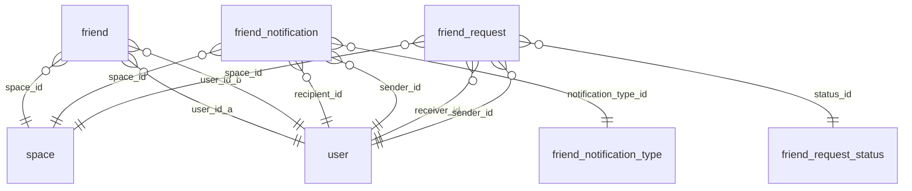

# DB Friends

Friend requests, friendships and friend notifications.

Part of [[DB Current State]]. Generated from: script file dev-06-10-2026-Schema-Only.sql, as of 2026-10-14T16:39:38. Tables: 5. Purposes are inferred from names and are **not verified**. Do not hand-edit: the next refresh overwrites this note.

## Relationships

## Tables

### friend

PK: `id`. Columns: 8.

| Column | Type | Null | Notes |
|---|---|---|---|
| id | uniqueidentifier | no | PK |
| space_id | int | no | FK to space |
| user_id_a | uniqueidentifier | no | FK to user |
| user_id_b | uniqueidentifier | no | FK to user |
| created_at | datetime2(7) | no |  |
| is_deleted | bit | no |  |
| modified_time | datetime2(7) | no |  |
| modified_by | varchar(36) | no |  |

References: space_id to [[DB Spaces and Access#space|space]].id; user_id_a to [[DB Users and Auth#user|user]].id; user_id_b to [[DB Users and Auth#user|user]].id

### friend_notification

PK: `id`. Columns: 11.

| Column | Type | Null | Notes |
|---|---|---|---|
| id | uniqueidentifier | no | PK |
| space_id | int | no | FK to space |
| recipient_id | uniqueidentifier | no | FK to user |
| sender_id | uniqueidentifier | no | FK to user |
| notification_type_id | int | no | FK to friend_notification_type |
| reference_id | uniqueidentifier | yes |  |
| is_read | bit | no |  |
| created_at | datetime2(7) | no |  |
| is_deleted | bit | no |  |
| modified_time | datetime2(7) | no |  |
| modified_by | varchar(36) | no |  |

References: recipient_id to [[DB Users and Auth#user|user]].id; sender_id to [[DB Users and Auth#user|user]].id; space_id to [[DB Spaces and Access#space|space]].id; notification_type_id to [[DB Friends#friend_notification_type|friend_notification_type]].id

### friend_notification_type

PK: `id`. Columns: 5.

| Column | Type | Null | Notes |
|---|---|---|---|
| id | int | no | PK, identity |
| type_name | varchar(64) | no |  |
| is_deleted | bit | no |  |
| modified_time | datetime2(7) | no |  |
| modified_by | varchar(36) | no |  |

Referenced by: [[DB Friends#friend_notification|friend_notification]] (notification_type_id)

### friend_request

PK: `id`. Columns: 10.

| Column | Type | Null | Notes |
|---|---|---|---|
| id | uniqueidentifier | no | PK |
| space_id | int | no | FK to space |
| sender_id | uniqueidentifier | no | FK to user |
| receiver_id | uniqueidentifier | no | FK to user |
| status_id | int | no | FK to friend_request_status |
| sent_at | datetime2(7) | no |  |
| responded_at | datetime2(7) | yes |  |
| is_deleted | bit | no |  |
| modified_time | datetime2(7) | no |  |
| modified_by | varchar(36) | no |  |

References: receiver_id to [[DB Users and Auth#user|user]].id; sender_id to [[DB Users and Auth#user|user]].id; space_id to [[DB Spaces and Access#space|space]].id; status_id to [[DB Friends#friend_request_status|friend_request_status]].id

### friend_request_status

PK: `id`. Columns: 5.

| Column | Type | Null | Notes |
|---|---|---|---|
| id | int | no | PK, identity |
| status | varchar(32) | no |  |
| is_deleted | bit | no |  |
| modified_time | datetime2(7) | no |  |
| modified_by | varchar(36) | no |  |

Referenced by: [[DB Friends#friend_request|friend_request]] (status_id)

## Stored procedures (11)

Grouped by the first table each procedure writes (or reads if it writes none). Table lists come from the SQL text and miss dynamic SQL. SQL text: `05-Database/Procedures/<name>.sql`. Logic column: ok (summary matches current SQL), STALE (SQL changed since the summary), missing (no summary yet).

| Procedure | Writes | Reads | Logic |
|---|---|---|---|
| usp_friend_notification_get |  | friend_notification, friend_notification_type, user | missing |
| usp_friend_notification_mark_all_read | friend_notification |  | missing |
| usp_friend_notification_mark_read | friend_notification |  | missing |
| usp_friend_remove | friend |  | missing |
| usp_friend_request_accept | friend, friend_notification, friend_request | friend_notification_type, friend_request_status, user, user_session_management | missing |
| usp_friend_request_cancel | friend_request | friend_request_status | missing |
| usp_friend_request_decline | friend_notification, friend_request | friend_notification_type, friend_request_status | missing |
| usp_friend_request_get_by_id |  | friend_request, friend_request_status | missing |
| usp_friend_request_get_incoming |  | friend_request, friend_request_status, user | missing |
| usp_friend_request_get_outgoing |  | friend_request, friend_request_status, user | missing |
| usp_friend_request_send | friend_request | friend, friend_request_status, user | missing |
