# DB Games and Leaderboards

Games, game types (trivia, predict match, guess player, fastest runner), sessions, scoreboards, coins and game announcements with prizes.

Part of [[DB Current State]]. Generated from: script file dev-06-10-2026-Schema-Only.sql, as of 2026-10-14T16:39:38. Tables: 20. Purposes are inferred from names and are **not verified**. Do not hand-edit: the next refresh overwrites this note.

## Relationships

```mermaid
erDiagram
  "fastest_runner_game" }o--|| "game" : "game_id"
  "fastest_runner_game" }o--|| "user" : "user_id"
  "game_announcement" }o--|| "game" : "game_id"
  "game_announcement" }o--|| "space" : "space_id"
  "game_announcement_prize_pack" }o--|| "game_announcement" : "announcement_id"
  "game_announcement_prize_pack" }o--|| "item" : "item_id"
  "game_announcement_user_prize" }o--|| "game_announcement" : "announcement_id"
  "game_announcement_user_prize" }o--|| "item" : "item_id"
  "game_announcement_user_prize" }o--|| "user" : "user_id"
  "game_announcement_winner" }o--|| "game_announcement" : "announcement_id"
  "game_announcement_winner" }o--|| "orders" : "granted_order_id"
  "game_announcement_winner" }o--|| "user" : "user_id"
  "game_badges" }o--|| "badge" : "badge_id"
  "game_badges" }o--|| "game" : "game_id"
  "game_option" }o--|| "game" : "game_id"
  "game_option" }o--|| "option_text" : "option_text_id"
  "guess_player_game" }o--|| "game" : "game_id"
  "guess_player_game" }o--|| "game_difficulty" : "difficulty_id"
  "guess_player_game" }o--|| "media" : "media_id"
  "guess_player_game" }o--|| "personality" : "personality_id"
  "guess_player_game_clue" }o--|| "guess_player_game" : "guess_player_game_id"
  "predict_match_game" }o--|| "entity" : "away_entity_id"
  "predict_match_game" }o--|| "entity" : "home_entity_id"
  "predict_match_game" }o--|| "game" : "game_id"
  "trivia_question_game" }o--|| "game" : "game_id"
  "trivia_question_game" }o--|| "game_difficulty" : "difficulty_id"
  "trivia_question_option" }o--|| "game_option" : "game_option_id"
  "trivia_question_option" }o--|| "trivia_question_game" : "question_id"
  "user_game_coins" }o--|| "user" : "user_id"
  "user_game_scoreboard" }o--|| "game" : "game_id"
  "user_game_scoreboard" }o--|| "space" : "space_id"
  "user_game_scoreboard" }o--|| "user" : "user_id"
  "user_game_session" }o--|| "game" : "game_id"
  "user_game_session" }o--|| "user" : "user_id"
  "user_game_session" }o--|| "user_session_management" : "user_session_id"
  "user_guess_player_game_clue" }o--|| "guess_player_game_clue" : "clue_id"
  "user_guess_player_game_clue" }o--|| "user" : "user_id"
  "user_match_game_predictions" }o--|| "predict_match_game" : "predict_match_game_id"
  "user_match_game_predictions" }o--|| "user" : "user_id"
```

## Tables

### fastest_runner_game

PK: `id`. Columns: 10.

| Column | Type | Null | Notes |
|---|---|---|---|
| id | uniqueidentifier | no | PK |
| game_id | int | no | FK to game |
| user_id | uniqueidentifier | no | FK to user |
| start_time | datetime2(7) | no |  |
| end_time | datetime2(7) | no |  |
| best_run | decimal(8,6) | no |  |
| last_run | decimal(8,6) | yes |  |
| is_deleted | bit | no |  |
| modified_time | datetime2(7) | no |  |
| modified_by | varchar(36) | no |  |

References: game_id to [[DB Games and Leaderboards#game|game]].id; user_id to [[DB Users and Auth#user|user]].id

### game

PK: `id`. Columns: 10.

| Column | Type | Null | Notes |
|---|---|---|---|
| id | int | no | PK, identity |
| name_key | char(36) | no |  |
| description_key | char(36) | yes |  |
| sort_order | smallint | no |  |
| is_active | bit | no |  |
| is_deleted | bit | no |  |
| modified_time | datetime2(7) | no |  |
| modified_by | varchar(36) | no |  |
| game_code | varchar(50) | no |  |
| max_score | int | yes |  |

Referenced by: [[DB Games and Leaderboards#fastest_runner_game|fastest_runner_game]] (game_id), [[DB Games and Leaderboards#game_announcement|game_announcement]] (game_id), [[DB Games and Leaderboards#game_badges|game_badges]] (game_id), [[DB Games and Leaderboards#game_option|game_option]] (game_id), [[DB Games and Leaderboards#guess_player_game|guess_player_game]] (game_id), [[DB Games and Leaderboards#predict_match_game|predict_match_game]] (game_id), [[DB Games and Leaderboards#trivia_question_game|trivia_question_game]] (game_id), [[DB Games and Leaderboards#user_game_scoreboard|user_game_scoreboard]] (game_id), [[DB Games and Leaderboards#user_game_session|user_game_session]] (game_id)

### game_announcement

PK: `id`. Columns: 15.

| Column | Type | Null | Notes |
|---|---|---|---|
| id | int | no | PK, identity |
| space_id | int | no | FK to space |
| game_id | int | no | FK to game |
| name | varchar(200) | no |  |
| announcement_type | varchar(10) | no |  |
| start_date | date | no |  |
| end_date | date | no |  |
| top_count | int | no |  |
| announcement_date | date | yes |  |
| status | varchar(20) | no |  |
| is_deleted | bit | no |  |
| created_by | varchar(200) | no |  |
| created_time | datetime2(7) | no |  |
| modified_by | varchar(200) | no |  |
| modified_time | datetime2(7) | no |  |

References: game_id to [[DB Games and Leaderboards#game|game]].id; space_id to [[DB Spaces and Access#space|space]].id

Referenced by: [[DB Games and Leaderboards#game_announcement_prize_pack|game_announcement_prize_pack]] (announcement_id), [[DB Games and Leaderboards#game_announcement_user_prize|game_announcement_user_prize]] (announcement_id), [[DB Games and Leaderboards#game_announcement_winner|game_announcement_winner]] (announcement_id)

### game_announcement_prize_pack

PK: `id`. Columns: 6.

| Column | Type | Null | Notes |
|---|---|---|---|
| id | int | no | PK, identity |
| announcement_id | int | no | FK to game_announcement |
| item_id | int | no | FK to item |
| is_deleted | bit | no |  |
| modified_by | varchar(200) | no |  |
| modified_time | datetime2(7) | no |  |

References: announcement_id to [[DB Games and Leaderboards#game_announcement|game_announcement]].id; item_id to [[DB Shop Items and Orders#item|item]].id

### game_announcement_user_prize

PK: `id`. Columns: 8.

| Column | Type | Null | Notes |
|---|---|---|---|
| id | int | no | PK, identity |
| announcement_id | int | no | FK to game_announcement |
| user_id | uniqueidentifier | no | FK to user |
| item_id | int | no | FK to item |
| quantity | int | no |  |
| is_deleted | bit | no |  |
| modified_by | varchar(200) | no |  |
| modified_time | datetime2(7) | no |  |

References: announcement_id to [[DB Games and Leaderboards#game_announcement|game_announcement]].id; item_id to [[DB Shop Items and Orders#item|item]].id; user_id to [[DB Users and Auth#user|user]].id

### game_announcement_winner

PK: `id`. Columns: 10.

| Column | Type | Null | Notes |
|---|---|---|---|
| id | uniqueidentifier | no | PK |
| announcement_id | int | no | FK to game_announcement |
| user_id | uniqueidentifier | no | FK to user |
| rank | int | no |  |
| score | bigint | no |  |
| games_played | int | no |  |
| granted_order_id | uniqueidentifier | yes | FK to orders |
| granted_time | datetime2(7) | no |  |
| granted_by | varchar(200) | no |  |
| is_deleted | bit | no |  |

References: announcement_id to [[DB Games and Leaderboards#game_announcement|game_announcement]].id; granted_order_id to [[DB Shop Items and Orders#orders|orders]].id; user_id to [[DB Users and Auth#user|user]].id

### game_badges

PK: `id`. Columns: 6.

| Column | Type | Null | Notes |
|---|---|---|---|
| id | int | no | PK, identity |
| badge_id | int | no | FK to badge |
| game_id | int | no | FK to game |
| is_deleted | bit | no |  |
| modified_time | datetime2(7) | no |  |
| modified_by | varchar(36) | no |  |

References: badge_id to [[DB Users and Auth#badge|badge]].id; game_id to [[DB Games and Leaderboards#game|game]].id

### game_difficulty

PK: `id`. Columns: 6.

| Column | Type | Null | Notes |
|---|---|---|---|
| id | int | no | PK, identity |
| level | smallint | no |  |
| level_key | char(36) | no |  |
| is_deleted | bit | no |  |
| modified_time | datetime2(7) | no |  |
| modified_by | varchar(36) | no |  |

Referenced by: [[DB Games and Leaderboards#guess_player_game|guess_player_game]] (difficulty_id), [[DB Games and Leaderboards#trivia_question_game|trivia_question_game]] (difficulty_id)

### game_option

PK: `id`. Columns: 7.

| Column | Type | Null | Notes |
|---|---|---|---|
| id | int | no | PK, identity |
| game_id | int | no | FK to game |
| option_text_id | int | no | FK to option_text |
| is_correct | bit | no |  |
| is_deleted | bit | no |  |
| modified_time | datetime2(7) | no |  |
| modified_by | varchar(36) | no |  |

References: game_id to [[DB Games and Leaderboards#game|game]].id; option_text_id to [[DB Games and Leaderboards#option_text|option_text]].id

Referenced by: [[DB Games and Leaderboards#trivia_question_option|trivia_question_option]] (game_option_id)

### guess_player_game

PK: `id`. Columns: 8.

| Column | Type | Null | Notes |
|---|---|---|---|
| id | int | no | PK, identity |
| game_id | int | no | FK to game |
| personality_id | int | no | FK to personality |
| media_id | bigint | no | FK to media |
| difficulty_id | int | no | FK to game_difficulty |
| is_deleted | bit | no |  |
| modified_time | datetime2(7) | no |  |
| modified_by | varchar(36) | no |  |

References: difficulty_id to [[DB Games and Leaderboards#game_difficulty|game_difficulty]].id; game_id to [[DB Games and Leaderboards#game|game]].id; media_id to [[DB Content Media and Approval#media|media]].id; personality_id to [[DB Users and Auth#personality|personality]].id

Referenced by: [[DB Games and Leaderboards#guess_player_game_clue|guess_player_game_clue]] (guess_player_game_id)

### guess_player_game_clue

PK: `id`. Columns: 6.

| Column | Type | Null | Notes |
|---|---|---|---|
| id | int | no | PK, identity |
| guess_player_game_id | int | no | FK to guess_player_game |
| clue_key | char(36) | no |  |
| is_deleted | bit | no |  |
| modified_time | datetime2(7) | no |  |
| modified_by | varchar(36) | no |  |

References: guess_player_game_id to [[DB Games and Leaderboards#guess_player_game|guess_player_game]].id

Referenced by: [[DB Games and Leaderboards#user_guess_player_game_clue|user_guess_player_game_clue]] (clue_id)

### option_text

PK: `id`. Columns: 5.

| Column | Type | Null | Notes |
|---|---|---|---|
| id | int | no | PK, identity |
| option_key | char(36) | no |  |
| is_deleted | bit | no |  |
| modified_time | datetime2(7) | no |  |
| modified_by | varchar(36) | no |  |

Referenced by: [[DB Games and Leaderboards#game_option|game_option]] (option_text_id)

### predict_match_game

PK: `id`. Columns: 9.

| Column | Type | Null | Notes |
|---|---|---|---|
| id | int | no | PK, identity |
| game_id | int | no | FK to game |
| home_entity_id | int | no | FK to entity |
| away_entity_id | int | no | FK to entity |
| scheduled_date | datetime2(7) | no |  |
| result | int | yes |  |
| is_deleted | bit | no |  |
| modified_time | datetime2(7) | no |  |
| modified_by | varchar(36) | no |  |

References: away_entity_id to [[DB Spaces and Access#entity|entity]].id; game_id to [[DB Games and Leaderboards#game|game]].id; home_entity_id to [[DB Spaces and Access#entity|entity]].id

Referenced by: [[DB Games and Leaderboards#user_match_game_predictions|user_match_game_predictions]] (predict_match_game_id)

### trivia_question_game

PK: `id`. Columns: 7.

| Column | Type | Null | Notes |
|---|---|---|---|
| id | int | no | PK, identity |
| game_id | int | no | FK to game |
| question_key | char(36) | no |  |
| difficulty_id | int | no | FK to game_difficulty |
| is_deleted | bit | no |  |
| modified_time | datetime2(7) | no |  |
| modified_by | varchar(36) | no |  |

References: difficulty_id to [[DB Games and Leaderboards#game_difficulty|game_difficulty]].id; game_id to [[DB Games and Leaderboards#game|game]].id

Referenced by: [[DB Games and Leaderboards#trivia_question_option|trivia_question_option]] (question_id)

### trivia_question_option

PK: `id`. Columns: 7.

| Column | Type | Null | Notes |
|---|---|---|---|
| id | int | no | PK, identity |
| question_id | int | no | FK to trivia_question_game |
| game_option_id | int | no | FK to game_option |
| sort_order | smallint | no |  |
| is_deleted | bit | no |  |
| modified_time | datetime2(7) | no |  |
| modified_by | varchar(36) | no |  |

References: game_option_id to [[DB Games and Leaderboards#game_option|game_option]].id; question_id to [[DB Games and Leaderboards#trivia_question_game|trivia_question_game]].id

### user_game_coins

PK: `user_id`. Columns: 5.

| Column | Type | Null | Notes |
|---|---|---|---|
| user_id | uniqueidentifier | no | PK, FK to user |
| coins | bigint | no |  |
| is_deleted | bit | no |  |
| modified_time | datetime2(7) | no |  |
| modified_by | varchar(36) | no |  |

References: user_id to [[DB Users and Auth#user|user]].id

### user_game_scoreboard

PK: `user_id`, `space_id`, `game_id`. Columns: 15.

| Column | Type | Null | Notes |
|---|---|---|---|
| user_id | uniqueidentifier | no | PK, FK to user |
| space_id | int | no | PK, FK to space |
| game_id | int | no | PK, FK to game |
| total_score | bigint | no |  |
| games_played | int | no |  |
| last_played_time | datetime2(7) | yes |  |
| is_deleted | bit | no |  |
| modified_time | datetime2(7) | no |  |
| modified_by | varchar(36) | no |  |
| weekly_score | bigint | no |  |
| weekly_games_played | int | no |  |
| week_start_date | date | yes |  |
| monthly_score | bigint | no |  |
| monthly_games_played | int | no |  |
| month_start_date | date | yes |  |

References: game_id to [[DB Games and Leaderboards#game|game]].id; space_id to [[DB Spaces and Access#space|space]].id; user_id to [[DB Users and Auth#user|user]].id

### user_game_session

PK: `id`. Columns: 11.

| Column | Type | Null | Notes |
|---|---|---|---|
| id | uniqueidentifier | no | PK |
| user_id | uniqueidentifier | no | FK to user |
| user_session_id | uniqueidentifier | no | FK to user_session_management |
| game_id | int | no | FK to game |
| score_value | int | no |  |
| coins_earned | bigint | no |  |
| start_time | datetime2(7) | no |  |
| end_time | datetime2(7) | yes |  |
| is_deleted | bit | no |  |
| modified_time | datetime2(7) | no |  |
| modified_by | varchar(36) | no |  |

References: game_id to [[DB Games and Leaderboards#game|game]].id; user_id to [[DB Users and Auth#user|user]].id; user_session_id to [[DB Users and Auth#user_session_management|user_session_management]].id

### user_guess_player_game_clue

PK: `id`. Columns: 7.

| Column | Type | Null | Notes |
|---|---|---|---|
| id | int | no | PK, identity |
| user_id | uniqueidentifier | no | FK to user |
| clue_id | int | no | FK to guess_player_game_clue |
| is_unlocked | bit | no |  |
| is_deleted | bit | no |  |
| modified_time | datetime2(7) | no |  |
| modified_by | varchar(36) | no |  |

References: clue_id to [[DB Games and Leaderboards#guess_player_game_clue|guess_player_game_clue]].id; user_id to [[DB Users and Auth#user|user]].id

### user_match_game_predictions

PK: `id`. Columns: 7.

| Column | Type | Null | Notes |
|---|---|---|---|
| id | int | no | PK, identity |
| user_id | uniqueidentifier | no | FK to user |
| predict_match_game_id | int | no | FK to predict_match_game |
| prediction | tinyint | no |  |
| is_deleted | bit | no |  |
| modified_time | datetime2(7) | no |  |
| modified_by | varchar(36) | no |  |

References: predict_match_game_id to [[DB Games and Leaderboards#predict_match_game|predict_match_game]].id; user_id to [[DB Users and Auth#user|user]].id

## Stored procedures (21)

Grouped by the first table each procedure writes (or reads if it writes none). Table lists come from the SQL text and miss dynamic SQL. SQL text: `05-Database/Procedures/<name>.sql`. Logic column: ok (summary matches current SQL), STALE (SQL changed since the summary), missing (no summary yet).

| Procedure | Writes | Reads | Logic |
|---|---|---|---|
| sp_GameAnnouncementPrizePack_Add | game_announcement_prize_pack |  | missing |
| sp_GameAnnouncementPrizePack_ListByAnnouncement |  | game_announcement_prize_pack, i18n, item | missing |
| sp_GameAnnouncementPrizePack_Remove | game_announcement_prize_pack |  | missing |
| sp_GameAnnouncementUserPrize_Add | game_announcement_user_prize |  | missing |
| sp_GameAnnouncementWinner_Grant | game_announcement_winner |  | missing |
| sp_GameAnnouncementWinner_ListByAnnouncement |  | game_announcement_winner, i18n, item, order_line_item, user | missing |
| sp_GameAnnouncement_Create | game_announcement |  | missing |
| sp_GameAnnouncement_Delete | game_announcement |  | missing |
| sp_GameAnnouncement_GetById |  | game_announcement | missing |
| sp_GameAnnouncement_ListActiveForPublish |  | game, game_announcement, game_announcement_prize_pack, item, item_type | missing |
| sp_GameAnnouncement_ListBySpaceGame |  | game_announcement | missing |
| sp_GameAnnouncement_Update | game_announcement |  | missing |
| sp_GameSession_InsertAndUpdateLeaderboardBatch | user_game_scoreboard, user_game_session | game, user_session_management | missing |
| sp_Game_Create | game, i18n |  | missing |
| sp_Game_GetById |  | game, i18n | missing |
| sp_Game_List |  | game, i18n | missing |
| sp_GetSpacesWithGameAnnouncements |  | game, game_announcement | missing |
| sp_Leaderboard_GetTopAndCurrentUser |  | user, user_game_scoreboard | missing |
| sp_Leaderboard_GetUserGameStats |  | game, user_game_scoreboard | missing |
| sp_Scoreboard_GetByDateRange |  | user, user_game_scoreboard, user_game_session, user_session_management | missing |
| sp_Scoreboard_GetPlayerHistory |  | user_game_session, user_session_management | missing |
