# DB Metrics and Activity

Activity-tracking (mtx) tables and metric idempotency, filled by Async Push.

Part of [[DB Current State]]. Generated from: script file dev-06-10-2026-Schema-Only.sql, as of 2026-10-14T16:39:38. Tables: 7. Purposes are inferred from names and are **not verified**. Do not hand-edit: the next refresh overwrites this note.

## Relationships

```mermaid
erDiagram
  "event_shares_mtx" }o--|| "event" : "event_id"
  "event_shares_mtx" }o--|| "user" : "user_id"
  "portal_access_mtx" }o--|| "media" : "media_id"
  "portal_access_mtx" }o--|| "portal" : "portal_id"
  "portal_access_mtx" }o--|| "portal_type" : "portal_type_id"
  "portal_access_mtx" }o--|| "space" : "space_id"
  "portal_access_mtx" }o--|| "user" : "user_id"
  "portal_access_mtx" }o--|| "user_session_management" : "session_id"
  "teleport_table_activity_mtx" }o--|| "teleport_table" : "table_id"
  "teleport_table_activity_mtx" }o--|| "teleport_table_button" : "button_id"
  "teleport_table_activity_mtx" }o--|| "user" : "user_id"
  "tifoxr_3d_streaming_user_mtx" }o--|| "user_event_activity_mtx" : "user_activity_id"
  "user_booth_activity_mtx" }o--|| "booth" : "booth_id"
  "user_booth_activity_mtx" }o--|| "user" : "user_id"
  "user_booth_activity_mtx" }o--|| "user_exit_code" : "exit_code_id"
  "user_booth_activity_mtx" }o--|| "user_session_management" : "session_id"
  "user_event_activity_mtx" }o--|| "event" : "event_id"
  "user_event_activity_mtx" }o--|| "user" : "user_id"
  "user_event_activity_mtx" }o--|| "user_exit_code" : "exit_reason_id"
  "user_space_activity_mtx" }o--|| "space" : "space_id"
  "user_space_activity_mtx" }o--|| "user" : "user_id"
  "user_space_activity_mtx" }o--|| "user_exit_code" : "exit_code"
  "user_space_activity_mtx" }o--|| "user_session_management" : "session_id"
```

## Tables

### event_shares_mtx

PK: `id`. Columns: 8.

| Column | Type | Null | Notes |
|---|---|---|---|
| id | int | no | PK, identity |
| user_id | uniqueidentifier | no | FK to user |
| event_id | int | no | FK to event |
| share_channel | varchar(64) | yes |  |
| share_url | varchar(255) | yes |  |
| is_deleted | bit | no |  |
| modified_time | datetime2(7) | no |  |
| modified_by | varchar(36) | no |  |

References: event_id to [[DB Events#event|event]].id; user_id to [[DB Users and Auth#user|user]].id

### metric_idempotency_key

PK: `idempotency_key`. Columns: 5.

| Column | Type | Null | Notes |
|---|---|---|---|
| idempotency_key | varchar(128) | no | PK |
| status | varchar(20) | no |  |
| event_type | varchar(64) | no |  |
| created_time | datetime2(7) | no |  |
| modified_time | datetime2(7) | no |  |

### portal_access_mtx

PK: `id`. Columns: 14.

| Column | Type | Null | Notes |
|---|---|---|---|
| id | uniqueidentifier | no | PK |
| user_id | uniqueidentifier | no | FK to user |
| space_id | int | no | FK to space |
| portal_id | int | no | FK to portal |
| session_id | uniqueidentifier | no | FK to user_session_management |
| portal_type_id | int | no | FK to portal_type |
| media_id | bigint | no | FK to media |
| portal_link | varchar(255) | no |  |
| media_link | varchar(255) | no |  |
| thumbnail_link | varchar(255) | no |  |
| access_time | datetime2(7) | no |  |
| is_deleted | bit | no |  |
| modified_time | datetime2(7) | no |  |
| modified_by | varchar(36) | no |  |

References: media_id to [[DB Content Media and Approval#media|media]].id; portal_id to [[DB Booths Portals and Teleport#portal|portal]].id; portal_type_id to [[DB Booths Portals and Teleport#portal_type|portal_type]].id; session_id to [[DB Users and Auth#user_session_management|user_session_management]].id; space_id to [[DB Spaces and Access#space|space]].id; user_id to [[DB Users and Auth#user|user]].id

### teleport_table_activity_mtx

PK: `id`. Columns: 7.

| Column | Type | Null | Notes |
|---|---|---|---|
| id | int | no | PK, identity |
| user_id | uniqueidentifier | no | FK to user |
| table_id | int | no | FK to teleport_table |
| button_id | int | no | FK to teleport_table_button |
| is_deleted | bit | no |  |
| modified_time | datetime2(7) | no |  |
| modified_by | varchar(36) | no |  |

References: button_id to [[DB Booths Portals and Teleport#teleport_table_button|teleport_table_button]].id; table_id to [[DB Booths Portals and Teleport#teleport_table|teleport_table]].id; user_id to [[DB Users and Auth#user|user]].id

### user_booth_activity_mtx

PK: `id`. Columns: 12.

| Column | Type | Null | Notes |
|---|---|---|---|
| id | uniqueidentifier | no | PK |
| booth_id | int | no | FK to booth |
| user_id | uniqueidentifier | no | FK to user |
| exit_code_id | int | yes | FK to user_exit_code |
| booth_name_key | char(36) | no |  |
| session_id | uniqueidentifier | no | FK to user_session_management |
| entry_datetime | datetime2(7) | no |  |
| session_duration | int | yes |  |
| exit_datetime | datetime2(7) | yes |  |
| is_deleted | bit | no |  |
| modified_time | datetime2(7) | no |  |
| modified_by | varchar(36) | no |  |

References: booth_id to [[DB Booths Portals and Teleport#booth|booth]].id; exit_code_id to [[DB Users and Auth#user_exit_code|user_exit_code]].id; session_id to [[DB Users and Auth#user_session_management|user_session_management]].id; user_id to [[DB Users and Auth#user|user]].id

### user_event_activity_mtx

PK: `id`. Columns: 10.

| Column | Type | Null | Notes |
|---|---|---|---|
| id | uniqueidentifier | no | PK |
| event_id | int | no | FK to event |
| user_id | uniqueidentifier | no | FK to user |
| exit_reason_id | int | yes | FK to user_exit_code |
| join_datetime | datetime2(7) | no |  |
| exit_datetime | datetime2(7) | yes |  |
| duration | int | yes |  |
| is_deleted | bit | no |  |
| modified_time | datetime2(7) | no |  |
| modified_by | varchar(36) | no |  |

References: event_id to [[DB Events#event|event]].id; user_id to [[DB Users and Auth#user|user]].id; exit_reason_id to [[DB Users and Auth#user_exit_code|user_exit_code]].id

Referenced by: [[DB 3D Streaming and Moderation#tifoxr_3d_streaming_user_mtx|tifoxr_3d_streaming_user_mtx]] (user_activity_id)

### user_space_activity_mtx

PK: `id`. Columns: 11.

| Column | Type | Null | Notes |
|---|---|---|---|
| id | uniqueidentifier | no | PK |
| space_id | int | no | FK to space |
| user_id | uniqueidentifier | no | FK to user |
| exit_code | int | yes | FK to user_exit_code |
| session_id | uniqueidentifier | no | FK to user_session_management |
| join_time | datetime2(7) | no |  |
| session_duration | int | no |  |
| left_datetime | datetime2(7) | yes |  |
| is_deleted | bit | no |  |
| modified_time | datetime2(7) | no |  |
| modified_by | varchar(36) | no |  |

References: exit_code to [[DB Users and Auth#user_exit_code|user_exit_code]].id; session_id to [[DB Users and Auth#user_session_management|user_session_management]].id; space_id to [[DB Spaces and Access#space|space]].id; user_id to [[DB Users and Auth#user|user]].id

## Stored procedures (2)

Grouped by the first table each procedure writes (or reads if it writes none). Table lists come from the SQL text and miss dynamic SQL. SQL text: `05-Database/Procedures/<name>.sql`. Logic column: ok (summary matches current SQL), STALE (SQL changed since the summary), missing (no summary yet).

| Procedure | Writes | Reads | Logic |
|---|---|---|---|
| sp_Booth_DeleteCascade | booth, booth_comment, booth_media, custom_booth_item, custom_booth_item_link, i18n, media, media_localization, portal, portal_access_mtx, portal_link, user_booth_activity_mtx |  | missing |
| sp_ProcessMetricEventBatch | event_shares_mtx, portal_access_mtx, teleport_table_activity_mtx, tifoxr_3d_streaming_session_summary_mtx, tifoxr_3d_streaming_user_mtx, user_booth_activity_mtx, user_event_activity_mtx, user_space_activity_mtx |  | missing |
