# DB Payments

Gateways and their config, payment intents, charges, refunds, disputes, deposits, invoices, audit and gateway event logs.

Part of [[DB Current State]]. Generated from: script file dev-06-10-2026-Schema-Only.sql, as of 2026-10-14T16:39:38. Tables: 21. Purposes are inferred from names and are **not verified**. Do not hand-edit: the next refresh overwrites this note.

## Relationships

```mermaid
erDiagram
  "gateway_event_log" }o--|| "payment_charge" : "related_charge_id"
  "gateway_event_log" }o--|| "payment_gateway" : "payment_gateway_id"
  "gateway_event_log" }o--|| "payment_intent" : "related_intent_id"
  "gateway_event_log" }o--|| "payment_refund" : "related_refund_id"
  "invoice" }o--|| "currency" : "currency_id"
  "invoice" }o--|| "invoice_status" : "status_id"
  "invoice" }o--|| "orders" : "order_id"
  "invoice" }o--|| "payment_charge" : "payment_charge_id"
  "invoice" }o--|| "payment_gateway" : "payment_gateway_id"
  "invoice" }o--|| "space" : "space_id"
  "invoice" }o--|| "user" : "user_id"
  "invoice_line_item" }o--|| "currency" : "currency_id"
  "invoice_line_item" }o--|| "invoice" : "invoice_id"
  "invoice_line_item" }o--|| "item_type" : "item_type_id"
  "orders" }o--|| "payment_gateway" : "gateway_preferred_id"
  "orders" }o--|| "transaction_type" : "transaction_type_id"
  "payment_charge" }o--|| "currency" : "currency_id"
  "payment_charge" }o--|| "currency" : "merchant_net_currency_id"
  "payment_charge" }o--|| "payment_intent" : "payment_intent_id"
  "payment_charge" }o--|| "payment_status" : "status_id"
  "payment_deposit" }o--|| "space" : "space_id"
  "payment_destination" }o--|| "currency" : "currency_id"
  "payment_destination" }o--|| "payment_gateway" : "payment_gateway_id"
  "payment_dispute" }o--|| "currency" : "currency_id"
  "payment_dispute" }o--|| "dispute_status" : "status_id"
  "payment_dispute" }o--|| "payment_charge" : "payment_charge_id"
  "payment_gateway_config" }o--|| "charity" : "charity_id"
  "payment_gateway_config" }o--|| "payment_gateway" : "payment_gateway_id"
  "payment_gateway_config" }o--|| "space" : "space_id"
  "payment_gateway_config_currency" }o--|| "currency" : "currency_id"
  "payment_gateway_config_currency" }o--|| "payment_gateway_config" : "payment_gateway_config_id"
  "payment_intent" }o--|| "currency" : "currency_id"
  "payment_intent" }o--|| "orders" : "order_id"
  "payment_intent" }o--|| "payment_gateway" : "payment_gateway_id"
  "payment_intent" }o--|| "payment_method_type" : "payment_method_type_id"
  "payment_intent" }o--|| "payment_status" : "status_id"
  "payment_refund" }o--|| "currency" : "currency_id"
  "payment_refund" }o--|| "payment_charge" : "payment_charge_id"
  "payment_refund" }o--|| "refund_status" : "status_id"
  "supported_payment_gateway" }o--|| "payment_gateway" : "payment_gateway_id"
  "supported_payment_gateway" }o--|| "space" : "space_id"
  "user_payment_method" }o--|| "payment_gateway" : "payment_gateway_id"
  "user_payment_method" }o--|| "payment_method_type" : "payment_method_type_id"
  "user_payment_method" }o--|| "user" : "user_id"
```

## Tables

### dispute_status

PK: `id`. Columns: 5.

| Column | Type | Null | Notes |
|---|---|---|---|
| id | int | no | PK, identity |
| status | varchar(64) | no |  |
| is_deleted | bit | no |  |
| modified_time | datetime2(7) | no |  |
| modified_by | varchar(36) | no |  |

Referenced by: [[DB Payments#payment_dispute|payment_dispute]] (status_id)

### gateway_event_log

PK: `id`. Columns: 11.

| Column | Type | Null | Notes |
|---|---|---|---|
| id | uniqueidentifier | no | PK |
| payment_gateway_id | int | no | FK to payment_gateway |
| provider_event_id | varchar(128) | no |  |
| event_type | varchar(128) | no |  |
| related_intent_id | uniqueidentifier | yes | FK to payment_intent |
| related_charge_id | uniqueidentifier | yes | FK to payment_charge |
| related_refund_id | uniqueidentifier | yes | FK to payment_refund |
| payload | nvarchar(max) | yes |  |
| is_deleted | bit | no |  |
| modified_time | datetime2(7) | no |  |
| modified_by | varchar(36) | no |  |

References: payment_gateway_id to [[DB Payments#payment_gateway|payment_gateway]].id; related_intent_id to [[DB Payments#payment_intent|payment_intent]].id; related_charge_id to [[DB Payments#payment_charge|payment_charge]].id; related_refund_id to [[DB Payments#payment_refund|payment_refund]].id

### invoice

PK: `id`. Columns: 27.

| Column | Type | Null | Notes |
|---|---|---|---|
| id | uniqueidentifier | no | PK |
| space_id | int | no | FK to space |
| invoice_number | varchar(64) | no |  |
| status_id | int | no | FK to invoice_status |
| user_id | uniqueidentifier | no | FK to user |
| order_id | uniqueidentifier | yes | FK to orders |
| subscription_id | char(36) | yes |  |
| payment_charge_id | uniqueidentifier | no | FK to payment_charge |
| payment_gateway_id | int | no | FK to payment_gateway |
| provider_charge_id | varchar(128) | yes |  |
| issue_datetime | datetime2(7) | no |  |
| currency_id | int | no | FK to currency |
| subtotal_amount | bigint | yes |  |
| discount_amount | bigint | yes |  |
| tax_amount | bigint | yes |  |
| fee_amount | bigint | yes |  |
| total_amount | bigint | no |  |
| bill_to_name | varchar(128) | yes |  |
| bill_to_email | varchar(255) | yes |  |
| notes | varchar(255) | yes |  |
| pdf_url | varchar(255) | yes |  |
| metadata | nvarchar(max) | yes |  |
| is_deleted | bit | no |  |
| modified_time | datetime2(7) | no |  |
| modified_by | varchar(36) | no |  |
| created_by | varchar(36) | no |  |
| created_time | datetime2(7) | no |  |

References: currency_id to [[DB Shop Items and Orders#currency|currency]].id; order_id to [[DB Shop Items and Orders#orders|orders]].id; payment_charge_id to [[DB Payments#payment_charge|payment_charge]].id; payment_gateway_id to [[DB Payments#payment_gateway|payment_gateway]].id; space_id to [[DB Spaces and Access#space|space]].id; status_id to [[DB Payments#invoice_status|invoice_status]].id; user_id to [[DB Users and Auth#user|user]].id

Referenced by: [[DB Payments#invoice_line_item|invoice_line_item]] (invoice_id)

### invoice_line_item

PK: `id`. Columns: 15.

| Column | Type | Null | Notes |
|---|---|---|---|
| id | uniqueidentifier | no | PK |
| invoice_id | uniqueidentifier | no | FK to invoice |
| item_type_id | int | no | FK to item_type |
| item_ref_id | char(36) | yes |  |
| description_key | char(36) | yes |  |
| quantity | int | no |  |
| unit_amount | bigint | no |  |
| amount | bigint | no |  |
| currency_id | int | no | FK to currency |
| metadata | nvarchar(max) | yes |  |
| is_deleted | bit | no |  |
| modified_time | datetime2(7) | no |  |
| modified_by | varchar(36) | no |  |
| created_by | varchar(36) | no |  |
| created_time | datetime2(7) | no |  |

References: currency_id to [[DB Shop Items and Orders#currency|currency]].id; invoice_id to [[DB Payments#invoice|invoice]].id; item_type_id to [[DB Shop Items and Orders#item_type|item_type]].id

### invoice_status

PK: `id`. Columns: 5.

| Column | Type | Null | Notes |
|---|---|---|---|
| id | int | no | PK, identity |
| status | varchar(64) | no |  |
| is_deleted | bit | no |  |
| modified_time | datetime2(7) | no |  |
| modified_by | varchar(36) | no |  |

Referenced by: [[DB Payments#invoice|invoice]] (status_id)

### payment_audit_log

PK: `id`. Columns: 11.

| Column | Type | Null | Notes |
|---|---|---|---|
| id | uniqueidentifier | no | PK |
| order_id | uniqueidentifier | yes |  |
| source_table | varchar(64) | no |  |
| source_row_id | char(36) | no |  |
| column_name | varchar(255) | no |  |
| old_value | varchar(255) | yes |  |
| new_value | varchar(255) | no |  |
| modified_time | datetime2(7) | no |  |
| modified_by | varchar(36) | no |  |
| change_reason | varchar(255) | yes |  |
| changed_by | varchar(200) | no |  |

### payment_charge

PK: `id`. Columns: 22.

| Column | Type | Null | Notes |
|---|---|---|---|
| id | uniqueidentifier | no | PK |
| payment_intent_id | uniqueidentifier | no | FK to payment_intent |
| status_id | int | no | FK to payment_status |
| amount_captured | bigint | no |  |
| currency_id | int | no | FK to currency |
| provider_charge_id | varchar(128) | yes |  |
| gateway_fee_amount | bigint | yes |  |
| exchange_rate | decimal(18,6) | yes |  |
| payment_datetime | datetime2(7) | no |  |
| metadata | nvarchar(max) | yes |  |
| is_deleted | bit | no |  |
| modified_time | datetime2(7) | no |  |
| modified_by | varchar(36) | no |  |
| payer_email | varchar(255) | yes |  |
| payer_id | varchar(128) | yes |  |
| payment_method_type | varchar(50) | yes |  |
| created_by | varchar(36) | no |  |
| created_time | datetime2(7) | no |  |
| contract_percentage_applied | decimal(5,2) | yes |  |
| merchant_net_amount | bigint | yes |  |
| merchant_net_currency_id | int | yes | FK to currency |
| deposit_id | varchar(64) | yes |  |

References: currency_id to [[DB Shop Items and Orders#currency|currency]].id; merchant_net_currency_id to [[DB Shop Items and Orders#currency|currency]].id; payment_intent_id to [[DB Payments#payment_intent|payment_intent]].id; status_id to [[DB Payments#payment_status|payment_status]].id

Referenced by: [[DB Payments#gateway_event_log|gateway_event_log]] (related_charge_id), [[DB Payments#invoice|invoice]] (payment_charge_id), [[DB Payments#payment_dispute|payment_dispute]] (payment_charge_id), [[DB Payments#payment_refund|payment_refund]] (payment_charge_id)

### payment_deposit

PK: `id`. Columns: 13.

| Column | Type | Null | Notes |
|---|---|---|---|
| id | int | no | PK, identity |
| deposit_id | varchar(64) | no |  |
| space_id | int | no | FK to space |
| document_blob_path | varchar(500) | yes |  |
| document_original_file_name | varchar(255) | yes |  |
| document_content_type | varchar(100) | yes |  |
| document_file_extension | varchar(10) | yes |  |
| document_file_size_bytes | bigint | yes |  |
| document_uploaded_by | varchar(128) | yes |  |
| document_uploaded_at | datetime2(7) | yes |  |
| is_deleted | bit | no |  |
| modified_time | datetime2(7) | no |  |
| modified_by | varchar(128) | no |  |

References: space_id to [[DB Spaces and Access#space|space]].id

### payment_destination

PK: `id`. Columns: 9.

| Column | Type | Null | Notes |
|---|---|---|---|
| id | uniqueidentifier | no | PK |
| payment_gateway_id | int | no | FK to payment_gateway |
| destination_ref | varchar(128) | no |  |
| currency_id | int | no | FK to currency |
| network | varchar(64) | yes |  |
| metadata | nvarchar(max) | yes |  |
| is_deleted | bit | no |  |
| modified_time | datetime2(7) | no |  |
| modified_by | varchar(36) | no |  |

References: currency_id to [[DB Shop Items and Orders#currency|currency]].id; payment_gateway_id to [[DB Payments#payment_gateway|payment_gateway]].id

### payment_dispute

PK: `id`. Columns: 12.

| Column | Type | Null | Notes |
|---|---|---|---|
| id | uniqueidentifier | no | PK |
| payment_charge_id | uniqueidentifier | no | FK to payment_charge |
| status_id | int | no | FK to dispute_status |
| amount | bigint | no |  |
| currency_id | int | no | FK to currency |
| provider_dispute_id | varchar(128) | yes |  |
| opened_datetime | datetime2(7) | no |  |
| closed_datetime | datetime2(7) | yes |  |
| metadata | nvarchar(max) | yes |  |
| is_deleted | bit | no |  |
| modified_time | datetime2(7) | no |  |
| modified_by | varchar(36) | no |  |

References: currency_id to [[DB Shop Items and Orders#currency|currency]].id; payment_charge_id to [[DB Payments#payment_charge|payment_charge]].id; status_id to [[DB Payments#dispute_status|dispute_status]].id

### payment_gateway

PK: `id`. Columns: 5.

| Column | Type | Null | Notes |
|---|---|---|---|
| id | int | no | PK, identity |
| payment_gateway | varchar(64) | no |  |
| is_deleted | bit | no |  |
| modified_time | datetime2(7) | no |  |
| modified_by | varchar(36) | no |  |

Referenced by: [[DB Payments#gateway_event_log|gateway_event_log]] (payment_gateway_id), [[DB Payments#invoice|invoice]] (payment_gateway_id), [[DB Shop Items and Orders#orders|orders]] (gateway_preferred_id), [[DB Payments#payment_destination|payment_destination]] (payment_gateway_id), [[DB Payments#payment_gateway_config|payment_gateway_config]] (payment_gateway_id), [[DB Payments#payment_intent|payment_intent]] (payment_gateway_id), [[DB Payments#supported_payment_gateway|supported_payment_gateway]] (payment_gateway_id), [[DB Payments#user_payment_method|user_payment_method]] (payment_gateway_id)

### payment_gateway_config

PK: `id`. Columns: 13.

| Column | Type | Null | Notes |
|---|---|---|---|
| id | int | no | PK, identity |
| space_id | int | no | FK to space |
| charity_id | int | yes | FK to charity |
| payment_gateway_id | int | no | FK to payment_gateway |
| encrypted_client_id | nvarchar(max) | no |  |
| encrypted_secret_key | nvarchar(max) | no |  |
| is_enabled | bit | no |  |
| is_deleted | bit | no |  |
| created_time | datetime2(7) | no |  |
| created_by | varchar(36) | no |  |
| modified_time | datetime2(7) | no |  |
| modified_by | varchar(36) | no |  |
| status | varchar(20) | no |  |

References: charity_id to [[DB Ads Campaigns and Charity#charity|charity]].id; payment_gateway_id to [[DB Payments#payment_gateway|payment_gateway]].id; space_id to [[DB Spaces and Access#space|space]].id

Referenced by: [[DB Payments#payment_gateway_config_currency|payment_gateway_config_currency]] (payment_gateway_config_id)

### payment_gateway_config_currency

PK: `id`. Columns: 7.

| Column | Type | Null | Notes |
|---|---|---|---|
| id | int | no | PK, identity |
| payment_gateway_config_id | int | no | FK to payment_gateway_config |
| currency_id | int | no | FK to currency |
| created_time | datetime2(7) | no |  |
| created_by | varchar(36) | no |  |
| modified_time | datetime2(7) | no |  |
| modified_by | varchar(36) | no |  |

References: payment_gateway_config_id to [[DB Payments#payment_gateway_config|payment_gateway_config]].id; currency_id to [[DB Shop Items and Orders#currency|currency]].id

### payment_intent

PK: `id`. Columns: 14.

| Column | Type | Null | Notes |
|---|---|---|---|
| id | uniqueidentifier | no | PK |
| order_id | uniqueidentifier | no | FK to orders |
| payment_method_type_id | int | yes | FK to payment_method_type |
| payment_gateway_id | int | no | FK to payment_gateway |
| status_id | int | no | FK to payment_status |
| amount | bigint | no |  |
| currency_id | int | no | FK to currency |
| client_secret | varchar(128) | yes |  |
| provider_intent_id | varchar(128) | yes |  |
| idempotency_key | varchar(255) | yes |  |
| metadata | nvarchar(max) | yes |  |
| is_deleted | bit | no |  |
| modified_time | datetime2(7) | no |  |
| modified_by | varchar(36) | no |  |

References: currency_id to [[DB Shop Items and Orders#currency|currency]].id; order_id to [[DB Shop Items and Orders#orders|orders]].id; payment_method_type_id to [[DB Payments#payment_method_type|payment_method_type]].id; payment_gateway_id to [[DB Payments#payment_gateway|payment_gateway]].id; status_id to [[DB Payments#payment_status|payment_status]].id

Referenced by: [[DB Payments#gateway_event_log|gateway_event_log]] (related_intent_id), [[DB Payments#payment_charge|payment_charge]] (payment_intent_id)

### payment_method_type

PK: `id`. Columns: 5.

| Column | Type | Null | Notes |
|---|---|---|---|
| id | int | no | PK, identity |
| type | varchar(64) | no |  |
| is_deleted | bit | no |  |
| modified_time | datetime2(7) | no |  |
| modified_by | varchar(36) | no |  |

Referenced by: [[DB Payments#payment_intent|payment_intent]] (payment_method_type_id), [[DB Payments#user_payment_method|user_payment_method]] (payment_method_type_id)

### payment_refund

PK: `id`. Columns: 15.

| Column | Type | Null | Notes |
|---|---|---|---|
| id | uniqueidentifier | no | PK |
| payment_charge_id | uniqueidentifier | no | FK to payment_charge |
| status_id | int | no | FK to refund_status |
| idempotency_key | varchar(50) | yes |  |
| currency_id | int | no | FK to currency |
| amount | bigint | no |  |
| provider_refund_id | varchar(128) | yes |  |
| reason | varchar(255) | yes |  |
| refund_datetime | datetime2(7) | no |  |
| metadata | nvarchar(max) | yes |  |
| is_deleted | bit | no |  |
| modified_time | datetime2(7) | no |  |
| modified_by | varchar(36) | no |  |
| created_by | varchar(36) | no |  |
| created_time | datetime2(7) | no |  |

References: currency_id to [[DB Shop Items and Orders#currency|currency]].id; payment_charge_id to [[DB Payments#payment_charge|payment_charge]].id; status_id to [[DB Payments#refund_status|refund_status]].id

Referenced by: [[DB Payments#gateway_event_log|gateway_event_log]] (related_refund_id)

### payment_status

PK: `id`. Columns: 5.

| Column | Type | Null | Notes |
|---|---|---|---|
| id | int | no | PK, identity |
| status | varchar(64) | no |  |
| is_deleted | bit | no |  |
| modified_time | datetime2(7) | no |  |
| modified_by | varchar(36) | no |  |

Referenced by: [[DB Payments#payment_charge|payment_charge]] (status_id), [[DB Payments#payment_intent|payment_intent]] (status_id)

### refund_status

PK: `id`. Columns: 5.

| Column | Type | Null | Notes |
|---|---|---|---|
| id | int | no | PK, identity |
| status | varchar(64) | no |  |
| is_deleted | bit | no |  |
| modified_time | datetime2(7) | no |  |
| modified_by | varchar(36) | no |  |

Referenced by: [[DB Payments#payment_refund|payment_refund]] (status_id)

### supported_payment_gateway

PK: `id`. Columns: 6.

| Column | Type | Null | Notes |
|---|---|---|---|
| id | int | no | PK, identity |
| space_id | int | no | FK to space |
| payment_gateway_id | int | no | FK to payment_gateway |
| is_deleted | bit | no |  |
| modified_time | datetime2(7) | no |  |
| modified_by | varchar(36) | no |  |

References: payment_gateway_id to [[DB Payments#payment_gateway|payment_gateway]].id; space_id to [[DB Spaces and Access#space|space]].id

### transaction_type

PK: `id`. Columns: 5.

| Column | Type | Null | Notes |
|---|---|---|---|
| id | int | no | PK, identity |
| type | varchar(64) | no |  |
| is_deleted | bit | no |  |
| modified_time | datetime2(7) | no |  |
| modified_by | varchar(36) | no |  |

Referenced by: [[DB Shop Items and Orders#orders|orders]] (transaction_type_id)

### user_payment_method

PK: `id`. Columns: 9.

| Column | Type | Null | Notes |
|---|---|---|---|
| id | uniqueidentifier | no | PK |
| user_id | uniqueidentifier | no | FK to user |
| payment_gateway_id | int | no | FK to payment_gateway |
| payment_method_type_id | int | yes | FK to payment_method_type |
| gateway_ref | varchar(64) | yes |  |
| metadata | nvarchar(max) | yes |  |
| is_deleted | bit | no |  |
| modified_time | datetime2(7) | no |  |
| modified_by | varchar(36) | no |  |

References: payment_gateway_id to [[DB Payments#payment_gateway|payment_gateway]].id; payment_method_type_id to [[DB Payments#payment_method_type|payment_method_type]].id; user_id to [[DB Users and Auth#user|user]].id

## Stored procedures (34)

Grouped by the first table each procedure writes (or reads if it writes none). Table lists come from the SQL text and miss dynamic SQL. SQL text: `05-Database/Procedures/<name>.sql`. Logic column: ok (summary matches current SQL), STALE (SQL changed since the summary), missing (no summary yet).

| Procedure | Writes | Reads | Logic |
|---|---|---|---|
| sp_TransactionType_GetIdByCode |  | transaction_type | missing |
| usp_Charge_AssignDepositId | payment_deposit | orders, payment_charge, payment_intent | missing |
| usp_Charge_GetContext |  | orders, payment_charge, payment_intent, payment_refund | missing |
| usp_Charge_Insert | payment_charge |  | missing |
| usp_Charge_SelectByOrder |  | payment_charge, payment_intent | missing |
| usp_Charge_SelectUnassigned |  | currency, orders, payment_charge, payment_gateway, payment_intent, user | missing |
| usp_Charge_Snapshot |  | payment_charge, payment_intent | missing |
| usp_DepositWireTransferDocument_GetByDepositId |  | payment_deposit | missing |
| usp_DepositWireTransferDocument_Upsert | payment_deposit |  | missing |
| usp_Deposit_GetDetail |  | currency, entity, orders, payment_charge, payment_deposit, payment_gateway, payment_intent, payment_refund, space, user | missing |
| usp_Deposit_Select |  | currency, entity, payment_charge, payment_deposit, space | missing |
| usp_Intent_Context |  | entity, orders, payment_intent, space | missing |
| usp_Intent_FindByIdem |  | payment_intent | missing |
| usp_Intent_FindPendingForOrder |  | payment_intent | missing |
| usp_Intent_Insert | payment_intent |  | missing |
| usp_Intent_SelectByOrder |  | payment_intent | missing |
| usp_Intent_TryClaimForCapture | payment_intent |  | missing |
| usp_Intent_UpdateProvideId | payment_intent |  | missing |
| usp_Intent_UpdateStatus | payment_intent |  | missing |
| usp_InvoiceLineItem_Insert | invoice_line_item | order_line_item | missing |
| usp_Invoice_Insert | invoice |  | missing |
| usp_Order_SelectInvoices |  | invoice | missing |
| usp_Order_SumCaptured |  | payment_charge, payment_intent | missing |
| usp_PaymentAuditLog_Insert | payment_audit_log |  | missing |
| usp_PaymentDeposit_Exists |  | payment_deposit | missing |
| usp_PaymentGatewayConfig_GetByCharity |  | payment_gateway, payment_gateway_config | missing |
| usp_PaymentGatewayConfig_GetBySpace |  | payment_gateway, payment_gateway_config | missing |
| usp_PaymentGatewayConfig_GetOne |  | payment_gateway_config | missing |
| usp_PaymentGatewayConfig_Toggle | payment_gateway_config |  | missing |
| usp_PaymentGatewayConfig_Upsert | payment_gateway_config |  | missing |
| usp_Refund_Insert | payment_refund |  | missing |
| usp_Refund_SelectByOrder |  | payment_charge, payment_intent, payment_refund | missing |
| usp_Transaction_Select |  | currency, entity, orders, payment_charge, payment_deposit, payment_gateway, payment_intent, payment_refund, space, user | missing |
| usp_Transaction_SelectBySpace |  | currency, orders, payment_charge, payment_gateway, payment_intent, payment_refund | missing |
