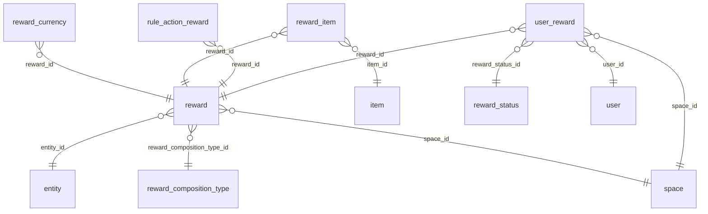

# DB Rewards

Rewards, their composition and items, and user rewards.

Part of [[DB Current State]]. Generated from: script file dev-06-10-2026-Schema-Only.sql, as of 2026-10-14T16:39:38. Tables: 6. Purposes are inferred from names and are **not verified**. Do not hand-edit: the next refresh overwrites this note.

## Relationships

## Tables

### reward

PK: `id`. Columns: 19.

| Column | Type | Null | Notes |
|---|---|---|---|
| id | int | no | PK, identity |
| reward_composition_type_id | int | no | FK to reward_composition_type |
| name_key | char(36) | no |  |
| description_key | char(36) | yes |  |
| space_id | int | no | FK to space |
| entity_id | int | yes | FK to entity |
| max_total_claims | int | yes |  |
| max_claims_per_user | int | yes |  |
| cooldown_seconds | int | yes |  |
| claim_required | bit | no |  |
| is_active | bit | no |  |
| valid_from | datetime2(7) | yes |  |
| valid_to | datetime2(7) | yes |  |
| is_deleted | bit | no |  |
| modified_time | datetime2(7) | no |  |
| modified_by | varchar(36) | no |  |
| created_by | varchar(36) | no |  |
| created_time | datetime2(7) | no |  |
| status | varchar(20) | no |  |

References: entity_id to [[DB Spaces and Access#entity|entity]].id; reward_composition_type_id to [[DB Rewards#reward_composition_type|reward_composition_type]].id; space_id to [[DB Spaces and Access#space|space]].id

Referenced by: [[DB Rewards#reward_currency|reward_currency]] (reward_id), [[DB Rewards#reward_item|reward_item]] (reward_id), [[DB Rules Engine#rule_action_reward|rule_action_reward]] (reward_id), [[DB Rewards#user_reward|user_reward]] (reward_id)

### reward_composition_type

PK: `id`. Columns: 5.

| Column | Type | Null | Notes |
|---|---|---|---|
| id | int | no | PK, identity |
| type | varchar(64) | no |  |
| is_deleted | bit | no |  |
| modified_time | datetime2(7) | no |  |
| modified_by | varchar(36) | no |  |

Referenced by: [[DB Rewards#reward|reward]] (reward_composition_type_id)

### reward_currency

PK: `id`. Columns: 7.

| Column | Type | Null | Notes |
|---|---|---|---|
| id | int | no | PK, identity |
| reward_id | int | no | FK to reward |
| currency_id | int | no |  |
| amount | bigint | no |  |
| is_deleted | bit | no |  |
| modified_time | datetime2(7) | no |  |
| modified_by | varchar(36) | no |  |

References: reward_id to [[DB Rewards#reward|reward]].id

### reward_item

PK: `id`. Columns: 7.

| Column | Type | Null | Notes |
|---|---|---|---|
| id | int | no | PK, identity |
| reward_id | int | no | FK to reward |
| item_id | int | no | FK to item |
| quantity | int | no |  |
| is_deleted | bit | no |  |
| modified_time | datetime2(7) | no |  |
| modified_by | varchar(36) | no |  |

References: item_id to [[DB Shop Items and Orders#item|item]].id; reward_id to [[DB Rewards#reward|reward]].id

### reward_status

PK: `id`. Columns: 5.

| Column | Type | Null | Notes |
|---|---|---|---|
| id | int | no | PK, identity |
| status | varchar(64) | no |  |
| is_deleted | bit | no |  |
| modified_time | datetime2(7) | no |  |
| modified_by | varchar(36) | no |  |

Referenced by: [[DB Rewards#user_reward|user_reward]] (reward_status_id)

### user_reward

PK: `id`. Columns: 13.

| Column | Type | Null | Notes |
|---|---|---|---|
| id | int | no | PK, identity |
| user_id | uniqueidentifier | no | FK to user |
| reward_id | int | no | FK to reward |
| space_id | int | no | FK to space |
| reward_status_id | int | no | FK to reward_status |
| grant_source | varchar(50) | yes |  |
| source_event_id | int | yes |  |
| idempotency_key | char(36) | no |  |
| claimed_at | datetime2(7) | no |  |
| expired_at | datetime2(7) | yes |  |
| is_deleted | bit | no |  |
| modified_time | datetime2(7) | no |  |
| modified_by | varchar(36) | no |  |

References: reward_id to [[DB Rewards#reward|reward]].id; reward_status_id to [[DB Rewards#reward_status|reward_status]].id; space_id to [[DB Spaces and Access#space|space]].id; user_id to [[DB Users and Auth#user|user]].id

## Stored procedures (0)

Grouped by the first table each procedure writes (or reads if it writes none). Table lists come from the SQL text and miss dynamic SQL. SQL text: `05-Database/Procedures/<name>.sql`. Logic column: ok (summary matches current SQL), STALE (SQL changed since the summary), missing (no summary yet).

