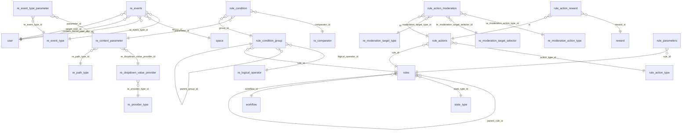

# DB Rules Engine

Rule authoring: rules, conditions, actions, parameters, event types and moderation actions (re_* and rule_* tables).

Part of [[DB Current State]]. Generated from: script file dev-06-10-2026-Schema-Only.sql, as of 2026-10-14T16:39:38. Tables: 20. Purposes are inferred from names and are **not verified**. Do not hand-edit: the next refresh overwrites this note.

## Relationships

## Tables

### re_comparator

PK: `id`. Columns: 10.

| Column | Type | Null | Notes |
|---|---|---|---|
| id | int | no | PK, identity |
| code | varchar(50) | no |  |
| ui_label | varchar(64) | yes |  |
| supported_types | varchar(64) | no |  |
| engine_format | nvarchar(max) | no |  |
| value_arity | int | no |  |
| case_sensitive | bit | yes |  |
| is_deleted | bit | no |  |
| modified_time | datetime2(7) | no |  |
| modified_by | varchar(36) | no |  |

Referenced by: [[DB Rules Engine#rule_condition|rule_condition]] (comparator_id)

### re_context_parameter

PK: `id`. Columns: 14.

| Column | Type | Null | Notes |
|---|---|---|---|
| id | int | no | PK, identity |
| key | varchar(50) | no |  |
| source | varchar(64) | no |  |
| path | nvarchar(max) | no |  |
| re_path_type_id | int | no | FK to re_path_type |
| data_type | varchar(255) | no |  |
| ui_label | varchar(64) | no |  |
| ui_help_key | char(36) | no |  |
| unit | varchar(50) | yes |  |
| re_dropdown_value_provider_id | int | yes | FK to re_dropdown_value_provider |
| example_value | varchar(50) | yes |  |
| is_deleted | bit | no |  |
| modified_time | datetime2(7) | no |  |
| modified_by | varchar(36) | no |  |

References: re_dropdown_value_provider_id to [[DB Rules Engine#re_dropdown_value_provider|re_dropdown_value_provider]].id; re_path_type_id to [[DB Rules Engine#re_path_type|re_path_type]].id

Referenced by: [[DB Rules Engine#re_event_type_parameter|re_event_type_parameter]] (parameter_id), [[DB Rules Engine#rule_condition|rule_condition]] (parameter_id)

### re_dropdown_value_provider

PK: `id`. Columns: 6.

| Column | Type | Null | Notes |
|---|---|---|---|
| id | int | no | PK, identity |
| re_provider_type_id | int | no | FK to re_provider_type |
| config_json | json | yes |  |
| is_deleted | bit | no |  |
| modified_time | datetime2(7) | no |  |
| modified_by | varchar(36) | no |  |

References: re_provider_type_id to [[DB Rules Engine#re_provider_type|re_provider_type]].id

Referenced by: [[DB Rules Engine#re_context_parameter|re_context_parameter]] (re_dropdown_value_provider_id)

### re_event_type

PK: `id`. Columns: 5.

| Column | Type | Null | Notes |
|---|---|---|---|
| id | int | no | PK, identity |
| name | varchar(50) | no |  |
| is_deleted | bit | no |  |
| modified_time | datetime2(7) | no |  |
| modified_by | varchar(36) | no |  |

Referenced by: [[DB Rules Engine#re_event_type_parameter|re_event_type_parameter]] (re_event_type_id), [[DB Rules Engine#re_events|re_events]] (re_event_type_id)

### re_event_type_parameter

PK: `id`. Columns: 8.

| Column | Type | Null | Notes |
|---|---|---|---|
| id | int | no | PK, identity |
| re_event_type_id | int | no | FK to re_event_type |
| parameter_id | int | no | FK to re_context_parameter |
| is_required | bit | no |  |
| default_value_json | json | yes |  |
| is_deleted | bit | no |  |
| modified_time | datetime2(7) | no |  |
| modified_by | varchar(36) | no |  |

References: parameter_id to [[DB Rules Engine#re_context_parameter|re_context_parameter]].id; re_event_type_id to [[DB Rules Engine#re_event_type|re_event_type]].id

### re_events

PK: `id`. Columns: 13.

| Column | Type | Null | Notes |
|---|---|---|---|
| id | int | no | PK, identity |
| space_id | int | no | FK to space |
| target_user_id | uniqueidentifier | yes | FK to user |
| re_event_type_id | int | no | FK to re_event_type |
| actor_user_id | uniqueidentifier | yes | FK to user |
| content_ref | varchar(255) | yes |  |
| content_owner_user_id | uniqueidentifier | yes | FK to user |
| occurred_at | datetime2(7) | no |  |
| properties_json | nvarchar(max) | yes |  |
| ingested_at | datetime2(7) | no |  |
| is_deleted | bit | no |  |
| modified_time | datetime2(7) | no |  |
| modified_by | varchar(36) | no |  |

References: actor_user_id to [[DB Users and Auth#user|user]].id; content_owner_user_id to [[DB Users and Auth#user|user]].id; re_event_type_id to [[DB Rules Engine#re_event_type|re_event_type]].id; space_id to [[DB Spaces and Access#space|space]].id; target_user_id to [[DB Users and Auth#user|user]].id

### re_logical_operator

PK: `id`. Columns: 7.

| Column | Type | Null | Notes |
|---|---|---|---|
| id | int | no | PK, identity |
| code | varchar(50) | no |  |
| ui_label | varchar(64) | yes |  |
| engine_symbol | char(5) | no |  |
| is_deleted | bit | no |  |
| modified_time | datetime2(7) | no |  |
| modified_by | varchar(36) | no |  |

Referenced by: [[DB Rules Engine#rule_condition_group|rule_condition_group]] (logical_operator_id)

### re_moderation_action_type

PK: `id`. Columns: 5.

| Column | Type | Null | Notes |
|---|---|---|---|
| id | int | no | PK, identity |
| type | varchar(50) | no |  |
| is_deleted | bit | no |  |
| modified_time | datetime2(7) | no |  |
| modified_by | varchar(36) | no |  |

Referenced by: [[DB Rules Engine#rule_action_moderation|rule_action_moderation]] (re_moderation_action_type_id)

### re_moderation_target_selector

PK: `id`. Columns: 5.

| Column | Type | Null | Notes |
|---|---|---|---|
| id | int | no | PK, identity |
| type | varchar(50) | no |  |
| is_deleted | bit | no |  |
| modified_time | datetime2(7) | no |  |
| modified_by | varchar(36) | no |  |

Referenced by: [[DB Rules Engine#rule_action_moderation|rule_action_moderation]] (re_moderation_target_selector_id)

### re_moderation_target_type

PK: `id`. Columns: 5.

| Column | Type | Null | Notes |
|---|---|---|---|
| id | int | no | PK, identity |
| type | varchar(50) | no |  |
| is_deleted | bit | no |  |
| modified_time | datetime2(7) | no |  |
| modified_by | varchar(36) | no |  |

Referenced by: [[DB Rules Engine#rule_action_moderation|rule_action_moderation]] (moderation_target_type_id)

### re_path_type

PK: `id`. Columns: 5.

| Column | Type | Null | Notes |
|---|---|---|---|
| id | int | no | PK, identity |
| code | varchar(50) | no |  |
| is_deleted | bit | no |  |
| modified_time | datetime2(7) | no |  |
| modified_by | varchar(36) | no |  |

Referenced by: [[DB Rules Engine#re_context_parameter|re_context_parameter]] (re_path_type_id)

### re_provider_type

PK: `id`. Columns: 5.

| Column | Type | Null | Notes |
|---|---|---|---|
| id | int | no | PK, identity |
| type | varchar(50) | no |  |
| is_deleted | bit | no |  |
| modified_time | datetime2(7) | no |  |
| modified_by | varchar(36) | no |  |

Referenced by: [[DB Rules Engine#re_dropdown_value_provider|re_dropdown_value_provider]] (re_provider_type_id)

### rule_action_moderation

PK: `id`. Columns: 14.

| Column | Type | Null | Notes |
|---|---|---|---|
| id | int | no | PK, FK to rule_actions |
| re_moderation_action_type_id | int | no | FK to re_moderation_action_type |
| moderation_target_type_id | int | no | FK to re_moderation_target_type |
| re_moderation_target_selector_id | int | no | FK to re_moderation_target_selector |
| content_ref_template | varchar(255) | yes |  |
| duration_seconds | int | yes |  |
| reason_code | varchar(64) | yes |  |
| message_template_key | char(36) | yes |  |
| silent | bit | yes |  |
| auto_escalate | bit | no |  |
| escalate_after_seconds | int | no |  |
| is_deleted | bit | no |  |
| modified_time | datetime2(7) | no |  |
| modified_by | varchar(36) | no |  |

References: moderation_target_type_id to [[DB Rules Engine#re_moderation_target_type|re_moderation_target_type]].id; re_moderation_action_type_id to [[DB Rules Engine#re_moderation_action_type|re_moderation_action_type]].id; re_moderation_target_selector_id to [[DB Rules Engine#re_moderation_target_selector|re_moderation_target_selector]].id; id to [[DB Rules Engine#rule_actions|rule_actions]].id

### rule_action_reward

PK: `id`. Columns: 5.

| Column | Type | Null | Notes |
|---|---|---|---|
| id | int | no | PK, FK to rule_actions |
| reward_id | int | no | FK to reward |
| is_deleted | bit | no |  |
| modified_time | datetime2(7) | no |  |
| modified_by | varchar(36) | no |  |

References: reward_id to [[DB Rewards#reward|reward]].id; id to [[DB Rules Engine#rule_actions|rule_actions]].id

### rule_action_type

PK: `id`. Columns: 6.

| Column | Type | Null | Notes |
|---|---|---|---|
| id | int | no | PK, identity |
| code | int | no |  |
| label | char(36) | no |  |
| is_deleted | bit | no |  |
| modified_time | datetime2(7) | no |  |
| modified_by | varchar(36) | no |  |

Referenced by: [[DB Rules Engine#rule_actions|rule_actions]] (action_type_id)

### rule_actions

PK: `id`. Columns: 12.

| Column | Type | Null | Notes |
|---|---|---|---|
| id | int | no | PK, identity |
| rule_id | int | no | FK to rules |
| action_type_id | int | no | FK to rule_action_type |
| action_name | varchar(64) | no |  |
| action_key | varchar(64) | no |  |
| action_parameters_json | json | no |  |
| action_target_ref | varchar(255) | yes |  |
| order_index | int | no |  |
| is_active | bit | no |  |
| is_deleted | bit | no |  |
| modified_time | datetime2(7) | no |  |
| modified_by | varchar(36) | no |  |

References: action_type_id to [[DB Rules Engine#rule_action_type|rule_action_type]].id; rule_id to [[DB Rules Engine#rules|rules]].id

Referenced by: [[DB Rules Engine#rule_action_moderation|rule_action_moderation]] (id), [[DB Rules Engine#rule_action_reward|rule_action_reward]] (id)

### rule_condition

PK: `id`. Columns: 11.

| Column | Type | Null | Notes |
|---|---|---|---|
| id | int | no | PK, identity |
| group_id | int | no | FK to rule_condition_group |
| parameter_id | int | no | FK to re_context_parameter |
| comparator_id | int | no | FK to re_comparator |
| negate | bit | no |  |
| right_value_kind | varchar(64) | no |  |
| right_value_json | json | yes |  |
| order_index | int | no |  |
| is_deleted | bit | no |  |
| modified_time | datetime2(7) | no |  |
| modified_by | varchar(36) | no |  |

References: comparator_id to [[DB Rules Engine#re_comparator|re_comparator]].id; group_id to [[DB Rules Engine#rule_condition_group|rule_condition_group]].id; parameter_id to [[DB Rules Engine#re_context_parameter|re_context_parameter]].id

### rule_condition_group

PK: `id`. Columns: 10.

| Column | Type | Null | Notes |
|---|---|---|---|
| id | int | no | PK, identity |
| rule_id | int | no | FK to rules |
| parent_group_id | int | yes | FK to rule_condition_group |
| logical_operator_id | int | no | FK to re_logical_operator |
| order_index | int | no |  |
| name_key | char(36) | yes |  |
| description_key | char(36) | yes |  |
| is_deleted | bit | no |  |
| modified_time | datetime2(7) | no |  |
| modified_by | varchar(36) | no |  |

References: logical_operator_id to [[DB Rules Engine#re_logical_operator|re_logical_operator]].id; parent_group_id to [[DB Rules Engine#rule_condition_group|rule_condition_group]].id; rule_id to [[DB Rules Engine#rules|rules]].id

Referenced by: [[DB Rules Engine#rule_condition|rule_condition]] (group_id), [[DB Rules Engine#rule_condition_group|rule_condition_group]] (parent_group_id)

### rule_parameters

PK: `id`. Columns: 7.

| Column | Type | Null | Notes |
|---|---|---|---|
| id | int | no | PK, identity |
| rule_id | int | no | FK to rules |
| name | varchar(64) | no |  |
| value_json | nvarchar(max) | no |  |
| is_deleted | bit | no |  |
| modified_time | datetime2(7) | no |  |
| modified_by | varchar(36) | no |  |

References: rule_id to [[DB Rules Engine#rules|rules]].id

### rules

PK: `id`. Columns: 17.

| Column | Type | Null | Notes |
|---|---|---|---|
| id | int | no | PK, identity |
| workflow_id | int | no | FK to workflow |
| rule_name | varchar(255) | no |  |
| expression | nvarchar(max) | no |  |
| target_type | varchar(64) | yes |  |
| version | int | yes |  |
| parent_rule_id | int | yes | FK to rules |
| success_event | varchar(64) | yes |  |
| priority | int | no |  |
| rule_cooldown_seconds | int | no |  |
| state_type_id | int | no | FK to state_type |
| is_deleted | bit | no |  |
| modified_time | datetime2(7) | no |  |
| modified_by | varchar(36) | no |  |
| created_by | varchar(36) | no |  |
| created_time | datetime2(7) | no |  |
| status | varchar(20) | no |  |

References: parent_rule_id to [[DB Rules Engine#rules|rules]].id; state_type_id to [[DB Spaces and Access#state_type|state_type]].id; workflow_id to [[DB Content Media and Approval#workflow|workflow]].id

Referenced by: [[DB Rules Engine#rule_actions|rule_actions]] (rule_id), [[DB Rules Engine#rule_condition_group|rule_condition_group]] (rule_id), [[DB Rules Engine#rule_parameters|rule_parameters]] (rule_id), [[DB Rules Engine#rules|rules]] (parent_rule_id)

## Stored procedures (0)

Grouped by the first table each procedure writes (or reads if it writes none). Table lists come from the SQL text and miss dynamic SQL. SQL text: `05-Database/Procedures/<name>.sql`. Logic column: ok (summary matches current SQL), STALE (SQL changed since the summary), missing (no summary yet).

