# DB Shop Items and Orders

Items, prices, discounts, shop, packages, merchandise, tickets, orders, inventory, entitlements, currencies and free trial.

Part of [[DB Current State]]. Generated from: script file dev-06-10-2026-Schema-Only.sql, as of 2026-10-14T16:39:38. Tables: 29. Purposes are inferred from names and are **not verified**. Do not hand-edit: the next refresh overwrites this note.

## Relationships

```mermaid
erDiagram
  "avatar" }o--|| "item" : "id"
  "badge" }o--|| "item" : "id"
  "charity_campaigns" }o--|| "currency" : "currency_id"
  "discounts" }o--|| "discount_type" : "discount_type_id"
  "entitlement" }o--|| "entitlement_status" : "status_id"
  "entitlement" }o--|| "order_line_item" : "order_line_item_id"
  "entitlement" }o--|| "user" : "user_id"
  "entity" }o--|| "currency" : "currency_id"
  "free_trial_items" }o--|| "item" : "item_id"
  "free_trial_items" }o--|| "package" : "package_id"
  "free_trial_items" }o--|| "space" : "space_id"
  "free_trial_settings" }o--|| "space" : "space_id"
  "game_announcement_prize_pack" }o--|| "item" : "item_id"
  "game_announcement_user_prize" }o--|| "item" : "item_id"
  "game_announcement_winner" }o--|| "orders" : "granted_order_id"
  "invoice" }o--|| "currency" : "currency_id"
  "invoice" }o--|| "orders" : "order_id"
  "invoice_line_item" }o--|| "currency" : "currency_id"
  "invoice_line_item" }o--|| "item_type" : "item_type_id"
  "item" }o--|| "entity" : "entity_id"
  "item" }o--|| "item_type" : "item_type_id"
  "item" }o--|| "space" : "space_id"
  "item_discounts" }o--|| "discounts" : "discount_id"
  "item_discounts" }o--|| "item" : "item_id"
  "item_discounts" }o--|| "region" : "region_id"
  "item_prices" }o--|| "currency" : "currency_id"
  "item_prices" }o--|| "item" : "item_id"
  "merchandise" }o--|| "item" : "id"
  "merchandise" }o--|| "media" : "thumbnail_media_id"
  "merchandise" }o--|| "merchandise_category" : "merchandise_category_id"
  "merchandise" }o--|| "merchandise_type" : "merchandise_type_id"
  "order_adjustment" }o--|| "order_adjustment_type" : "adjustment_type_id"
  "order_adjustment" }o--|| "order_line_item" : "order_line_item_id"
  "order_adjustment" }o--|| "orders" : "order_id"
  "order_line_item" }o--|| "item_type" : "item_type_id"
  "order_line_item" }o--|| "orders" : "order_id"
  "order_line_item" }o--|| "shop" : "shop_id"
  "orders" }o--|| "currency" : "currency_id"
  "orders" }o--|| "order_status" : "status_id"
  "orders" }o--|| "payment_gateway" : "gateway_preferred_id"
  "orders" }o--|| "space" : "space_id"
  "orders" }o--|| "transaction_type" : "transaction_type_id"
  "orders" }o--|| "user" : "user_id"
  "package" }o--|| "media" : "thumbnail_media_id"
  "package" }o--|| "tax_category" : "tax_category_id"
  "package_item" }o--|| "item" : "item_id"
  "package_item" }o--|| "package" : "package_id"
  "payment_charge" }o--|| "currency" : "currency_id"
  "payment_charge" }o--|| "currency" : "merchant_net_currency_id"
  "payment_destination" }o--|| "currency" : "currency_id"
  "payment_dispute" }o--|| "currency" : "currency_id"
  "payment_gateway_config_currency" }o--|| "currency" : "currency_id"
  "payment_intent" }o--|| "currency" : "currency_id"
  "payment_intent" }o--|| "orders" : "order_id"
  "payment_refund" }o--|| "currency" : "currency_id"
  "regional_currency" }o--|| "region" : "region_id"
  "reward_item" }o--|| "item" : "item_id"
  "shop" }o--|| "entity" : "entity_id"
  "shop" }o--|| "platform_type" : "platform_type_id"
  "shop" }o--|| "space" : "space_id"
  "shop_items" }o--|| "currency" : "currency_id"
  "shop_items" }o--|| "item" : "item_id"
  "shop_items" }o--|| "shop" : "shop_id"
  "space" }o--|| "currency" : "currency_id"
  "ticket" }o--|| "event" : "event_id"
  "ticket" }o--|| "item" : "id"
  "ticket" }o--|| "ticket_type" : "ticket_type_id"
  "user_free_trial_grant_item" }o--|| "item" : "item_id"
  "user_free_trial_grant_item" }o--|| "orders" : "order_id"
  "user_free_trial_grant_item" }o--|| "package" : "package_id"
  "user_free_trial_grant_item" }o--|| "space" : "space_id"
```

## Tables

### currency

PK: `id`. Columns: 9.

| Column | Type | Null | Notes |
|---|---|---|---|
| id | int | no | PK, identity |
| name | varchar(64) | no |  |
| ISO | varchar(5) | no |  |
| delimiter | char(1) | no |  |
| symbol | char(5) | yes |  |
| is_deleted | bit | no |  |
| modified_time | datetime2(7) | no |  |
| modified_by | varchar(36) | no |  |
| decimal_places | tinyint | no |  |

Referenced by: [[DB Ads Campaigns and Charity#charity_campaigns|charity_campaigns]] (currency_id), [[DB Spaces and Access#entity|entity]] (currency_id), [[DB Payments#invoice|invoice]] (currency_id), [[DB Payments#invoice_line_item|invoice_line_item]] (currency_id), [[DB Shop Items and Orders#item_prices|item_prices]] (currency_id), [[DB Shop Items and Orders#orders|orders]] (currency_id), [[DB Payments#payment_charge|payment_charge]] (currency_id), [[DB Payments#payment_charge|payment_charge]] (merchant_net_currency_id), [[DB Payments#payment_destination|payment_destination]] (currency_id), [[DB Payments#payment_dispute|payment_dispute]] (currency_id), [[DB Payments#payment_gateway_config_currency|payment_gateway_config_currency]] (currency_id), [[DB Payments#payment_intent|payment_intent]] (currency_id), [[DB Payments#payment_refund|payment_refund]] (currency_id), [[DB Shop Items and Orders#shop_items|shop_items]] (currency_id), [[DB Spaces and Access#space|space]] (currency_id)

### discount_type

PK: `id`. Columns: 5.

| Column | Type | Null | Notes |
|---|---|---|---|
| id | int | no | PK, identity |
| type | varchar(64) | no |  |
| is_deleted | bit | no |  |
| modified_time | datetime2(7) | no |  |
| modified_by | varchar(36) | no |  |

Referenced by: [[DB Shop Items and Orders#discounts|discounts]] (discount_type_id)

### discounts

PK: `id`. Columns: 15.

| Column | Type | Null | Notes |
|---|---|---|---|
| id | int | no | PK, identity |
| discount_type_id | int | no | FK to discount_type |
| name_key | char(36) | no |  |
| start_at | date | yes |  |
| end_at | date | yes |  |
| metadata | json | yes |  |
| is_deleted | bit | no |  |
| modified_time | datetime2(7) | no |  |
| modified_by | varchar(36) | no |  |
| space_id | int | no |  |
| rate_pct | decimal(5,2) | yes |  |
| amount | bigint | yes |  |
| created_time | datetime2(7) | no |  |
| created_by | varchar(100) | no |  |
| status | varchar(20) | no |  |

References: discount_type_id to [[DB Shop Items and Orders#discount_type|discount_type]].id

Referenced by: [[DB Shop Items and Orders#item_discounts|item_discounts]] (discount_id)

### entitlement

PK: `id`. Columns: 11.

| Column | Type | Null | Notes |
|---|---|---|---|
| id | uniqueidentifier | no | PK |
| order_line_item_id | uniqueidentifier | no | FK to order_line_item |
| user_id | uniqueidentifier | no | FK to user |
| status_id | int | no | FK to entitlement_status |
| quantity | int | no |  |
| granted_datetime | datetime2(7) | yes |  |
| revoked_reason | varchar(128) | yes |  |
| metadata | nvarchar(max) | yes |  |
| is_deleted | bit | no |  |
| modified_time | datetime2(7) | no |  |
| modified_by | varchar(36) | no |  |

References: order_line_item_id to [[DB Shop Items and Orders#order_line_item|order_line_item]].id; status_id to [[DB Shop Items and Orders#entitlement_status|entitlement_status]].id; user_id to [[DB Users and Auth#user|user]].id

### entitlement_status

PK: `id`. Columns: 5.

| Column | Type | Null | Notes |
|---|---|---|---|
| id | int | no | PK, identity |
| status | varchar(64) | no |  |
| is_deleted | bit | no |  |
| modified_time | datetime2(7) | no |  |
| modified_by | varchar(36) | no |  |

Referenced by: [[DB Shop Items and Orders#entitlement|entitlement]] (status_id)

### free_trial_items

PK: `id`. Columns: 10.

| Column | Type | Null | Notes |
|---|---|---|---|
| id | int | no | PK, identity |
| space_id | int | no | FK to space |
| item_id | int | yes | FK to item |
| status | varchar(20) | no |  |
| is_deleted | bit | no |  |
| created_time | datetime2(7) | no |  |
| created_by | varchar(200) | no |  |
| modified_time | datetime2(7) | no |  |
| modified_by | varchar(200) | no |  |
| package_id | int | yes | FK to package |

References: item_id to [[DB Shop Items and Orders#item|item]].id; package_id to [[DB Shop Items and Orders#package|package]].id; space_id to [[DB Spaces and Access#space|space]].id

### free_trial_settings

PK: `id`. Columns: 11.

| Column | Type | Null | Notes |
|---|---|---|---|
| id | int | no | PK, identity |
| space_id | int | no | FK to space |
| start_at | date | no |  |
| end_at | date | no |  |
| is_enabled | bit | no |  |
| status | varchar(20) | no |  |
| is_deleted | bit | no |  |
| created_time | datetime2(7) | no |  |
| created_by | varchar(200) | no |  |
| modified_time | datetime2(7) | no |  |
| modified_by | varchar(200) | no |  |

References: space_id to [[DB Spaces and Access#space|space]].id

### item

PK: `id`. Columns: 16.

| Column | Type | Null | Notes |
|---|---|---|---|
| id | int | no | PK, identity |
| item_type_id | int | no | FK to item_type |
| entity_id | int | yes | FK to entity |
| space_id | int | no | FK to space |
| name_key | char(36) | no |  |
| description_key | char(36) | yes |  |
| is_available | bit | no |  |
| is_deleted | bit | no |  |
| modified_time | datetime2(7) | no |  |
| modified_by | varchar(36) | no |  |
| tax_category_id | int | yes |  |
| tax_is_inclusive | bit | yes |  |
| created_by | varchar(36) | no |  |
| created_time | datetime2(7) | no |  |
| status | varchar(20) | no |  |
| is_price_only | bit | no |  |

References: entity_id to [[DB Spaces and Access#entity|entity]].id; item_type_id to [[DB Shop Items and Orders#item_type|item_type]].id; space_id to [[DB Spaces and Access#space|space]].id

Referenced by: [[DB Users and Auth#avatar|avatar]] (id), [[DB Users and Auth#badge|badge]] (id), [[DB Shop Items and Orders#free_trial_items|free_trial_items]] (item_id), [[DB Games and Leaderboards#game_announcement_prize_pack|game_announcement_prize_pack]] (item_id), [[DB Games and Leaderboards#game_announcement_user_prize|game_announcement_user_prize]] (item_id), [[DB Shop Items and Orders#item_discounts|item_discounts]] (item_id), [[DB Shop Items and Orders#item_prices|item_prices]] (item_id), [[DB Shop Items and Orders#merchandise|merchandise]] (id), [[DB Shop Items and Orders#package_item|package_item]] (item_id), [[DB Rewards#reward_item|reward_item]] (item_id), [[DB Shop Items and Orders#shop_items|shop_items]] (item_id), [[DB Shop Items and Orders#ticket|ticket]] (id), [[DB Shop Items and Orders#user_free_trial_grant_item|user_free_trial_grant_item]] (item_id)

### item_discounts

PK: `id`. Columns: 9.

| Column | Type | Null | Notes |
|---|---|---|---|
| id | int | no | PK, identity |
| item_id | int | no | FK to item |
| discount_id | int | no | FK to discounts |
| region_id | int | yes | FK to region |
| is_deleted | bit | no |  |
| modified_time | datetime2(7) | no |  |
| modified_by | varchar(36) | no |  |
| created_time | datetime2(7) | no |  |
| created_by | varchar(100) | no |  |

References: discount_id to [[DB Shop Items and Orders#discounts|discounts]].id; item_id to [[DB Shop Items and Orders#item|item]].id; region_id to [[DB Spaces and Access#region|region]].id

### item_prices

PK: `id`. Columns: 7.

| Column | Type | Null | Notes |
|---|---|---|---|
| id | int | no | PK, identity |
| item_id | int | no | FK to item |
| base_cost | bigint | no |  |
| is_deleted | bit | no |  |
| modified_time | datetime2(7) | no |  |
| modified_by | varchar(36) | no |  |
| currency_id | int | no | FK to currency |

References: item_id to [[DB Shop Items and Orders#item|item]].id; currency_id to [[DB Shop Items and Orders#currency|currency]].id

### item_type

PK: `id`. Columns: 5.

| Column | Type | Null | Notes |
|---|---|---|---|
| id | int | no | PK, identity |
| type | varchar(64) | no |  |
| is_deleted | bit | no |  |
| modified_time | datetime2(7) | no |  |
| modified_by | varchar(36) | no |  |

Referenced by: [[DB Payments#invoice_line_item|invoice_line_item]] (item_type_id), [[DB Shop Items and Orders#item|item]] (item_type_id), [[DB Shop Items and Orders#order_line_item|order_line_item]] (item_type_id)

### merchandise

PK: `id`. Columns: 8.

| Column | Type | Null | Notes |
|---|---|---|---|
| id | int | no | PK, FK to item |
| merchandise_type_id | int | no | FK to merchandise_type |
| merchandise_category_id | int | yes | FK to merchandise_category |
| asset_url | varchar(255) | no |  |
| thumbnail_media_id | bigint | no | FK to media |
| is_deleted | bit | no |  |
| modified_time | datetime2(7) | no |  |
| modified_by | varchar(36) | no |  |

References: merchandise_type_id to [[DB Shop Items and Orders#merchandise_type|merchandise_type]].id; merchandise_category_id to [[DB Shop Items and Orders#merchandise_category|merchandise_category]].id; thumbnail_media_id to [[DB Content Media and Approval#media|media]].id; id to [[DB Shop Items and Orders#item|item]].id

### merchandise_category

PK: `id`. Columns: 5.

| Column | Type | Null | Notes |
|---|---|---|---|
| id | int | no | PK, identity |
| category | varchar(64) | no |  |
| is_deleted | bit | no |  |
| modified_time | datetime2(7) | no |  |
| modified_by | varchar(36) | no |  |

Referenced by: [[DB Shop Items and Orders#merchandise|merchandise]] (merchandise_category_id)

### merchandise_type

PK: `id`. Columns: 7.

| Column | Type | Null | Notes |
|---|---|---|---|
| id | int | no | PK, identity |
| type | varchar(64) | no |  |
| is_deleted | bit | no |  |
| modified_time | datetime2(7) | no |  |
| modified_by | varchar(36) | no |  |
| position | varchar(50) | yes |  |
| interaction | varchar(50) | yes |  |

Referenced by: [[DB Shop Items and Orders#merchandise|merchandise]] (merchandise_type_id)

### order_adjustment

PK: `id`. Columns: 14.

| Column | Type | Null | Notes |
|---|---|---|---|
| id | uniqueidentifier | no | PK |
| order_id | uniqueidentifier | no | FK to orders |
| order_line_item_id | uniqueidentifier | yes | FK to order_line_item |
| adjustment_type_id | smallint | no | FK to order_adjustment_type |
| code | varchar(64) | yes |  |
| amount | bigint | no |  |
| description_key | varchar(255) | yes |  |
| metadata | nvarchar(max) | yes |  |
| is_deleted | bit | no |  |
| modified_time | datetime2(7) | no |  |
| modified_by | varchar(36) | no |  |
| tax_category_id | int | yes |  |
| created_by | varchar(36) | no |  |
| created_time | datetime2(7) | no |  |

References: adjustment_type_id to [[DB Shop Items and Orders#order_adjustment_type|order_adjustment_type]].id; order_id to [[DB Shop Items and Orders#orders|orders]].id; order_line_item_id to [[DB Shop Items and Orders#order_line_item|order_line_item]].id

### order_adjustment_type

PK: `id`. Columns: 5.

| Column | Type | Null | Notes |
|---|---|---|---|
| id | smallint | no | PK, identity |
| type | varchar(50) | no |  |
| is_deleted | bit | no |  |
| modified_time | datetime2(7) | no |  |
| modified_by | varchar(36) | no |  |

Referenced by: [[DB Shop Items and Orders#order_adjustment|order_adjustment]] (adjustment_type_id)

### order_line_item

PK: `id`. Columns: 14.

| Column | Type | Null | Notes |
|---|---|---|---|
| id | uniqueidentifier | no | PK |
| order_id | uniqueidentifier | no | FK to orders |
| item_type_id | int | no | FK to item_type |
| item_ref_id | char(36) | no |  |
| shop_id | int | yes | FK to shop |
| quantity | int | no |  |
| unit_amount | bigint | no |  |
| metadata | nvarchar(max) | yes |  |
| is_deleted | bit | no |  |
| modified_time | datetime2(7) | no |  |
| modified_by | varchar(36) | no |  |
| created_by | varchar(36) | no |  |
| created_time | datetime2(7) | no |  |
| package_id | int | yes |  |

References: item_type_id to [[DB Shop Items and Orders#item_type|item_type]].id; order_id to [[DB Shop Items and Orders#orders|orders]].id; shop_id to [[DB Shop Items and Orders#shop|shop]].id

Referenced by: [[DB Shop Items and Orders#entitlement|entitlement]] (order_line_item_id), [[DB Shop Items and Orders#order_adjustment|order_adjustment]] (order_line_item_id)

### order_status

PK: `id`. Columns: 5.

| Column | Type | Null | Notes |
|---|---|---|---|
| id | int | no | PK, identity |
| status | varchar(64) | no |  |
| is_deleted | bit | no |  |
| modified_time | datetime2(7) | no |  |
| modified_by | varchar(36) | no |  |

Referenced by: [[DB Shop Items and Orders#orders|orders]] (status_id)

### orders

PK: `id`. Columns: 23.

| Column | Type | Null | Notes |
|---|---|---|---|
| id | uniqueidentifier | no | PK |
| user_id | uniqueidentifier | no | FK to user |
| space_id | int | no | FK to space |
| transaction_type_id | int | no | FK to transaction_type |
| currency_id | int | no | FK to currency |
| status_id | int | no | FK to order_status |
| total_gross_amount | bigint | no |  |
| total_discount_amount | bigint | no |  |
| change_reason | varchar(255) | yes |  |
| total_tax_amount | bigint | no |  |
| total_fee_amount | bigint | no |  |
| total_net_amount | bigint | no |  |
| original_order_id | char(36) | yes |  |
| session_id | char(36) | no |  |
| gateway_preferred_id | int | yes | FK to payment_gateway |
| order_datetime | datetime2(7) | no |  |
| remarks | varchar(255) | yes |  |
| idempotency_key | varchar(64) | yes |  |
| is_deleted | bit | no |  |
| modified_time | datetime2(7) | no |  |
| modified_by | varchar(36) | no |  |
| created_by | varchar(36) | no |  |
| created_time | datetime2(7) | no |  |

References: currency_id to [[DB Shop Items and Orders#currency|currency]].id; gateway_preferred_id to [[DB Payments#payment_gateway|payment_gateway]].id; space_id to [[DB Spaces and Access#space|space]].id; status_id to [[DB Shop Items and Orders#order_status|order_status]].id; transaction_type_id to [[DB Payments#transaction_type|transaction_type]].id; user_id to [[DB Users and Auth#user|user]].id

Referenced by: [[DB Games and Leaderboards#game_announcement_winner|game_announcement_winner]] (granted_order_id), [[DB Payments#invoice|invoice]] (order_id), [[DB Shop Items and Orders#order_adjustment|order_adjustment]] (order_id), [[DB Shop Items and Orders#order_line_item|order_line_item]] (order_id), [[DB Payments#payment_intent|payment_intent]] (order_id), [[DB Shop Items and Orders#user_free_trial_grant_item|user_free_trial_grant_item]] (order_id)

### package

PK: `id`. Columns: 14.

| Column | Type | Null | Notes |
|---|---|---|---|
| id | int | no | PK, identity |
| space_id | int | no |  |
| name_key | uniqueidentifier | no |  |
| description_key | uniqueidentifier | yes |  |
| thumbnail_media_id | bigint | no | FK to media |
| base_cost | bigint | no |  |
| currency_id | int | no |  |
| tax_category_id | int | yes | FK to tax_category |
| tax_is_inclusive | bit | yes |  |
| is_available | bit | no |  |
| status | varchar(20) | no |  |
| is_deleted | bit | no |  |
| modified_time | datetime2(7) | no |  |
| modified_by | varchar(36) | no |  |

References: thumbnail_media_id to [[DB Content Media and Approval#media|media]].id; tax_category_id to [[DB Shop Items and Orders#tax_category|tax_category]].id

Referenced by: [[DB Shop Items and Orders#free_trial_items|free_trial_items]] (package_id), [[DB Shop Items and Orders#package_item|package_item]] (package_id), [[DB Shop Items and Orders#user_free_trial_grant_item|user_free_trial_grant_item]] (package_id)

### package_item

PK: `id`. Columns: 8.

| Column | Type | Null | Notes |
|---|---|---|---|
| id | int | no | PK, identity |
| package_id | int | no | FK to package |
| item_id | int | no | FK to item |
| quantity | int | no |  |
| status | varchar(20) | no |  |
| is_deleted | bit | no |  |
| modified_time | datetime2(7) | no |  |
| modified_by | varchar(36) | no |  |

References: item_id to [[DB Shop Items and Orders#item|item]].id; package_id to [[DB Shop Items and Orders#package|package]].id

### regional_currency

PK: `id`. Columns: 6.

| Column | Type | Null | Notes |
|---|---|---|---|
| id | int | no | PK, identity |
| region_id | int | no | FK to region |
| currency_id | int | no |  |
| is_deleted | bit | no |  |
| modified_time | datetime2(7) | no |  |
| modified_by | varchar(36) | no |  |

References: region_id to [[DB Spaces and Access#region|region]].id

### shop

PK: `id`. Columns: 9.

| Column | Type | Null | Notes |
|---|---|---|---|
| id | int | no | PK, identity |
| platform_type_id | int | no | FK to platform_type |
| space_id | int | yes | FK to space |
| entity_id | int | yes | FK to entity |
| name_key | char(36) | no |  |
| is_deleted | bit | no |  |
| modified_time | datetime2(7) | no |  |
| modified_by | varchar(36) | no |  |
| created_by | varchar(36) | no |  |

References: entity_id to [[DB Spaces and Access#entity|entity]].id; platform_type_id to [[DB Spaces and Access#platform_type|platform_type]].id; space_id to [[DB Spaces and Access#space|space]].id

Referenced by: [[DB Shop Items and Orders#order_line_item|order_line_item]] (shop_id), [[DB Shop Items and Orders#shop_items|shop_items]] (shop_id)

### shop_items

PK: `id`. Columns: 9.

| Column | Type | Null | Notes |
|---|---|---|---|
| id | int | no | PK, identity |
| shop_id | int | no | FK to shop |
| item_id | int | no | FK to item |
| amount | bigint | yes |  |
| stock_quantity | int | yes |  |
| is_deleted | bit | no |  |
| modified_time | datetime2(7) | no |  |
| modified_by | varchar(36) | no |  |
| currency_id | int | no | FK to currency |

References: item_id to [[DB Shop Items and Orders#item|item]].id; shop_id to [[DB Shop Items and Orders#shop|shop]].id; currency_id to [[DB Shop Items and Orders#currency|currency]].id

### tax_category

PK: `id`. Columns: 7.

| Column | Type | Null | Notes |
|---|---|---|---|
| id | int | no | PK, identity |
| space_id | int | no |  |
| name | varchar(100) | no |  |
| rate_pct | decimal(5,2) | no |  |
| is_deleted | bit | no |  |
| modified_time | datetime2(7) | no |  |
| modified_by | varchar(200) | no |  |

Referenced by: [[DB Shop Items and Orders#package|package]] (tax_category_id)

### ticket

PK: `id`. Columns: 12.

| Column | Type | Null | Notes |
|---|---|---|---|
| id | int | no | PK, FK to item |
| event_id | int | no | FK to event |
| ticket_type_id | int | no | FK to ticket_type |
| seat | varchar(10) | yes |  |
| section | varchar(50) | yes |  |
| valid_from | datetime2(7) | no |  |
| valid_to | datetime2(7) | no |  |
| is_transferable | bit | no |  |
| is_deleted | bit | no |  |
| modified_time | datetime2(7) | no |  |
| modified_by | varchar(36) | no |  |
| thumbnail_media_id | bigint | yes |  |

References: event_id to [[DB Events#event|event]].id; id to [[DB Shop Items and Orders#item|item]].id; ticket_type_id to [[DB Shop Items and Orders#ticket_type|ticket_type]].id

### ticket_type

PK: `id`. Columns: 5.

| Column | Type | Null | Notes |
|---|---|---|---|
| id | int | no | PK, identity |
| type | varchar(64) | no |  |
| is_deleted | bit | no |  |
| modified_time | datetime2(7) | no |  |
| modified_by | varchar(36) | no |  |

Referenced by: [[DB Shop Items and Orders#ticket|ticket]] (ticket_type_id)

### user_free_trial_grant_item

PK: `id`. Columns: 11.

| Column | Type | Null | Notes |
|---|---|---|---|
| id | uniqueidentifier | no | PK |
| user_id | varchar(36) | no |  |
| item_id | int | yes | FK to item |
| space_id | int | no | FK to space |
| order_id | uniqueidentifier | no | FK to orders |
| quantity | int | no |  |
| claimed_at | datetime2(7) | no |  |
| is_deleted | bit | no |  |
| modified_time | datetime2(7) | no |  |
| modified_by | varchar(200) | no |  |
| package_id | int | yes | FK to package |

References: item_id to [[DB Shop Items and Orders#item|item]].id; order_id to [[DB Shop Items and Orders#orders|orders]].id; package_id to [[DB Shop Items and Orders#package|package]].id; space_id to [[DB Spaces and Access#space|space]].id

### user_inventory

PK: `id`. Columns: 8.

| Column | Type | Null | Notes |
|---|---|---|---|
| id | uniqueidentifier | no | PK |
| user_id | varchar(36) | no |  |
| item_id | int | no |  |
| quantity | int | no |  |
| is_deleted | bit | no |  |
| modified_time | datetime2(7) | no |  |
| modified_by | varchar(200) | no |  |
| item_type_id | int | no |  |

## Stored procedures (143)

Grouped by the first table each procedure writes (or reads if it writes none). Table lists come from the SQL text and miss dynamic SQL. SQL text: `05-Database/Procedures/<name>.sql`. Logic column: ok (summary matches current SQL), STALE (SQL changed since the summary), missing (no summary yet).

| Procedure | Writes | Reads | Logic |
|---|---|---|---|
| sp_FreeTrialClaims_SelectBySpace |  | free_trial_settings, item, orders, package, transaction_type, user, user_free_trial_grant_item | missing |
| sp_FreeTrialItem_Delete | free_trial_items | package_item, user_free_trial_grant_item | missing |
| sp_FreeTrialItem_DeleteById | free_trial_items, user_free_trial_grant_item | package_item | missing |
| sp_FreeTrialItem_DeleteForPackage | free_trial_items, user_free_trial_grant_item |  | missing |
| sp_FreeTrialItem_ExistsForItem |  | free_trial_items | missing |
| sp_FreeTrialItem_ExistsForPackage |  | free_trial_items | missing |
| sp_FreeTrialItem_GetForUpdate |  | free_trial_items | missing |
| sp_FreeTrialItem_GetPackageIdById |  | free_trial_items | missing |
| sp_FreeTrialItem_Insert | free_trial_items |  | missing |
| sp_FreeTrialItem_SelectBySpace |  | content_approval, free_trial_items | missing |
| sp_FreeTrialItem_SelectBySpace_Unity |  | free_trial_items | missing |
| sp_FreeTrialSetting_ExistsForSpace |  | free_trial_settings | missing |
| sp_FreeTrialSetting_GetForUpdate |  | free_trial_settings | missing |
| sp_FreeTrialSetting_Insert | free_trial_settings |  | missing |
| sp_FreeTrialSetting_SelectBySpace |  | content_approval, free_trial_settings | missing |
| sp_FreeTrialSetting_SelectBySpace_Unity |  | free_trial_settings | missing |
| sp_FreeTrialSetting_Update | free_trial_settings |  | missing |
| sp_ItemCatalog_TrialEligibility_SelectBySpace |  | free_trial_items, free_trial_settings | missing |
| sp_Item_GetTypeId |  | item | missing |
| sp_Item_SelectPickerBySpace |  | avatar, badge, i18n, item, media_localization, merchandise, ticket | missing |
| sp_Item_SelectPrizeOnlyBySpace |  | avatar, badge, i18n, item, media_localization, merchandise, ticket | missing |
| sp_Item_SetPriceOnly | item |  | missing |
| sp_PackageCatalog_TrialEligibility_Get |  | free_trial_items, free_trial_settings | missing |
| sp_PackageCatalog_TrialEligibility_SelectBySpace |  | free_trial_items, free_trial_settings | missing |
| sp_UserFreeTrialGrantItem_ExistsForUserItem |  | user_free_trial_grant_item | missing |
| sp_UserFreeTrialGrantItem_ExistsForUserPackage |  | user_free_trial_grant_item | missing |
| sp_UserFreeTrialGrantItem_Insert | user_free_trial_grant_item |  | missing |
| sp_UserFreeTrialGrantItem_IsLiveForUser |  | free_trial_settings, user_free_trial_grant_item | missing |
| sp_UserFreeTrialGrantItem_IsLiveForUserPackage |  | free_trial_settings, user_free_trial_grant_item | missing |
| sp_UserInventory_ExistsForUserItem |  | user_inventory | missing |
| sp_UserInventory_ExistsForUserPackage |  | user_inventory | missing |
| usp_Currency_Exists |  | currency | missing |
| usp_Currency_Insert | currency |  | missing |
| usp_Currency_SelectIsoById |  | currency | missing |
| usp_Currency_Update | currency |  | missing |
| usp_DiscountType_Exists |  | discount_type | missing |
| usp_Discount_Delete | discounts |  | missing |
| usp_Discount_ExistsInSpace |  | discounts | missing |
| usp_Discount_ExistsNameKey |  | discounts | missing |
| usp_Discount_GetForUpdate |  | discounts | missing |
| usp_Discount_Insert | discounts |  | missing |
| usp_Discount_SelectActiveForItem |  | discounts, item_discounts | missing |
| usp_Discount_SelectById |  | content_approval, discounts, i18n, item_discounts, supported_languages | missing |
| usp_Discount_SelectBySpace |  | content_approval, discounts, i18n, item_discounts, supported_languages | missing |
| usp_Discount_SelectBySpace_Unity |  | discounts, i18n, item_discounts, supported_languages | missing |
| usp_Discount_SoftExpire | discounts, i18n, item_discounts |  | missing |
| usp_Discount_Update | discounts |  | missing |
| usp_Entitlement_Insert | entitlement | order_line_item, orders | missing |
| usp_Entitlement_RevokeByOrder |  | entitlement, order_line_item | missing |
| usp_GetUserInventory |  | avatar, badge, entitlement, entitlement_status, free_trial_settings, game_announcement_winner, i18n, item, item_type, media_localization, merchandise, merchandise_category, merchandise_type, order_line_item, orders, package, ticket, ticket_type, user_free_trial_grant_item, user_inventory | missing |
| usp_Intent_FindLatestOrderWithPending |  | order_line_item, orders, payment_intent | missing |
| usp_Inventory_HasValidEventTicket |  | ticket, user_inventory | missing |
| usp_ItemDiscount_DeleteByItem | item_discounts |  | missing |
| usp_ItemDiscount_Exists |  | discounts | missing |
| usp_ItemDiscount_Insert | item_discounts |  | missing |
| usp_ItemDiscount_Upsert | item_discounts |  | missing |
| usp_ItemPrice_BulkUpdateCurrencyBySpace |  | item, item_prices, shop_items | missing |
| usp_ItemPrice_ExistsForCurrency |  | item_prices | missing |
| usp_ItemPrice_GetCurrencyImpact |  | item, item_prices | missing |
| usp_ItemPrice_Insert | item_prices |  | missing |
| usp_ItemPrice_Select |  | item_prices, shop_items | missing |
| usp_ItemPrice_Upsert | item_prices |  | missing |
| usp_Item_ExistsInSpace |  | item | missing |
| usp_Item_GetDeleteInfo |  | badge, item, merchandise | missing |
| usp_Item_GetSnapshot |  | item | missing |
| usp_Item_Insert | item |  | missing |
| usp_Item_SelectById |  | avatar, badge, content_approval, discounts, event, i18n, item, item_discounts, item_prices, media_localization, merchandise, merchandise_category, merchandise_type, shop_items, supported_languages, tax_category, ticket, ticket_type | missing |
| usp_Item_SelectById_Unity |  | avatar, badge, discounts, event, i18n, item, item_discounts, item_prices, media_localization, merchandise, merchandise_category, merchandise_type, shop_items, supported_languages, tax_category, ticket, ticket_type | missing |
| usp_Item_SelectBySpace |  | avatar, badge, content_approval, discounts, event, i18n, item, item_discounts, item_prices, media_localization, merchandise, merchandise_category, merchandise_type, shop_items, supported_languages, tax_category, ticket, ticket_type | missing |
| usp_Item_SelectBySpace_Unity |  | avatar, badge, discounts, event, i18n, item, item_discounts, item_prices, media_localization, merchandise, merchandise_category, merchandise_type, shop_items, supported_languages, tax_category, ticket, ticket_type | missing |
| usp_Item_SelectCreatedEnvelope |  | item | missing |
| usp_Item_SoftDelete | avatar, badge, free_trial_items, item, item_discounts, item_prices, media, media_localization, merchandise, shop_items, ticket | package_item, user_free_trial_grant_item | missing |
| usp_Item_UpdateBasics | item |  | missing |
| usp_Item_UpdateDescKey | item |  | missing |
| usp_Lookup_Currencies |  | currency | missing |
| usp_Lookup_ItemTypes |  | item_type | missing |
| usp_Lookup_MerchandiseCategories |  | merchandise_category | missing |
| usp_Lookup_MerchandiseTypes |  | merchandise_type | missing |
| usp_Lookup_RegionalCurrencies |  | currency, region, regional_currency | missing |
| usp_Lookup_TicketTypes |  | ticket_type | missing |
| usp_MerchandiseCategory_Insert | merchandise_category |  | missing |
| usp_MerchandiseCategory_SoftDelete | merchandise_category |  | missing |
| usp_MerchandiseCategory_Update | merchandise_category |  | missing |
| usp_MerchandiseType_Insert | merchandise_type |  | missing |
| usp_MerchandiseType_SoftDelete | merchandise_type |  | missing |
| usp_MerchandiseType_Update | merchandise_type |  | missing |
| usp_Merchandise_GetThumb |  | merchandise | missing |
| usp_Merchandise_Insert | merchandise |  | missing |
| usp_Merchandise_Update | merchandise |  | missing |
| usp_Order_ExistsInSpace |  | orders | missing |
| usp_Order_FindExisting |  | orders | missing |
| usp_Order_GetHeader |  | orders | missing |
| usp_Order_GetTotalNet |  | orders | missing |
| usp_Order_Insert | orders |  | missing |
| usp_Order_InsertAdjustment | order_adjustment |  | missing |
| usp_Order_InsertLine | order_line_item | event, shop_items, ticket | missing |
| usp_Order_SelectAdjustments |  | order_adjustment | missing |
| usp_Order_SelectEntitlements |  | entitlement, order_line_item | missing |
| usp_Order_SelectHeader |  | orders | missing |
| usp_Order_SelectLines |  | order_line_item, orders | missing |
| usp_Order_Snapshot |  | order_adjustment, order_line_item, orders | missing |
| usp_Order_UpdatePaidStatus | orders |  | missing |
| usp_Order_UpdateStatus | orders |  | missing |
| usp_PackageItem_Delete | package_item |  | missing |
| usp_PackageItem_DeleteById | package_item |  | missing |
| usp_PackageItem_Insert | package_item | item, package | missing |
| usp_PackageItem_SelectByPackage |  | avatar, badge, i18n, item, item_prices, item_type, media_localization, merchandise, package_item, supported_languages, ticket | missing |
| usp_Package_GetById |  | content_approval, i18n, media_localization, package, supported_languages, tax_category | missing |
| usp_Package_GetForPurchase |  | item, package, package_item, tax_category | missing |
| usp_Package_Insert | package |  | missing |
| usp_Package_SelectBySpace |  | content_approval, i18n, media_localization, package, package_item, supported_languages, tax_category | missing |
| usp_Package_SelectBySpace_Unity |  | i18n, media_localization, package, supported_languages, tax_category | missing |
| usp_Package_SoftDelete | free_trial_items, media, media_localization, package, package_item, user_free_trial_grant_item |  | missing |
| usp_Package_Update | package |  | missing |
| usp_Reconcile_FindCandidates |  | entitlement, invoice, order_line_item, orders, payment_charge, payment_intent | missing |
| usp_ShopItem_Add | shop_items |  | missing |
| usp_ShopItem_CountBySpace |  | shop, shop_items | missing |
| usp_ShopItem_Delete |  | item, shop, shop_items | missing |
| usp_ShopItem_DeleteByItem | shop_items |  | missing |
| usp_ShopItem_ExistsMapping |  | item, shop, shop_items | missing |
| usp_ShopItem_GetItemKeys |  | item, shop, shop_items | missing |
| usp_ShopItem_InsertFromItem | shop_items |  | missing |
| usp_ShopItem_SelectByShop |  | badge, discounts, i18n, item, item_discounts, item_prices, media, media_localization, merchandise, merchandise_category, merchandise_type, shop, shop_items, supported_languages, ticket | missing |
| usp_ShopItem_SelectEnvelope |  | discounts, item, item_discounts, item_prices, shop, shop_items | missing |
| usp_ShopItem_SelectOne |  | badge, discounts, item, item_discounts, item_prices, merchandise, shop_items, ticket | missing |
| usp_ShopItem_Update | shop_items |  | missing |
| usp_ShopItem_UpdateStock | shop_items |  | missing |
| usp_Shop_ExistsInSpace |  | shop | missing |
| usp_Shop_InsertDefault | shop |  | missing |
| usp_Shop_SelectDefaultBySpace |  | shop | missing |
| usp_TaxCategory_ExistsInSpace |  | tax_category | missing |
| usp_TaxCategory_GetById |  | tax_category | missing |
| usp_TaxCategory_Insert | tax_category |  | missing |
| usp_TaxCategory_SelectById |  | tax_category | missing |
| usp_TaxCategory_SelectByItem |  | item, tax_category | missing |
| usp_TaxCategory_SelectBySpace |  | tax_category | missing |
| usp_TaxCategory_SoftDelete | tax_category |  | missing |
| usp_TaxCategory_Update | tax_category |  | missing |
| usp_TicketType_Exists |  | ticket_type | missing |
| usp_Ticket_GetCurrentThumb |  | ticket | missing |
| usp_Ticket_Insert | ticket |  | missing |
| usp_Ticket_Update | ticket |  | missing |
| usp_UserInventory_Upsert | user_inventory | order_line_item, orders | missing |
