# DB Spaces and Access

Spaces (clubs/venues), their config and lighting, members and roles, entities, and global system settings.

Part of [[DB Current State]]. Generated from: script file dev-06-10-2026-Schema-Only.sql, as of 2026-10-14T16:39:38. Tables: 18. Purposes are inferred from names and are **not verified**. Do not hand-edit: the next refresh overwrites this note.

## Relationships

```mermaid
erDiagram
  "ad_3d_model" }o--|| "space" : "space_id"
  "ad_placement" }o--|| "space" : "space_id"
  "advertiser" }o--|| "space" : "space_id"
  "booth" }o--|| "space" : "space_id"
  "booth_comment" }o--|| "space" : "space_id"
  "charity_campaigns" }o--|| "entity" : "entity_id"
  "content_approval" }o--|| "space" : "space_id"
  "entity" }o--|| "currency" : "currency_id"
  "entity" }o--|| "entity" : "parent_entity_id"
  "entity" }o--|| "i18n_locale" : "locale_id"
  "entity" }o--|| "space" : "space_id"
  "event" }o--|| "platform_type" : "platform_type_id"
  "event" }o--|| "space" : "space_id"
  "free_trial_items" }o--|| "space" : "space_id"
  "free_trial_settings" }o--|| "space" : "space_id"
  "friend" }o--|| "space" : "space_id"
  "friend_notification" }o--|| "space" : "space_id"
  "friend_request" }o--|| "space" : "space_id"
  "game_announcement" }o--|| "space" : "space_id"
  "geolocation" }o--|| "region" : "region_id"
  "hosting" }o--|| "space" : "space_id"
  "i18n" }o--|| "space" : "space_id"
  "invoice" }o--|| "space" : "space_id"
  "item" }o--|| "entity" : "entity_id"
  "item" }o--|| "space" : "space_id"
  "item_discounts" }o--|| "region" : "region_id"
  "light_config" }o--|| "media" : "thumbnail_media_id"
  "media" }o--|| "space" : "space_id"
  "orders" }o--|| "space" : "space_id"
  "payment_deposit" }o--|| "space" : "space_id"
  "payment_gateway_config" }o--|| "space" : "space_id"
  "pending_invitation" }o--|| "role" : "role_id"
  "pending_invitation" }o--|| "space" : "space_id"
  "pending_invitation" }o--|| "user" : "invited_by"
  "personality" }o--|| "entity" : "entity_id"
  "personality" }o--|| "sport" : "sport_id"
  "portal" }o--|| "space" : "space_id"
  "portal_access_mtx" }o--|| "space" : "space_id"
  "predict_match_game" }o--|| "entity" : "away_entity_id"
  "predict_match_game" }o--|| "entity" : "home_entity_id"
  "re_events" }o--|| "space" : "space_id"
  "regional_currency" }o--|| "region" : "region_id"
  "reward" }o--|| "entity" : "entity_id"
  "reward" }o--|| "space" : "space_id"
  "rules" }o--|| "state_type" : "state_type_id"
  "selfie_jumbotron" }o--|| "space" : "space_id"
  "shop" }o--|| "entity" : "entity_id"
  "shop" }o--|| "platform_type" : "platform_type_id"
  "shop" }o--|| "space" : "space_id"
  "space" }o--|| "currency" : "currency_id"
  "space" }o--|| "platform_type" : "platform_type_id"
  "space_config" }o--|| "space" : "space_id"
  "space_lighting" }o--|| "light_config" : "light_config_id"
  "space_lighting" }o--|| "space" : "space_id"
  "space_member" }o--|| "space" : "space_id"
  "space_member" }o--|| "user" : "user_id"
  "space_member_role" }o--|| "role" : "role_id"
  "space_member_role" }o--|| "space_member" : "space_member_id"
  "supported_languages" }o--|| "space" : "space_id"
  "supported_payment_gateway" }o--|| "space" : "space_id"
  "teleport_table" }o--|| "space" : "space_id"
  "tifoxr_3d_stream" }o--|| "entity" : "entity_id"
  "tifoxr_3d_streaming_user_session" }o--|| "platform_type" : "platform_id"
  "user" }o--|| "entity" : "entity_id"
  "user" }o--|| "platform_type" : "platform_type_id"
  "user" }o--|| "role" : "system_role_id"
  "user_entity_map" }o--|| "entity" : "entity_id"
  "user_entity_map" }o--|| "user" : "user_id"
  "user_free_trial_grant_item" }o--|| "space" : "space_id"
  "user_game_scoreboard" }o--|| "space" : "space_id"
  "user_reward" }o--|| "space" : "space_id"
  "user_session_management" }o--|| "geolocation" : "geolocation_id"
  "user_session_management" }o--|| "platform_type" : "platform_type_id"
  "user_session_management" }o--|| "space" : "space_id"
  "user_space_activity_mtx" }o--|| "space" : "space_id"
  "workflow" }o--|| "space" : "space_id"
  "workflow" }o--|| "state_type" : "state_type_id"
```

## Tables

### entity

PK: `id`. Columns: 14.

| Column | Type | Null | Notes |
|---|---|---|---|
| id | int | no | PK, identity |
| entity_type_id | int | no |  |
| space_id | int | yes | FK to space |
| parent_entity_id | int | yes | FK to entity |
| name_key | char(36) | no |  |
| description_key | char(36) | yes |  |
| is_deleted | bit | no |  |
| modified_time | datetime2(7) | no |  |
| modified_by | varchar(36) | no |  |
| created_by | varchar(36) | no |  |
| created_time | datetime2(7) | no |  |
| currency_id | int | no | FK to currency |
| locale_id | varchar(10) | no | FK to i18n_locale |
| contract_percentage | decimal(5,2) | no |  |

References: parent_entity_id to [[DB Spaces and Access#entity|entity]].id; space_id to [[DB Spaces and Access#space|space]].id; currency_id to [[DB Shop Items and Orders#currency|currency]].id; locale_id to [[DB Content Media and Approval#i18n_locale|i18n_locale]].id

Referenced by: [[DB Ads Campaigns and Charity#charity_campaigns|charity_campaigns]] (entity_id), [[DB Spaces and Access#entity|entity]] (parent_entity_id), [[DB Shop Items and Orders#item|item]] (entity_id), [[DB Users and Auth#personality|personality]] (entity_id), [[DB Games and Leaderboards#predict_match_game|predict_match_game]] (away_entity_id), [[DB Games and Leaderboards#predict_match_game|predict_match_game]] (home_entity_id), [[DB Rewards#reward|reward]] (entity_id), [[DB Shop Items and Orders#shop|shop]] (entity_id), [[DB 3D Streaming and Moderation#tifoxr_3d_stream|tifoxr_3d_stream]] (entity_id), [[DB Users and Auth#user|user]] (entity_id), [[DB Spaces and Access#user_entity_map|user_entity_map]] (entity_id)

### entity_type

PK: `id`. Columns: 5.

| Column | Type | Null | Notes |
|---|---|---|---|
| id | int | no | PK, identity |
| type | nvarchar(64) | no |  |
| code | int | no |  |
| modified_time | datetime2(6) | no |  |
| modified_by | nvarchar(36) | no |  |

### geolocation

PK: `id`. Columns: 7.

| Column | Type | Null | Notes |
|---|---|---|---|
| id | uniqueidentifier | no | PK |
| latitude | decimal(8,6) | yes |  |
| longitude | decimal(9,6) | yes |  |
| region_id | int | yes | FK to region |
| is_deleted | bit | no |  |
| modified_time | datetime2(7) | no |  |
| modified_by | varchar(36) | no |  |

References: region_id to [[DB Spaces and Access#region|region]].id

Referenced by: [[DB Users and Auth#user_session_management|user_session_management]] (geolocation_id)

### global_ccu_settings

PK: `id`. Columns: 8.

| Column | Type | Null | Notes |
|---|---|---|---|
| id | int | no | PK |
| global_max_normal | int | no |  |
| global_max_absolute | int | no |  |
| max_players_per_room | int | no |  |
| inactivity_timeout_seconds | int | no |  |
| max_session_timer_seconds | int | no |  |
| modified_by | nvarchar(100) | no |  |
| modified_time | datetime2(7) | no |  |

### light_config

PK: `id`. Columns: 8.

| Column | Type | Null | Notes |
|---|---|---|---|
| id | int | no | PK, identity |
| name_key | char(36) | no |  |
| description_key | char(36) | no |  |
| thumbnail_media_id | bigint | yes | FK to media |
| is_active | bit | no |  |
| is_deleted | bit | no |  |
| modified_time | datetime2(7) | no |  |
| modified_by | varchar(36) | no |  |

References: thumbnail_media_id to [[DB Content Media and Approval#media|media]].id

Referenced by: [[DB Spaces and Access#space_lighting|space_lighting]] (light_config_id)

### pending_invitation

PK: `id`. Columns: 15.

| Column | Type | Null | Notes |
|---|---|---|---|
| id | int | no | PK, identity |
| space_id | int | yes | FK to space |
| email | varchar(256) | no |  |
| invited_by | uniqueidentifier | no | FK to user |
| token | varchar(64) | no |  |
| expires_at | datetime2(7) | no |  |
| accepted_at | datetime2(7) | yes |  |
| is_deleted | bit | no |  |
| modified_time | datetime2(7) | no |  |
| modified_by | varchar(36) | no |  |
| created_by | varchar(36) | no |  |
| created_time | datetime2(7) | no |  |
| entity_id | int | yes |  |
| role_id | int | no | FK to role |
| name | varchar(64) | yes |  |

References: invited_by to [[DB Users and Auth#user|user]].id; role_id to [[DB Spaces and Access#role|role]].id; space_id to [[DB Spaces and Access#space|space]].id

### platform_type

PK: `id`. Columns: 5.

| Column | Type | Null | Notes |
|---|---|---|---|
| id | int | no | PK, identity |
| platform_name | varchar(64) | no |  |
| is_deleted | bit | no |  |
| modified_time | datetime2(7) | no |  |
| modified_by | varchar(36) | no |  |

Referenced by: [[DB Events#event|event]] (platform_type_id), [[DB Shop Items and Orders#shop|shop]] (platform_type_id), [[DB Spaces and Access#space|space]] (platform_type_id), [[DB 3D Streaming and Moderation#tifoxr_3d_streaming_user_session|tifoxr_3d_streaming_user_session]] (platform_id), [[DB Users and Auth#user|user]] (platform_type_id), [[DB Users and Auth#user_session_management|user_session_management]] (platform_type_id)

### region

PK: `id`. Columns: 8.

| Column | Type | Null | Notes |
|---|---|---|---|
| id | int | no | PK, identity |
| localized_continent_name_key | char(36) | yes |  |
| localized_country_name_key | char(36) | no |  |
| localized_city_key | char(36) | yes |  |
| code | char(3) | no |  |
| is_deleted | bit | no |  |
| modified_time | datetime2(7) | no |  |
| modified_by | varchar(36) | no |  |

Referenced by: [[DB Spaces and Access#geolocation|geolocation]] (region_id), [[DB Shop Items and Orders#item_discounts|item_discounts]] (region_id), [[DB Shop Items and Orders#regional_currency|regional_currency]] (region_id)

### role

PK: `id`. Columns: 7.

| Column | Type | Null | Notes |
|---|---|---|---|
| id | int | no | PK, identity |
| name | varchar(50) | no |  |
| scope | varchar(20) | no |  |
| description | varchar(255) | yes |  |
| is_deleted | bit | no |  |
| created_by | varchar(36) | no |  |
| created_time | datetime2(7) | no |  |

Referenced by: [[DB Spaces and Access#pending_invitation|pending_invitation]] (role_id), [[DB Spaces and Access#space_member_role|space_member_role]] (role_id), [[DB Users and Auth#user|user]] (system_role_id)

### space

PK: `id`. Columns: 19.

| Column | Type | Null | Notes |
|---|---|---|---|
| id | int | no | PK, identity |
| platform_type_id | int | no | FK to platform_type |
| entity_id | int | no |  |
| sku | varchar(64) | yes |  |
| name_key | char(36) | no |  |
| description_key | char(36) | no |  |
| link | varchar(255) | no |  |
| is_published | bit | no |  |
| is_live | bit | no |  |
| is_deleted | bit | no |  |
| modified_time | datetime2(7) | no |  |
| modified_by | varchar(36) | no |  |
| currency_id | int | yes | FK to currency |
| display_name | varchar(255) | yes |  |
| created_by | varchar(36) | no |  |
| created_time | datetime2(7) | no |  |
| is_extra_ccu_enabled | bit | no |  |
| active_ccu | int | no |  |
| google_client_id | varchar(255) | yes |  |

References: platform_type_id to [[DB Spaces and Access#platform_type|platform_type]].id; currency_id to [[DB Shop Items and Orders#currency|currency]].id

Referenced by: [[DB Ads Campaigns and Charity#ad_3d_model|ad_3d_model]] (space_id), [[DB Ads Campaigns and Charity#ad_placement|ad_placement]] (space_id), [[DB Ads Campaigns and Charity#advertiser|advertiser]] (space_id), [[DB Booths Portals and Teleport#booth|booth]] (space_id), [[DB Booths Portals and Teleport#booth_comment|booth_comment]] (space_id), [[DB Content Media and Approval#content_approval|content_approval]] (space_id), [[DB Spaces and Access#entity|entity]] (space_id), [[DB Events#event|event]] (space_id), [[DB Shop Items and Orders#free_trial_items|free_trial_items]] (space_id), [[DB Shop Items and Orders#free_trial_settings|free_trial_settings]] (space_id), [[DB Friends#friend|friend]] (space_id), [[DB Friends#friend_notification|friend_notification]] (space_id), [[DB Friends#friend_request|friend_request]] (space_id), [[DB Games and Leaderboards#game_announcement|game_announcement]] (space_id), [[DB Booths Portals and Teleport#hosting|hosting]] (space_id), [[DB Content Media and Approval#i18n|i18n]] (space_id), [[DB Payments#invoice|invoice]] (space_id), [[DB Shop Items and Orders#item|item]] (space_id), [[DB Content Media and Approval#media|media]] (space_id), [[DB Shop Items and Orders#orders|orders]] (space_id), [[DB Payments#payment_deposit|payment_deposit]] (space_id), [[DB Payments#payment_gateway_config|payment_gateway_config]] (space_id), [[DB Spaces and Access#pending_invitation|pending_invitation]] (space_id), [[DB Booths Portals and Teleport#portal|portal]] (space_id), [[DB Metrics and Activity#portal_access_mtx|portal_access_mtx]] (space_id), [[DB Rules Engine#re_events|re_events]] (space_id), [[DB Rewards#reward|reward]] (space_id), [[DB Booths Portals and Teleport#selfie_jumbotron|selfie_jumbotron]] (space_id), [[DB Shop Items and Orders#shop|shop]] (space_id), [[DB Spaces and Access#space_config|space_config]] (space_id), [[DB Spaces and Access#space_lighting|space_lighting]] (space_id), [[DB Spaces and Access#space_member|space_member]] (space_id), [[DB Content Media and Approval#supported_languages|supported_languages]] (space_id), [[DB Payments#supported_payment_gateway|supported_payment_gateway]] (space_id), [[DB Booths Portals and Teleport#teleport_table|teleport_table]] (space_id), [[DB Shop Items and Orders#user_free_trial_grant_item|user_free_trial_grant_item]] (space_id), [[DB Games and Leaderboards#user_game_scoreboard|user_game_scoreboard]] (space_id), [[DB Rewards#user_reward|user_reward]] (space_id), [[DB Users and Auth#user_session_management|user_session_management]] (space_id), [[DB Metrics and Activity#user_space_activity_mtx|user_space_activity_mtx]] (space_id), [[DB Content Media and Approval#workflow|workflow]] (space_id)

### space_config

PK: `space_id`. Columns: 18.

| Column | Type | Null | Notes |
|---|---|---|---|
| space_id | int | no | PK, FK to space |
| payments | bit | no |  |
| events | bit | no |  |
| advertisers | bit | no |  |
| ai_moderation | bit | no |  |
| selfies | bit | no |  |
| lighting | bit | no |  |
| items | bit | no |  |
| rewards | bit | no |  |
| charities | bit | no |  |
| subscriptions | bit | no |  |
| recognition | bit | no |  |
| api_version | nvarchar(20) | no |  |
| modified_at | datetime2(7) | no |  |
| modified_by | int | yes |  |
| booths | bit | no |  |
| hosting | bit | no |  |
| approvals | bit | no |  |

References: space_id to [[DB Spaces and Access#space|space]].id

### space_lighting

PK: `id`. Columns: 7.

| Column | Type | Null | Notes |
|---|---|---|---|
| id | int | no | PK, identity |
| space_id | int | no | FK to space |
| light_config_id | int | no | FK to light_config |
| is_active | bit | no |  |
| is_deleted | bit | no |  |
| modified_time | datetime2(7) | no |  |
| modified_by | varchar(36) | no |  |

References: light_config_id to [[DB Spaces and Access#light_config|light_config]].id; space_id to [[DB Spaces and Access#space|space]].id

### space_member

PK: `id`. Columns: 13.

| Column | Type | Null | Notes |
|---|---|---|---|
| id | int | no | PK, identity |
| space_id | int | no | FK to space |
| user_id | uniqueidentifier | no | FK to user |
| invited_by | uniqueidentifier | yes |  |
| joined_at | datetime2(7) | no |  |
| is_deleted | bit | no |  |
| modified_time | datetime2(7) | no |  |
| modified_by | varchar(36) | no |  |
| created_by | varchar(36) | no |  |
| created_time | datetime2(7) | no |  |
| is_excluded_from_approval | bit | no |  |
| approval_exclusion_changed_by | varchar(36) | yes |  |
| approval_exclusion_changed_at | datetime2(7) | yes |  |

References: space_id to [[DB Spaces and Access#space|space]].id; user_id to [[DB Users and Auth#user|user]].id

Referenced by: [[DB Spaces and Access#space_member_role|space_member_role]] (space_member_id)

### space_member_role

PK: `id`. Columns: 5.

| Column | Type | Null | Notes |
|---|---|---|---|
| id | int | no | PK, identity |
| space_member_id | int | no | FK to space_member |
| role_id | int | no | FK to role |
| created_by | varchar(36) | no |  |
| created_time | datetime2(7) | no |  |

References: space_member_id to [[DB Spaces and Access#space_member|space_member]].id; role_id to [[DB Spaces and Access#role|role]].id

### sport

PK: `id`. Columns: 6.

| Column | Type | Null | Notes |
|---|---|---|---|
| id | int | no | PK, identity |
| sport | varchar(64) | no |  |
| code | int | no |  |
| is_deleted | bit | no |  |
| modified_time | datetime2(7) | no |  |
| modified_by | varchar(36) | no |  |

Referenced by: [[DB Users and Auth#personality|personality]] (sport_id)

### state_type

PK: `id`. Columns: 5.

| Column | Type | Null | Notes |
|---|---|---|---|
| id | int | no | PK, identity |
| type | varchar(50) | no |  |
| is_deleted | bit | no |  |
| modified_time | datetime2(7) | no |  |
| modified_by | varchar(36) | no |  |

Referenced by: [[DB Rules Engine#rules|rules]] (state_type_id), [[DB Content Media and Approval#workflow|workflow]] (state_type_id)

### system_config

PK: `id`. Columns: 5.

| Column | Type | Null | Notes |
|---|---|---|---|
| id | int | no | PK, identity |
| session_timeout_value | int | no |  |
| is_deleted | bit | no |  |
| modified_time | datetime2(7) | no |  |
| modified_by | varchar(36) | no |  |

### user_entity_map

PK: `id`. Columns: 8.

| Column | Type | Null | Notes |
|---|---|---|---|
| id | int | no | PK, identity |
| user_id | uniqueidentifier | no | FK to user |
| entity_id | int | no | FK to entity |
| is_deleted | bit | no |  |
| modified_time | datetime2(7) | no |  |
| modified_by | varchar(36) | no |  |
| created_by | varchar(36) | no |  |
| created_time | datetime2(7) | no |  |

References: entity_id to [[DB Spaces and Access#entity|entity]].id; user_id to [[DB Users and Auth#user|user]].id

## Stored procedures (57)

Grouped by the first table each procedure writes (or reads if it writes none). Table lists come from the SQL text and miss dynamic SQL. SQL text: `05-Database/Procedures/<name>.sql`. Logic column: ok (summary matches current SQL), STALE (SQL changed since the summary), missing (no summary yet).

| Procedure | Writes | Reads | Logic |
|---|---|---|---|
| sp_Entity_GetCurrencyIdBySpace |  | entity, space | missing |
| sp_Space_GetCurrencyId |  | space | missing |
| sp_Space_GetGoogleClientId |  | space | missing |
| sp_Space_SetGoogleClientId | space |  | missing |
| usp_ContentApproval_GetSpaceMembersWithRoles |  | role, space_member, space_member_role, user | missing |
| usp_Entity_ExistsInSpace |  | entity | missing |
| usp_GlobalCcuSettings_Select |  | global_ccu_settings | missing |
| usp_GlobalCcuSettings_Upsert | global_ccu_settings |  | missing |
| usp_Shop_GetSpaceInfo |  | space | missing |
| usp_SpaceMember_SetApprovalExclusion | space_member |  | missing |
| usp_Space_GetActiveCcu |  | space | missing |
| usp_Space_Insert | space |  | missing |
| usp_Space_JoinMultiplayer | space |  | missing |
| usp_Space_LeaveMultiplayer | space |  | missing |
| usp_Space_SelectById |  | currency, entity, i18n, space | missing |
| usp_Space_SelectForCcu |  | space | missing |
| usp_Space_SelectInheritingByEntity |  | space | missing |
| usp_Space_SetExtraCcuEnabled |  | space | missing |
| usp_Space_Update | space |  | missing |
| usp_admin_add_member_to_space | space_member, space_member_role | role | missing |
| usp_admin_add_role_to_member | space_member, space_member_role | role | missing |
| usp_admin_create_entity | entity | entity_type | missing |
| usp_admin_create_pending_invitation | pending_invitation | role | missing |
| usp_admin_create_space | space | platform_type | missing |
| usp_admin_delete_user_account | pending_invitation, space_member, user |  | missing |
| usp_admin_get_all_entities |  | entity, space, space_member | missing |
| usp_admin_get_entity_config |  | currency, entity, i18n_locale | missing |
| usp_admin_get_gms_spaces |  | entity, space | missing |
| usp_admin_get_members_by_space |  | role, space, space_member, space_member_role, user | missing |
| usp_admin_get_open_invitation_by_email_and_space |  | pending_invitation | missing |
| usp_admin_get_pending_entity_admin_invitations |  | pending_invitation, role, user | missing |
| usp_admin_get_pending_global_admin_invitations |  | pending_invitation, role, user | missing |
| usp_admin_get_pending_gms_accountant_invitations |  | pending_invitation, role, user | missing |
| usp_admin_get_pending_invitation_by_email |  | pending_invitation | missing |
| usp_admin_get_pending_invitations_by_space |  | pending_invitation, role, user | missing |
| usp_admin_get_roles_by_scope |  | role | missing |
| usp_admin_get_space_config |  | space, space_config | missing |
| usp_admin_get_spaces_by_entity |  | entity, space, space_member | missing |
| usp_admin_get_user_spaces |  | entity, role, space, space_member, space_member_role | missing |
| usp_admin_get_user_spaces_for_delete |  | space, space_member | missing |
| usp_admin_has_any_space_membership_or_pending |  | pending_invitation, space_member, user | missing |
| usp_admin_has_space_membership_outside_entity |  | pending_invitation, space, space_member, user | missing |
| usp_admin_is_conflicting_entity_admin_for_space |  | pending_invitation, role, space, user | missing |
| usp_admin_remove_member_from_space | space_member, space_member_role |  | missing |
| usp_admin_remove_role_from_member | space_member, space_member_role |  | missing |
| usp_admin_revoke_entity_admin_invitation | pending_invitation |  | missing |
| usp_admin_revoke_global_admin_invitation | pending_invitation | role | missing |
| usp_admin_revoke_gms_accountant_invitation | pending_invitation |  | missing |
| usp_admin_revoke_pending_invitation | pending_invitation |  | missing |
| usp_admin_role_exists_with_scope |  | role | missing |
| usp_admin_seed_space_config | space_config |  | missing |
| usp_admin_set_space_currency | space |  | missing |
| usp_admin_space_exists_in_entity |  | space | missing |
| usp_admin_sync_member_roles | space_member, space_member_role | role | missing |
| usp_admin_upsert_entity_config | entity |  | missing |
| usp_admin_upsert_space_config | space, space_config |  | missing |
| usp_auth_get_user_spaces_by_user_id |  | entity, role, space, space_member, space_member_role | missing |
