# DB Users and Auth

Player accounts, login types, sessions, avatars, badges and personalities.

Part of [[DB Current State]]. Generated from: script file dev-06-10-2026-Schema-Only.sql, as of 2026-10-14T16:39:38. Tables: 11. Purposes are inferred from names and are **not verified**. Do not hand-edit: the next refresh overwrites this note.

## Relationships

```mermaid
erDiagram
  "avatar" }o--|| "item" : "id"
  "avatar" }o--|| "media" : "thumbnail_media_id"
  "badge" }o--|| "item" : "id"
  "badge" }o--|| "media" : "media_id"
  "booth_comment" }o--|| "user" : "user_id"
  "content_approval" }o--|| "user" : "decided_by"
  "content_approval" }o--|| "user" : "last_edited_by"
  "content_approval" }o--|| "user" : "submitted_by"
  "entitlement" }o--|| "user" : "user_id"
  "event" }o--|| "personality" : "personality_id"
  "event_reviews" }o--|| "user" : "user_id"
  "event_shares_mtx" }o--|| "user" : "user_id"
  "fastest_runner_game" }o--|| "user" : "user_id"
  "friend" }o--|| "user" : "user_id_a"
  "friend" }o--|| "user" : "user_id_b"
  "friend_notification" }o--|| "user" : "recipient_id"
  "friend_notification" }o--|| "user" : "sender_id"
  "friend_request" }o--|| "user" : "receiver_id"
  "friend_request" }o--|| "user" : "sender_id"
  "game_announcement_user_prize" }o--|| "user" : "user_id"
  "game_announcement_winner" }o--|| "user" : "user_id"
  "game_badges" }o--|| "badge" : "badge_id"
  "guess_player_game" }o--|| "personality" : "personality_id"
  "invoice" }o--|| "user" : "user_id"
  "orders" }o--|| "user" : "user_id"
  "pending_invitation" }o--|| "user" : "invited_by"
  "personality" }o--|| "entity" : "entity_id"
  "personality" }o--|| "media" : "media_id"
  "personality" }o--|| "sport" : "sport_id"
  "portal_access_mtx" }o--|| "user" : "user_id"
  "portal_access_mtx" }o--|| "user_session_management" : "session_id"
  "re_events" }o--|| "user" : "actor_user_id"
  "re_events" }o--|| "user" : "content_owner_user_id"
  "re_events" }o--|| "user" : "target_user_id"
  "selfie_jumbotron" }o--|| "user" : "user_id"
  "space_member" }o--|| "user" : "user_id"
  "teleport_table_activity_mtx" }o--|| "user" : "user_id"
  "tifoxr_3d_streaming_user_entry_log" }o--|| "user" : "user_id"
  "tifoxr_3d_streaming_user_mtx" }o--|| "user" : "user_id"
  "tifoxr_3d_streaming_user_session" }o--|| "user" : "user_id"
  "tifoxr_3d_user_question" }o--|| "user" : "user_id"
  "user" }o--|| "entity" : "entity_id"
  "user" }o--|| "login_type" : "login_type_id"
  "user" }o--|| "platform_type" : "platform_type_id"
  "user" }o--|| "role" : "system_role_id"
  "user" }o--|| "user_age_range" : "user_age_range_id"
  "user" }o--|| "user_type" : "user_type_id"
  "user_badge" }o--|| "badge" : "badge_id"
  "user_badge" }o--|| "user" : "user_id"
  "user_booth_activity_mtx" }o--|| "user" : "user_id"
  "user_booth_activity_mtx" }o--|| "user_exit_code" : "exit_code_id"
  "user_booth_activity_mtx" }o--|| "user_session_management" : "session_id"
  "user_entity_map" }o--|| "user" : "user_id"
  "user_event_activity_mtx" }o--|| "user" : "user_id"
  "user_event_activity_mtx" }o--|| "user_exit_code" : "exit_reason_id"
  "user_game_coins" }o--|| "user" : "user_id"
  "user_game_scoreboard" }o--|| "user" : "user_id"
  "user_game_session" }o--|| "user" : "user_id"
  "user_game_session" }o--|| "user_session_management" : "user_session_id"
  "user_guess_player_game_clue" }o--|| "user" : "user_id"
  "user_match_game_predictions" }o--|| "user" : "user_id"
  "user_payment_method" }o--|| "user" : "user_id"
  "user_reward" }o--|| "user" : "user_id"
  "user_session_management" }o--|| "geolocation" : "geolocation_id"
  "user_session_management" }o--|| "platform_type" : "platform_type_id"
  "user_session_management" }o--|| "session_status" : "status_id"
  "user_session_management" }o--|| "space" : "space_id"
  "user_session_management" }o--|| "user" : "user_id"
  "user_space_activity_mtx" }o--|| "user" : "user_id"
  "user_space_activity_mtx" }o--|| "user_exit_code" : "exit_code"
  "user_space_activity_mtx" }o--|| "user_session_management" : "session_id"
```

## Tables

### avatar

PK: `id`. Columns: 6.

| Column | Type | Null | Notes |
|---|---|---|---|
| id | int | no | PK, FK to item |
| asset_url | varchar(255) | no |  |
| thumbnail_media_id | bigint | no | FK to media |
| is_deleted | bit | no |  |
| modified_time | datetime2(7) | no |  |
| modified_by | varchar(36) | no |  |

References: id to [[DB Shop Items and Orders#item|item]].id; thumbnail_media_id to [[DB Content Media and Approval#media|media]].id

### badge

PK: `id`. Columns: 7.

| Column | Type | Null | Notes |
|---|---|---|---|
| id | int | no | PK, FK to item |
| name_key | char(36) | yes |  |
| description_key | char(36) | yes |  |
| media_id | bigint | no | FK to media |
| is_deleted | bit | no |  |
| modified_time | datetime2(7) | no |  |
| modified_by | varchar(36) | no |  |

References: id to [[DB Shop Items and Orders#item|item]].id; media_id to [[DB Content Media and Approval#media|media]].id

Referenced by: [[DB Games and Leaderboards#game_badges|game_badges]] (badge_id), [[DB Users and Auth#user_badge|user_badge]] (badge_id)

### login_type

PK: `id`. Columns: 5.

| Column | Type | Null | Notes |
|---|---|---|---|
| id | int | no | PK, identity |
| type | varchar(50) | no |  |
| is_deleted | bit | no |  |
| modified_time | datetime2(7) | no |  |
| modified_by | varchar(36) | no |  |

Referenced by: [[DB Users and Auth#user|user]] (login_type_id)

### personality

PK: `id`. Columns: 12.

| Column | Type | Null | Notes |
|---|---|---|---|
| id | int | no | PK, identity |
| full_name | varchar(255) | no |  |
| sport_id | int | yes | FK to sport |
| entity_id | int | yes | FK to entity |
| country_name_key | char(36) | yes |  |
| bio_data_key | char(36) | yes |  |
| media_id | bigint | yes | FK to media |
| is_deleted | bit | no |  |
| modified_time | datetime2(7) | no |  |
| modified_by | varchar(36) | no |  |
| created_by | varchar(36) | no |  |
| created_time | datetime2(7) | no |  |

References: entity_id to [[DB Spaces and Access#entity|entity]].id; media_id to [[DB Content Media and Approval#media|media]].id; sport_id to [[DB Spaces and Access#sport|sport]].id

Referenced by: [[DB Events#event|event]] (personality_id), [[DB Games and Leaderboards#guess_player_game|guess_player_game]] (personality_id)

### session_status

PK: `id`. Columns: 5.

| Column | Type | Null | Notes |
|---|---|---|---|
| id | int | no | PK, identity |
| status | varchar(64) | no |  |
| is_deleted | bit | no |  |
| modified_time | datetime2(7) | no |  |
| modified_by | varchar(36) | no |  |

Referenced by: [[DB Users and Auth#user_session_management|user_session_management]] (status_id)

### user

PK: `id`. Columns: 22.

| Column | Type | Null | Notes |
|---|---|---|---|
| id | uniqueidentifier | no | PK |
| platform_type_id | int | yes | FK to platform_type |
| username | varchar(64) | no |  |
| user_type_id | int | no | FK to user_type |
| user_age_range_id | int | yes | FK to user_age_range |
| is_deleted | bit | no |  |
| modified_time | datetime2(7) | no |  |
| modified_by | varchar(36) | no |  |
| display_name | varchar(64) | yes |  |
| oid | varchar(128) | yes |  |
| tid | varchar(128) | yes |  |
| avatar_id | varchar(255) | yes |  |
| login_type_id | int | yes | FK to login_type |
| email | varchar(256) | yes |  |
| cms_oid | varchar(128) | yes |  |
| system_role_id | int | yes | FK to role |
| entity_id | int | yes | FK to entity |
| created_by | varchar(36) | no |  |
| created_time | datetime2(7) | no |  |
| health_and_safety_accepted | bit | no |  |
| health_and_safety_accepted_at | datetime2(7) | yes |  |
| google_sub | varchar(128) | yes |  |

References: entity_id to [[DB Spaces and Access#entity|entity]].id; platform_type_id to [[DB Spaces and Access#platform_type|platform_type]].id; user_age_range_id to [[DB Users and Auth#user_age_range|user_age_range]].id; user_type_id to [[DB Users and Auth#user_type|user_type]].id; login_type_id to [[DB Users and Auth#login_type|login_type]].id; system_role_id to [[DB Spaces and Access#role|role]].id

Referenced by: [[DB Booths Portals and Teleport#booth_comment|booth_comment]] (user_id), [[DB Content Media and Approval#content_approval|content_approval]] (decided_by), [[DB Content Media and Approval#content_approval|content_approval]] (last_edited_by), [[DB Content Media and Approval#content_approval|content_approval]] (submitted_by), [[DB Shop Items and Orders#entitlement|entitlement]] (user_id), [[DB Events#event_reviews|event_reviews]] (user_id), [[DB Metrics and Activity#event_shares_mtx|event_shares_mtx]] (user_id), [[DB Games and Leaderboards#fastest_runner_game|fastest_runner_game]] (user_id), [[DB Friends#friend|friend]] (user_id_a), [[DB Friends#friend|friend]] (user_id_b), [[DB Friends#friend_notification|friend_notification]] (recipient_id), [[DB Friends#friend_notification|friend_notification]] (sender_id), [[DB Friends#friend_request|friend_request]] (receiver_id), [[DB Friends#friend_request|friend_request]] (sender_id), [[DB Games and Leaderboards#game_announcement_user_prize|game_announcement_user_prize]] (user_id), [[DB Games and Leaderboards#game_announcement_winner|game_announcement_winner]] (user_id), [[DB Payments#invoice|invoice]] (user_id), [[DB Shop Items and Orders#orders|orders]] (user_id), [[DB Spaces and Access#pending_invitation|pending_invitation]] (invited_by), [[DB Metrics and Activity#portal_access_mtx|portal_access_mtx]] (user_id), [[DB Rules Engine#re_events|re_events]] (actor_user_id), [[DB Rules Engine#re_events|re_events]] (content_owner_user_id), [[DB Rules Engine#re_events|re_events]] (target_user_id), [[DB Booths Portals and Teleport#selfie_jumbotron|selfie_jumbotron]] (user_id), [[DB Spaces and Access#space_member|space_member]] (user_id), [[DB Metrics and Activity#teleport_table_activity_mtx|teleport_table_activity_mtx]] (user_id), [[DB 3D Streaming and Moderation#tifoxr_3d_streaming_user_entry_log|tifoxr_3d_streaming_user_entry_log]] (user_id), [[DB 3D Streaming and Moderation#tifoxr_3d_streaming_user_mtx|tifoxr_3d_streaming_user_mtx]] (user_id), [[DB 3D Streaming and Moderation#tifoxr_3d_streaming_user_session|tifoxr_3d_streaming_user_session]] (user_id), [[DB 3D Streaming and Moderation#tifoxr_3d_user_question|tifoxr_3d_user_question]] (user_id), [[DB Users and Auth#user_badge|user_badge]] (user_id), [[DB Metrics and Activity#user_booth_activity_mtx|user_booth_activity_mtx]] (user_id), [[DB Spaces and Access#user_entity_map|user_entity_map]] (user_id), [[DB Metrics and Activity#user_event_activity_mtx|user_event_activity_mtx]] (user_id), [[DB Games and Leaderboards#user_game_coins|user_game_coins]] (user_id), [[DB Games and Leaderboards#user_game_scoreboard|user_game_scoreboard]] (user_id), [[DB Games and Leaderboards#user_game_session|user_game_session]] (user_id), [[DB Games and Leaderboards#user_guess_player_game_clue|user_guess_player_game_clue]] (user_id), [[DB Games and Leaderboards#user_match_game_predictions|user_match_game_predictions]] (user_id), [[DB Payments#user_payment_method|user_payment_method]] (user_id), [[DB Rewards#user_reward|user_reward]] (user_id), [[DB Users and Auth#user_session_management|user_session_management]] (user_id), [[DB Metrics and Activity#user_space_activity_mtx|user_space_activity_mtx]] (user_id)

### user_age_range

PK: `id`. Columns: 6.

| Column | Type | Null | Notes |
|---|---|---|---|
| id | int | no | PK, identity |
| min_range | smallint | no |  |
| max_range | smallint | no |  |
| is_deleted | bit | no |  |
| modified_time | datetime2(7) | no |  |
| modified_by | varchar(36) | no |  |

Referenced by: [[DB Users and Auth#user|user]] (user_age_range_id)

### user_badge

PK: `id`. Columns: 6.

| Column | Type | Null | Notes |
|---|---|---|---|
| id | uniqueidentifier | no | PK |
| user_id | uniqueidentifier | no | FK to user |
| badge_id | int | no | FK to badge |
| is_deleted | bit | no |  |
| modified_time | datetime2(7) | no |  |
| modified_by | varchar(36) | no |  |

References: badge_id to [[DB Users and Auth#badge|badge]].id; user_id to [[DB Users and Auth#user|user]].id

### user_exit_code

PK: `id`. Columns: 5.

| Column | Type | Null | Notes |
|---|---|---|---|
| id | int | no | PK, identity |
| name | varchar(50) | no |  |
| is_deleted | bit | no |  |
| modified_time | datetime2(7) | no |  |
| modified_by | varchar(36) | no |  |

Referenced by: [[DB Metrics and Activity#user_booth_activity_mtx|user_booth_activity_mtx]] (exit_code_id), [[DB Metrics and Activity#user_event_activity_mtx|user_event_activity_mtx]] (exit_reason_id), [[DB Metrics and Activity#user_space_activity_mtx|user_space_activity_mtx]] (exit_code)

### user_session_management

PK: `id`. Columns: 18.

| Column | Type | Null | Notes |
|---|---|---|---|
| id | uniqueidentifier | no | PK |
| user_id | uniqueidentifier | no | FK to user |
| geolocation_id | uniqueidentifier | yes | FK to geolocation |
| platform_type_id | int | yes | FK to platform_type |
| space_id | int | yes | FK to space |
| ip_address | varchar(45) | yes |  |
| oauth_token | varchar(500) | yes |  |
| status_id | int | no | FK to session_status |
| start_time | datetime2(7) | no |  |
| last_active_time | datetime2(7) | yes |  |
| end_time | datetime2(7) | yes |  |
| expiration_time | datetime2(7) | yes |  |
| is_deleted | bit | no |  |
| modified_time | datetime2(7) | no |  |
| modified_by | varchar(36) | no |  |
| device_id | varchar(255) | yes |  |
| created_by | varchar(36) | no |  |
| created_time | datetime2(7) | no |  |

References: geolocation_id to [[DB Spaces and Access#geolocation|geolocation]].id; platform_type_id to [[DB Spaces and Access#platform_type|platform_type]].id; space_id to [[DB Spaces and Access#space|space]].id; status_id to [[DB Users and Auth#session_status|session_status]].id; user_id to [[DB Users and Auth#user|user]].id

Referenced by: [[DB Metrics and Activity#portal_access_mtx|portal_access_mtx]] (session_id), [[DB Metrics and Activity#user_booth_activity_mtx|user_booth_activity_mtx]] (session_id), [[DB Games and Leaderboards#user_game_session|user_game_session]] (user_session_id), [[DB Metrics and Activity#user_space_activity_mtx|user_space_activity_mtx]] (session_id)

### user_type

PK: `id`. Columns: 5.

| Column | Type | Null | Notes |
|---|---|---|---|
| id | int | no | PK, identity |
| type | varchar(64) | no |  |
| is_deleted | bit | no |  |
| modified_time | datetime2(7) | no |  |
| modified_by | varchar(36) | no |  |

Referenced by: [[DB Users and Auth#user|user]] (user_type_id)

## Stored procedures (59)

Grouped by the first table each procedure writes (or reads if it writes none). Table lists come from the SQL text and miss dynamic SQL. SQL text: `05-Database/Procedures/<name>.sql`. Logic column: ok (summary matches current SQL), STALE (SQL changed since the summary), missing (no summary yet).

| Procedure | Writes | Reads | Logic |
|---|---|---|---|
| sp_Auth_CreateGoogleUserWithSession | user, user_session_management | login_type, user_type | missing |
| sp_Auth_GetGoogleUserBySub |  | login_type, user, user_type | missing |
| sp_Auth_LinkGoogleIdentity | user | login_type, user_type | missing |
| usp_Avatar_GetCurrent |  | avatar | missing |
| usp_Avatar_Insert | avatar |  | missing |
| usp_Avatar_Update | avatar |  | missing |
| usp_Badge_GetCurrent |  | badge | missing |
| usp_Badge_Insert | badge |  | missing |
| usp_Badge_Update | badge |  | missing |
| usp_ContentApproval_GetUserDisplayName |  | user | missing |
| usp_Personality_ExistsInSpace |  | entity, personality | missing |
| usp_Personality_GetByEntity |  | media_localization, personality | missing |
| usp_User_GetDisplayName |  | user | missing |
| usp_admin_apply_pending_invitation | pending_invitation, space_member, space_member_role, user | role, space | missing |
| usp_admin_create_cms_user_from_invitation | user | login_type, role, user_type | missing |
| usp_admin_get_cms_user_by_cms_oid |  | role, user | missing |
| usp_admin_get_cms_user_by_email |  | role, user | missing |
| usp_admin_get_entity_admins |  | role, user | missing |
| usp_admin_get_global_admins |  | role, user | missing |
| usp_admin_get_gms_accountants |  | role, user | missing |
| usp_admin_get_user_analytics |  | entity, login_type, space, space_member, user | missing |
| usp_admin_get_user_analytics_cms |  | entity, space, space_member, user | missing |
| usp_admin_get_user_analytics_drilldown |  | login_type, space, space_member, user, user_session_management | missing |
| usp_admin_get_user_analytics_immersive |  | entity, login_type, space, user, user_session_management | missing |
| usp_admin_get_user_analytics_overview |  | login_type, user | missing |
| usp_admin_get_user_analytics_retention |  | space, user, user_session_management | missing |
| usp_admin_get_user_by_email |  | user | missing |
| usp_admin_get_user_dau_mau |  | entity, space, user_session_management | missing |
| usp_admin_invite_entity_admin | pending_invitation, user | role | missing |
| usp_admin_invite_global_admin | pending_invitation, user | role | missing |
| usp_admin_invite_gms_accountant | pending_invitation, user | role | missing |
| usp_admin_is_entity_admin_elsewhere |  | pending_invitation, role, user | missing |
| usp_admin_is_gms_accountant_or_pending |  | pending_invitation, role, user | missing |
| usp_admin_remove_entity_admin | user | space_member | missing |
| usp_admin_remove_global_admin | user | space_member | missing |
| usp_admin_remove_gms_accountant | user | role, space_member | missing |
| usp_admin_update_user_cms_oid | user | login_type, role | missing |
| usp_auth_backfill_user_email | user |  | missing |
| usp_auth_create_guest_user_with_session | user, user_session_management | login_type, user_type | missing |
| usp_auth_create_microsoft_user_with_session | user, user_session_management | login_type, user_type | missing |
| usp_auth_create_session | user_session_management |  | missing |
| usp_auth_end_session | user_session_management |  | missing |
| usp_auth_get_guest_by_device_id |  | login_type, user, user_session_management, user_type | missing |
| usp_auth_get_login_type_id_by_type |  | login_type | missing |
| usp_auth_get_microsoft_user_by_oid_tid |  | login_type, user, user_type | missing |
| usp_auth_get_session_status_id_by_status |  | session_status | missing |
| usp_auth_get_user_by_email |  | login_type, user, user_type | missing |
| usp_auth_get_user_type_id_by_type |  | user_type | missing |
| usp_auth_link_microsoft_identity | user | login_type, user_type | missing |
| usp_auth_mark_session_active | user_session_management |  | missing |
| usp_auth_mark_session_inactive | user_session_management |  | missing |
| usp_auth_username_exists |  | user | missing |
| usp_friend_get_list |  | friend, user, user_session_management | missing |
| usp_friend_user_search |  | friend, friend_request, friend_request_status, user, user_session_management | missing |
| usp_health_and_safety_accept | user |  | missing |
| usp_health_and_safety_get_by_user_id |  | user | missing |
| usp_user_get_by_user_id |  | user | missing |
| usp_user_update_profile | user |  | missing |
| usp_user_username_exists_excluding_user |  | user | missing |
